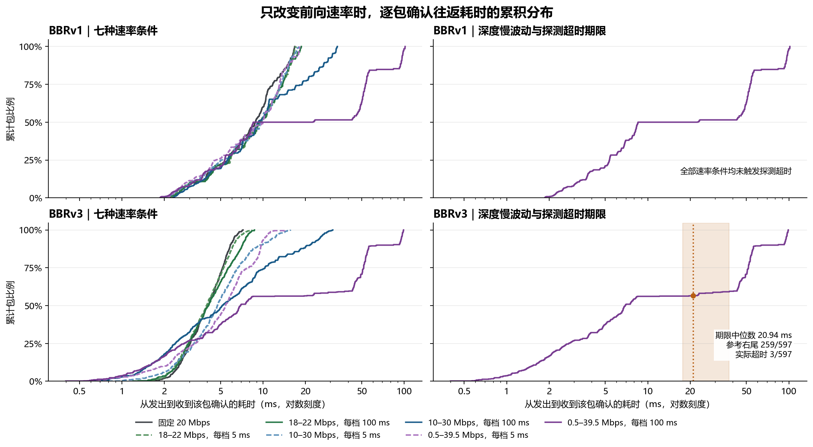
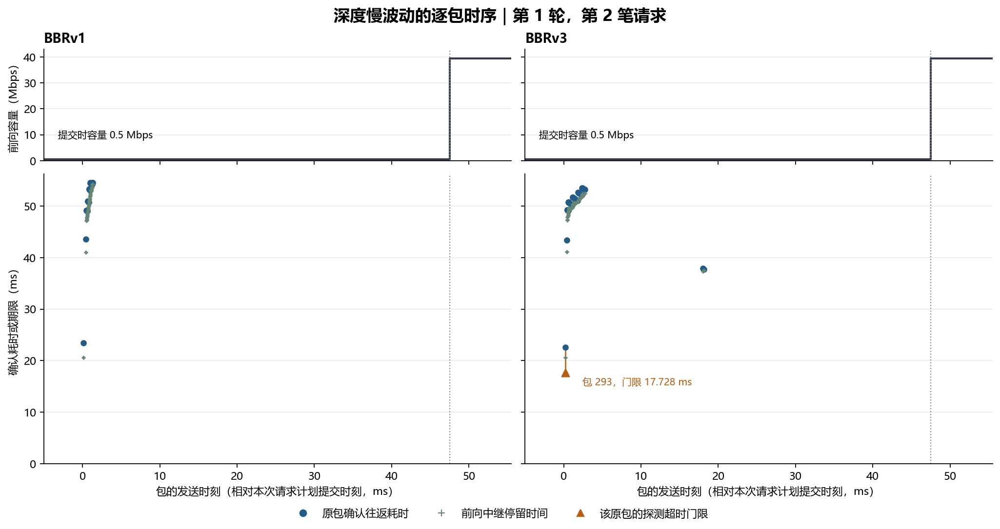
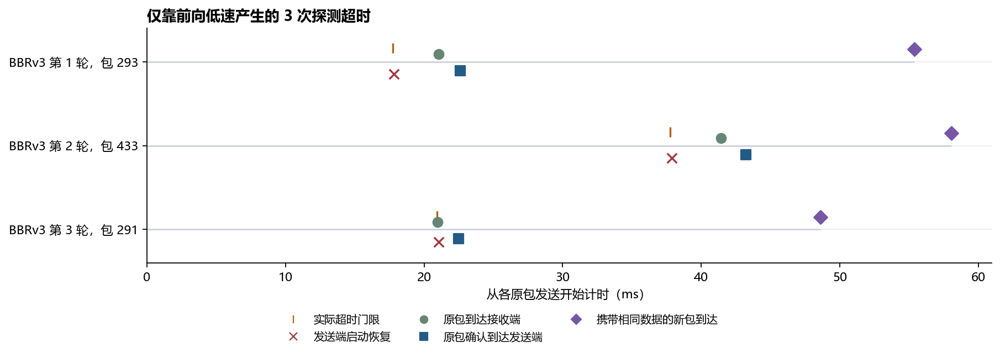

# QUIC 逐包确认往返耗时与判丢期限实测

**回程正常转发时，前向低速仍能触发探测超时。** 本次只改变前向服务速率，两个方向都没有人为附加时延。42 轮共提交 252 笔 40 kB 请求，全部收齐，前向中继没有丢包。BBRv1 的 **4,158** 个前向业务包没有判丢或探测超时。BBRv3 的 **4,161** 个前向业务包出现 **3 次探测超时**，全部来自 **0.5–39.5 Mbps、每档持续 100 ms** 的条件。三个原包最终均收到确认，确认都晚于各自的实际期限。[按条件统计](results/rate-only-loss/summary.csv) · [逐次事件配对](results/rate-only-loss/paired-time-events.csv)

## 1. 怎样用速率变化产生时延？

两版使用同一 picoquic 提交和相同的容量时序、任务大小与计划提交时刻。每种条件各测 3 轮，每轮 6 笔正式请求，先用一笔 300 kB 请求预热。相邻正式请求约间隔 350 ms，提交时刻按预设偏移覆盖不同容量档位。两版交替先跑，前向中继使用相同的 256 包先进先出缓冲区。两个方向的路由器接口均为 `noqueue`，没有配置 `netem`、时延抖动、重排或主动丢包。回程中继收到数据报后直接转发。逐轮日志核验了前向先进先出和回程直通，42 轮的前向溢出丢包均为零。[BBRv1 运行环境](results/rate-only-loss/bbr1/environment.json) · [BBRv3 运行环境](results/rate-only-loss/bbr3/environment.json) · [逐轮中继校验](results/rate-only-loss/relay-audit.csv)

| 前向容量条件 | 配置速率 | 每档持续时间 | 高低档完整周期 |
|---|---:|---:|---:|
| 固定速率 | 20 Mbps | 全程固定 | — |
| 小幅快速波动 | 18 / 22 Mbps | 5 ms | 10 ms |
| 小幅慢速波动 | 18 / 22 Mbps | 100 ms | 200 ms |
| 大幅快速波动 | 10 / 30 Mbps | 5 ms | 10 ms |
| 大幅慢速波动 | 10 / 30 Mbps | 100 ms | 200 ms |
| 深度快速波动 | 0.5 / 39.5 Mbps | 5 ms | 10 ms |
| 深度慢速波动 | 0.5 / 39.5 Mbps | 100 ms | 200 ms |

所有波动条件的高低档时间各占一半，完整周期的平均配置容量均为 **20 Mbps**。软件中继按每档容量累计服务字节，一个 IP 数据包积累到足够字节后才出队。包在低速档尚未获得足够服务时，剩余部分进入下一档继续计算。前向耗时由这段串行服务、等待前面的包出队以及本机处理构成。例如，一个 **1,280 B** 的 IP 包在 **0.5 Mbps** 下独占服务也需要 **20.48 ms**。只要低速档持续足够久，发送端就可能在接收端收到这个包之前先等到计时器到期。[容量计划生成脚本](studies/pacing_loss/rate_experiment.py) · [中继速率服务逻辑](studies/pacing_loss/relay.py)

## 2. 用哪个往返耗时和判丢期限比较？

**实际确认往返耗时 `D`** 从原包发出计到发送端第一次收到覆盖该原包包号的 ACK。ACK 是接收端发回的确认消息。这个耗时包含前向传输、接收端发出确认前的等待以及回程传输。**实际门限 `H`** 是发送端在触发事件时记录的期限时刻减去原包发出时刻。**恢复年龄 `A`** 是发送端实际采取恢复动作的时刻减去原包发出时刻。三者采用同一原包和同一时钟，单位均为 ms。`D > H` 表示该包的确认晚于自己的门限。两版都使用同一套 picoquic 恢复逻辑。[picoquic 判丢源码](https://github.com/private-octopus/picoquic/blob/37bb5d28aaea417649a6d4facc15f54de7d55829/picoquic/loss_recovery.c#L545-L622) · [RFC 9002 第 6 节](https://www.rfc-editor.org/rfc/rfc9002.html#section-6)

| 机制 | 发送端何时触发 | 本次前向业务数据结果 |
|---|---|---|
| 包号阈值 | 原包仍待确认，已确认的最大包号至少领先 3。 | 两版均为 0 次。 |
| RACK 时间阈值 | 已确认的最大包号领先 1 或 2，发送端根据后发包的确认时序计算期限，到期后可以判丢。 | 两版均为 0 次。 |
| 探测超时（PTO） | 确认进展不足，探测计时器到期。本次三个事件均以待确认队列尾包的发送时刻为计时起点。 | BBRv1 为 0 次。BBRv3 为 3 次。 |

前向低速会推迟排在队首的数据包，也会推迟排在其后的包。本次逐包记录显示，前向中继维持出队顺序，且没有丢包，因此实验中的长时延主要表现为确认整体变晚。本报告只统计携带正式请求数据的前向包，包括携带补发数据的新包。BBRv3 全量日志另有 2 个反向控制包的超时事件。这两个反向包的单向时延分别为 **0.383 ms** 和 **0.244 ms**，而确认它们的消息需要走受限速的前向路径。[BBRv3 全量判丢记录](results/rate-only-loss/bbr3/loss-events.csv) · [两个端点的抓包校验](results/rate-only-loss/bbr3/validation.json)

## 3. 容量变化怎样改变往返时延和实际超时率？



**图 1** 的横轴是原包确认往返耗时，单位为 ms，采用对数刻度。纵轴是确认往返耗时小于或等于横轴值的包比例。左列比较七种速率条件，右列单独展示深度慢波动。右下图的橙色区域覆盖 BBRv3 三次实际超时门限的范围 **17.728–37.771 ms**，橙色点线标出门限中位数 **20.937 ms**。按这条参考线读取 CDF，**259/597（43.38%）** 的确认往返耗时位于右侧。发送端实际记录 **3/597（0.50%）** 个探测超时，三次确认都晚于各自门限。事件日志只在触发时记录实际门限，因此整组 CDF 的右尾衡量长等待的覆盖范围，实际超时率由发送端日志确定。BBRv1 没有探测超时，右上图仅显示实测往返耗时分布。[各档的确认耗时和超时统计](results/rate-only-loss/summary.csv)

| 前向条件 | 确认往返耗时 P99（ms），BBRv1 / BBRv3 | 20 ms 内收齐 40 kB，BBRv1 / BBRv3 | 探测超时，BBRv1 / BBRv3 |
|---|---:|---:|---:|
| 固定 20 Mbps | 16.68 / 7.04 | 18/18 / 18/18 | 0/594 / 0/594 |
| 18–22 Mbps，每档 5 ms | 16.81 / 7.68 | 18/18 / 18/18 | 0/594 / 0/594 |
| 18–22 Mbps，每档 100 ms | 18.55 / 8.25 | 18/18 / 18/18 | 0/594 / 0/594 |
| 10–30 Mbps，每档 5 ms | 17.45 / 14.39 | 18/18 / 18/18 | 0/594 / 0/594 |
| 10–30 Mbps，每档 100 ms | 33.27 / 29.06 | 9/18 / 9/18 | 0/594 / 0/594 |
| 0.5–39.5 Mbps，每档 5 ms | 18.15 / 11.49 | 18/18 / 15/18 | 0/594 / 0/594 |
| 0.5–39.5 Mbps，每档 100 ms | 101.45 / 98.52 | 9/18 / 9/18 | 0/594 / 3/597 |

P99 表示约 99% 的确认往返耗时不超过该值。20 ms 完成率从请求提交到服务器收齐数据，按请求数计算。包耗时和请求完成率分别反映不同的等待。主要观察如下。

- **低速持续时间比平均容量更能解释长尾。** 保持 10–30 Mbps 两档不变，每档从 5 ms 延长到 100 ms 后，两版的确认往返耗时 P99 约从 17 / 14 ms 升到 33 / 29 ms，按时收齐都从 18/18 降到 9/18。40 kB 业务数据仅按 10 Mbps 串行发送就需要约 32 ms。快速波动时，后续高档可以较早接续服务。慢速波动时，低档可能覆盖整个 20 ms 业务预算。
- **前向中继停留时间解释了深度慢波动的长尾。** 两版前向中继停留时间 P99 为 **99.93 / 97.62 ms**，同一组 ACK 从接收端发出到发送端收到的回程单向耗时 P99 为 **1.04 / 0.48 ms**。中继停留时间从包进入中继计到转发，包含等待和串行服务。
- **长往返耗时与超时事件需要逐包对齐。** 深度慢波动中，BBRv1 的确认往返耗时最大为 **101.694 ms**，仍然没有发生探测超时。BBRv3 的三个事件与较早的有效超时时长有关。单看各版的全局最大耗时，无法还原每个原包等待的是哪个期限。[逐包表 BBRv1](results/rate-only-loss/bbr1/packets.csv.gz) · [逐包表 BBRv3](results/rate-only-loss/bbr3/packets.csv.gz)

## 4. 逐包时间图中，前向低速和超时门限怎样对上？



**图 2** 对照深度慢波动第 1 轮第 2 笔请求。横轴以该请求的计划提交时刻为 0 ms。上方黑线是前向配置容量，灰色竖线标出容量回升的时刻。下方每个蓝点的横坐标是一个包的发送时刻，纵坐标是该包的确认往返耗时。绿色加号表示同一个包在前向中继停留的时间。橙三角表示发送端为该原包记录的实际超时门限，橙线连接门限和该原包的确认耗时。其他包没有计时事件门限，保留蓝点和绿色加号。两版该请求的起始容量均为 **0.5 Mbps**，计划提交后 **47.5 ms** 回升至 **39.5 Mbps**。

在右图，BBRv3 的包 **293** 在前向中继停留 **20.606 ms**，从发出到接收端收到是 **21.063 ms**，确认返回的总耗时为 **22.590 ms**，其中确认的回程只用 **0.127 ms**。发送端当时的有效超时时长是 **15.197 ms**，待确认队列尾包比原包晚发 **2.531 ms**，实际门限因此为 **17.728 ms**。发送端在 **17.810 ms** 启动恢复，比收到原包确认早 **4.780 ms**。左图同一笔请求的 BBRv1 首包在发出时记录的有效超时时长已为 **108.845 ms**，其确认耗时为 **23.419 ms**，这笔请求未触发恢复。发包时的计时值用于说明两版当时的历史计时状态，实际超时期限制只在有事件时按对应包画出。[图 2 事件明细](results/rate-only-loss/examples.csv) · [BBRv1 发包计时记录](results/rate-only-loss/bbr1/packets.csv.gz)



**图 3** 的横轴分别从各原包发出开始。橙竖线表示实际超时门限，红叉表示发送端启动恢复，绿圆点表示接收端收到原包，蓝方块表示发送端收到原包的确认，紫菱形表示携带重叠业务字节的新包抵达。每行是一次事件，标记上下错开以便阅读。

| BBRv3 原包 | 实际超时门限（ms） | 启动恢复（ms） | 原包到达（ms） | 原包确认到达（ms） | 确认比门限晚（ms） |
|---|---:|---:|---:|---:|---:|
| 第 1 轮，包 293 | 17.728 | 17.810 | 21.063 | 22.590 | 4.862 |
| 第 2 轮，包 433 | 37.771 | 37.864 | 41.430 | 43.229 | 5.458 |
| 第 3 轮，包 291 | 20.937 | 21.048 | 20.970 | 22.475 | 1.538 |

前两次启动恢复时，原包还在前向传输。第三次实际恢复时，原包已在 **0.078 ms** 前抵达接收端，确认仍在路上。三次补发最终都携带了与原包重叠的业务字节。这个结果覆盖本地 FIFO 路径、40 kB 请求和三轮容量时序。它说明速率引起的排队就足以产生探测超时，事件数也会随两版当时的发送节奏和计时状态变化。[完整计时事件表](results/rate-only-loss/paired-time-events.csv)

## 复现和原始记录

在仓库根目录运行 `python studies/pacing_loss/rate_deadlines.py` 可用已发布记录重算三张图、超时配对和中继校验。复跑使用已有 BBRv1 判丢观测端点 `endpoint` 和 BBRv3 判丢观测端点 `endpoint-loss`。传入新的输出目录后，分别用 `studies/pacing_loss/analyze.py <原始目录> <结果目录> --archive` 生成两版数据，再将包含 `bbr1` 和 `bbr3` 子目录的结果目录传给制图脚本的 `--data`。[BBRv1 端点构建](studies/pacing_loss/README.md) · [BBRv3 端点构建](bbr3/README.md)

```bash
sudo "$PY" studies/pacing_loss/rate_experiment.py --testbed "$TESTBED" \
  --bbr1 "$BBR1_LOSS_ENDPOINT" --bbr3 "$BBR3_LOSS_ENDPOINT" \
  --out "$RATE_RAW" --repeats 3
```

[BBRv1 原始归档](results/rate-only-loss/bbr1/raw-evidence.tar.xz) · [BBRv3 原始归档](results/rate-only-loss/bbr3/raw-evidence.tar.xz) · [BBRv1 记录校验](results/rate-only-loss/bbr1/validation.json) · [BBRv3 记录校验](results/rate-only-loss/bbr3/validation.json)
