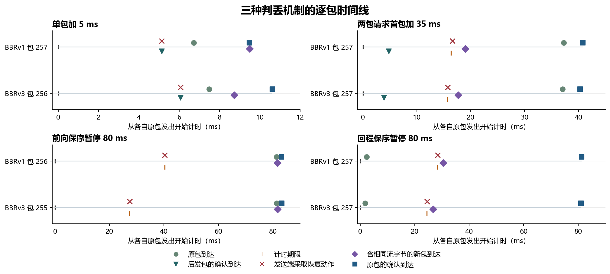
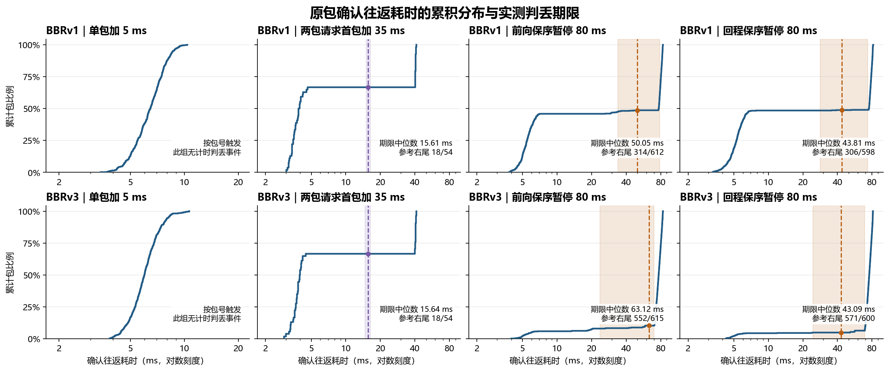
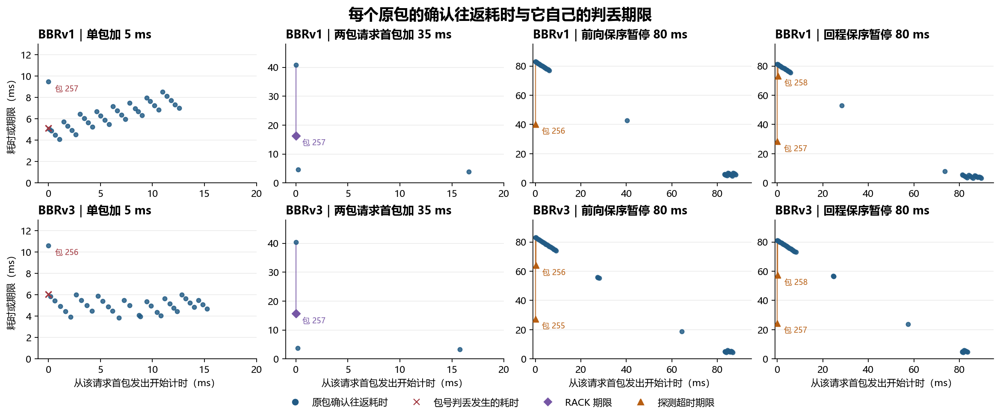

# QUIC 逐包确认往返耗时与判丢期限实测

在同一套 6G-Testbed 条件下，**BBRv1 有 22/4,977 个前向业务包触发探测超时，BBRv3 有 27/4,969 个**，分别占 **0.44% 和 0.54%**。这些包的确认消息全部在该包的实际超时期限之后才到达发送端。回程暂停组贡献了其中 4 次和 6 次，这些原包都在超时前到达了接收端。两版使用同一提交的 picoquic 判丢代码，实验中的差异来自各自实测的发包、确认和计时状态。[逐组数据](results/ack-deadlines/summary.csv) · [BBRv1 原始记录](results/pacing-loss/raw-evidence.tar.xz) · [BBRv3 原始记录](results/bbr3/loss/raw-evidence.tar.xz)

## 1. 哪个时延可以和判丢期限直接比较？

本文用**原包确认往返耗时** `D = 首次带有该原包包号的 ACK 到达发送端的时刻 − 原包发送时刻`。ACK 是接收端发回的确认消息。这个耗时包含前向传输、接收端等待发送确认和回程传输。它由同一个发送端的时钟计算，保留了接收端实际等待的时间。平滑往返时延是发送端用于计算计时器的历史估计，采用另一个口径。[逐包字段说明](studies/pacing_loss/README.md)

**判丢期限** `H = 发送端对该原包计算出的期限时刻 − 原包发送时刻`。**实际恢复年龄** `A = 发送端记录判丢或启动超时恢复的时刻 − 原包发送时刻`。`D`、`H`、`A` 都从原包发出算起，单位都是 ms。对同一个包，`D > H` 表示它的确认消息在发送端计算出的期限之后才到达。发送端是否执行恢复，以内部事件记录为准。

| 触发方式 | 本次 picoquic 实现的判断条件 | 图中的期限 |
|---|---|---|
| 包号阈值 | 原包仍在等待处理，并且已确认的最大包号至少比原包号大 3。 | 使用包号差判断。图中只标实际发生时刻。 |
| RACK 时间阈值 | 最大已确认包号领先 1 或 2。发送端根据后发包的确认时序计算期限，到期后可以判丢。RACK 指利用后发包的确认时序判断更早的包是否迟到。 | `H = min(基础计时值, 后发包确认到达时刻 − 原包发送时刻 + min(平滑往返时延/4, 5 ms) − 最近已确认包比原包晚发的时间 + 对端最大确认延迟)`。实现用整数微秒计算。 |
| 探测超时（PTO） | 确认进展不足时，发送端等待计时器到期，再发送探测包或补发仍需交付的数据。 | 本次记录的超时事件均走待确认队列尾包的计时口径，`H = 尾包发送时刻 − 原包发送时刻 + 当时的有效超时时长`。该时长还受超时退避影响。 |

这里使用固定版本的 picoquic 实际判丢路径。RFC 9002 把基于确认的判丢和探测超时分开描述，通用时间阈值公式也与这版实现不同。本文将探测超时单独计数。[picoquic 判丢与超时源码](https://github.com/private-octopus/picoquic/blob/37bb5d28aaea417649a6d4facc15f54de7d55829/picoquic/loss_recovery.c#L545-L622) · [计时值与退避源码](https://github.com/private-octopus/picoquic/blob/37bb5d28aaea417649a6d4facc15f54de7d55829/picoquic/timing.c#L39-L82) · [QUIC RFC 9002 第 6 节](https://www.rfc-editor.org/rfc/rfc9002.html#section-6)

每版均使用 9 种网络条件、每种 3 轮、每轮 6 笔正式请求。链路通过隔离网络命名空间和虚拟网卡，前向中继的服务预算为 20 Mbps。常规请求为 40 kB，隔离 RACK 的两包请求为 2.4 kB。统计包括所有携带正式请求数据的前向 QUIC 包，包括含补发流字节的新包。各版均有 18 个原包被中继主动丢弃，这些包计入发出分母。CDF 的分母使用有确认耗时的包，分别为 **4,959 和 4,951 个**。[实验与字段](studies/pacing_loss/README.md) · [BBRv1 双端日志和抓包核对](results/pacing-loss/validation.json) · [BBRv3 双端日志和抓包核对](results/bbr3/loss/validation.json)

## 2. 三种判丢在实际传输中如何发生？

**图 1** 的横轴从各自原包发出开始。每个面板的上下两行分别对应 BBRv1 和 BBRv3 的一个原包。绿圆点表示接收端收到原包，蓝方块表示发送端收到覆盖原包包号的 ACK，蓝绿三角表示促发包号或 RACK 判断的后发包 ACK 到达。橙色短竖线是发送端计算出的期限，红叉是发送端执行恢复的时刻，紫菱形是携带相同流字节的新包到达接收端的时刻。符号上下错开以便阅读。

| 机制与场景 | 版本和原包号 | 原包到达（ms） | 期限 `H`（ms） | 恢复年龄 `A`（ms） | 原包确认往返耗时 `D`（ms） |
|---|---|---:|---:|---:|---:|
| 包号阈值，单包加 5 ms | BBRv1，257 | 6.728 | — | 5.133 | 9.484 |
| 包号阈值，单包加 5 ms | BBRv3，256 | 7.485 | — | 6.067 | 10.627 |
| RACK，两包请求首包加 35 ms | BBRv1，257 | 37.275 | 16.354 | 16.599 | 40.825 |
| RACK，两包请求首包加 35 ms | BBRv3，257 | 37.044 | 15.657 | 15.745 | 40.324 |
| 探测超时，前向暂停 80 ms | BBRv1，256 | 81.332 | 40.249 | 40.271 | 83.109 |
| 探测超时，前向暂停 80 ms | BBRv3，255 | 81.347 | 27.289 | 27.380 | 83.196 |
| 探测超时，回程暂停 80 ms | BBRv1，257 | 2.356 | 28.309 | 28.401 | 81.242 |
| 探测超时，回程暂停 80 ms | BBRv3，257 | 1.813 | 24.449 | 24.533 | 81.099 |

- **包号阈值。** 两版都先收到了包 261 的确认。该包号分别领先未确认原包 **4 个和 5 个**，均达到包号阈值。BBRv3 携带相同流字节的新包在 **8.735 ms** 到达，原包在 **7.485 ms** 到达。这里的恢复是由包号进展触发的。
- **RACK 时间阈值。** 两版都是包 258 先获确认，包号差为 **1**。BBRv3 在原包发出后 **3.914 ms** 收到包 258 的确认。按 `3.914 + 1.904 − 0.161 + 10.000 = 15.657 ms` 得到较早的期限，另一候选基础计时值为 **24.585 ms**。原包的 ACK 在 **40.324 ms** 才返回，含相同流字节的新包在 **17.682 ms** 就到达了接收端。
- **探测超时。** 前向暂停时，两版的原包约在 **81.3 ms** 才到接收端。以 BBRv3 为例，待确认队列尾包比原包晚发 **9.149 ms**，当时的有效超时时长为 **18.140 ms**，原包期限为 **27.289 ms**。回程暂停时，BBRv3 的原包在 **1.813 ms** 就已到达，确认在回程上花了 **77.342 ms**，发送端在 **24.533 ms** 启动恢复。BBRv1 的回程暂停案例同样是原包先到、确认后到。[八个案例的逐包计算](results/ack-deadlines/examples.csv)

## 3. 累积分布上有多少长往返包，实际又有多少超时？

**图 2** 的横轴是确认往返耗时（ms，对数刻度），纵轴是确认往返耗时小于或等于横坐标的包比例。紫色表示 RACK，橙色表示探测超时。色带覆盖该组实际事件期限的最小值到最大值，竖虚线为中位数，圆点是该中位数在 CDF 上的位置。图中「参考右尾」使用该中位数读取整组分布。实际超时数来自发送端的超时事件。同一轮中多个包可能共同等待一次确认进展，而探测计时以待确认队列尾包为基准。旧日志只在触发判断时记录实际期限，右尾中的其他包没有相应的逐包期限可供配对。[计时事件采集条件](studies/pacing_loss/build.py) · [完整九组统计](results/ack-deadlines/summary.csv)

| 网络条件 | 版本 | 实测期限中位数（ms） | 确认耗时超过该中位数 | 发送端实际记录的事件数 / 发出包数 | 有对应事件且原包 ACK 晚于自身期限 |
|---|---|---:|---:|---:|---:|
| 两包请求首包加 35 ms | BBRv1 | 15.611（RACK） | 18/54（33.33%） | 18/54（RACK） | 18/18 |
| 两包请求首包加 35 ms | BBRv3 | 15.645（RACK） | 18/54（33.33%） | 18/54（RACK） | 18/18 |
| 前向保序暂停 80 ms | BBRv1 | 50.047（PTO） | 314/612（51.31%） | 18/612（2.94%） | 18/18 |
| 前向保序暂停 80 ms | BBRv3 | 63.119（PTO） | 552/615（89.76%） | 21/615（3.41%） | 21/21 |
| 回程保序暂停 80 ms | BBRv1 | 43.808（PTO） | 306/598（51.17%） | 4/598（0.67%） | 4/4 |
| 回程保序暂停 80 ms | BBRv3 | 43.094（PTO） | 571/600（95.17%） | 6/600（1.00%） | 6/6 |

**回程暂停最能看出参考右尾与实际超时率的差别。** BBRv3 的确认往返耗时有 **571/600** 超过这组实际事件期限的中位数，发送端只对 **6/600** 个原包记录了超时恢复。这 6 个原包的 ACK 均晚于各自的实际期限。BBRv1 在同一条件下有 **306/598** 个长往返包和 **4/598** 次超时恢复。整组右尾衡量长等待的覆盖范围，逐事件配对才回答被取来恢复的原包是否真的超时。

九组加总后，BBRv1 和 BBRv3 的包号判丢分别为 **152 次和 142 次**，RACK 分别为 **18 次和 19 次**，探测超时分别为 **22 次和 27 次**。BBRv3 多出的 1 个 RACK 事件来自允许乱序组的包 444。发送端收包日志在 **6.876 ms** 已记录覆盖该包的确认范围，判丢路径在 **15.477 ms** 仍对该包执行恢复，记录的期限为 **15.215 ms**。现有日志可以核对这两个时刻，尚缺少该确认范围在恢复队列中的处理状态。此事件保留在 19 次中，因此 BBRv3 的 RACK 原包确认晚于自身期限为 **18/19**。[BBRv1 事件记录](results/pacing-loss/loss-events.csv) · [BBRv3 事件记录](results/bbr3/loss/loss-events.csv) · [BBRv3 双端原始日志](results/bbr3/loss/raw-evidence.tar.xz)

## 4. 把每个包的耗时和对应期限画在同一张时间图上

**图 3** 展示每版每个条件第 1 轮的第 1 笔正式请求，包含该请求的所有数据包及携带该请求补发数据的新包。横轴是每个包实际发出的时刻，以该请求首包发出为 0 ms。纵轴的蓝点表示该包的确认往返耗时。紫菱形和橙三角分别表示同一个包的 RACK 期限和探测超时期限。竖线连接这个包的确认往返耗时和其期限，两者垂直相差 `D − H`。红叉表示包号判丢时的实际恢复年龄。没有记录计时判丢事件的包只画蓝点。

在两个暂停场景中，许多早发包的蓝点集中在 **约 80 ms**。晚发包的蓝点随发送时刻向右移动而降低，因为释放时刻接近，晚发包等待暂停结束的时间更短。两版的橙三角只出现在被发送端选来启动超时恢复的包上。前向暂停时，原包的前向传输占了大部分等待。回程暂停时，原包已经到达，等待主要发生在确认返回路径。图 1 的接收时刻与确认时刻可以核对这两种情况。[BBRv1 逐包表](results/pacing-loss/packets.csv.gz) · [BBRv3 逐包表](results/bbr3/loss/packets.csv.gz)

## 复算

在仓库根目录运行 `python studies/pacing_loss/ack_deadlines.py`。脚本从已发布的逐包表和判丢事件表重新配对，生成本报告的三张图、按组统计、八个案例和所有计时事件的逐包配对。需要 Matplotlib 和支持简体中文的字体，可用 `--font` 指定字体文件。[制图与复算脚本](studies/pacing_loss/ack_deadlines.py) · [全部计时事件的逐包配对](results/ack-deadlines/paired-time-events.csv)
