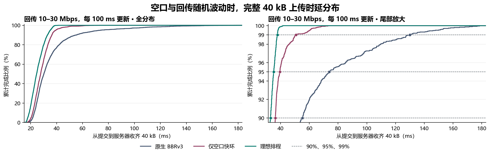
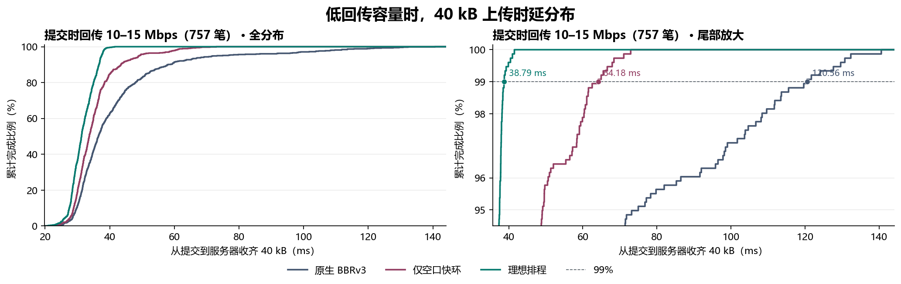
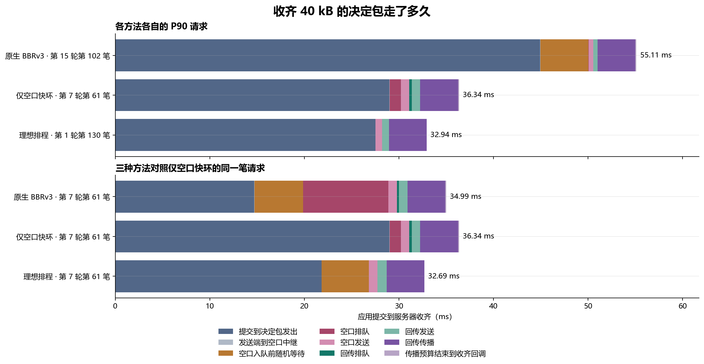
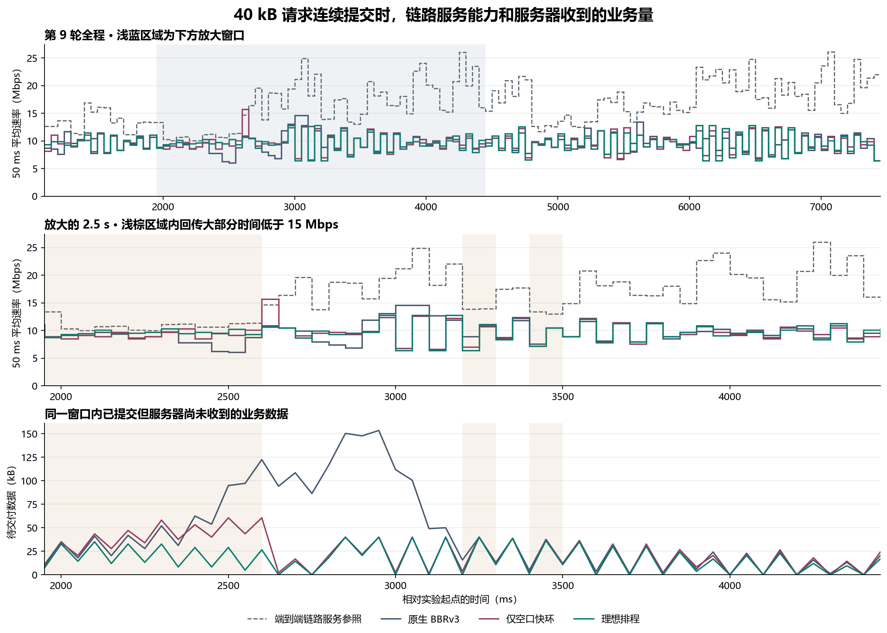

# 回传 10–30 Mbps、每 100 ms 更新时的 40 kB 上传与 P90 时延分解

本报告比较原生 QUIC BBRv3、仅空口快环与理想排程，检验仅空口快环距理想排程是否还有 30% 的上传时延空间。上传从终端应用提交计时，到服务器收齐 40,000 byte 并收到 QUIC 流的结束标记为止。服务器向终端返回回复的时间另计。

**这组条件下，仅空口快环的 P90 距理想排程还差 3.40 ms，剩余降幅为 9.36%。** 以原生 BBRv3 为起点，启用仅空口快环获得了 34.05% 的实测 P90 降幅。

## 实验配置

| 项目 | 配置 |
|---|---|
| 上行业务 | 每 33 ms 提交一个 40 kB 请求。每轮 192 笔正式请求，首末提交相差 6.303 s，观测到实验起点后 10 s |
| 空口容量 | 10–30 Mbps，每 5 ms 更新。容量生成过程的相邻状态相关参数为 0.65 |
| 上行回传容量 | 从空口结束后到服务器的一段，10–30 Mbps，每 100 ms 更新。生成过程的相邻状态相关参数为 0.70，随机序列独立于空口 |
| 空口逐包等待 | 上行数据报有 10% 概率等 5 ms，等待后重新抽签，可连续等待 |
| 传播时延 | 回传发送完成后加 4 ms 上行传播。服务器发往终端的回复与确认使用 10–20 ms 的随机回程 |
| 样本 | 原生 BBRv3 和仅空口快环各跑 16 轮，对应 32 轮真实 QUIC、6,144 笔实际上传。理想排程在同一批 16 条链路轨迹上重放 3,072 笔 |

**仅空口快环**根据空口容量与空口队列调整目标发包速率，使用既有的固定拥塞窗口。**理想排程**使用同一份请求与容量计划，复用逐包等待分布，以 1,218 byte 业务数据加 62 byte 头部近似满包。它提前知道两段服务和随机等待结果，可为数据报预留回传服务并反推空口服务及终端发出时间。理想排程的数值给出模型参照，实际 QUIC 还要处理确认、拥塞窗口和重传。

## 完整上传的累积分布

**图 1a。** 横轴为应用提交到服务器收齐 40 kB 的时延，纵轴为在该时限内完成上传的请求比例。右图放大 90%–100% 附近，圆点标出 P90、P95、P99。每条曲线有 3,072 个点，P90 对应排序后的第 2,765 笔请求。剩余空间以仅空口快环的时延为分母，计算 `(仅空口快环 − 理想排程) / 仅空口快环`，且在同一个分位计算。区间按 16 对运行轮次做配对重抽样。

| 上传分位 | 原生 BBRv3（ms） | 仅空口快环（ms） | 理想排程（ms） | BBRv3 到仅空口快环的实测降幅 | 仅空口快环距理想排程的空间 |
|---|---:|---:|---:|---:|---:|
| P90 | 55.11 | 36.34 | 32.94 | 34.05% | 9.36% |
| P95 | 73.85 | 39.39 | 35.14 | 46.66% | 10.81% |
| P99 | 130.04 | 50.65 | 37.77 | 61.05% | 25.42% |

仅空口快环的 P90 剩余降幅的 95% 重抽样区间为 8.29%–10.57%。如果把收到回复也算进去，原生 BBRv3、仅空口快环、理想排程的 P90 分别为 70.05 ms、52.40 ms、48.28 ms。以仅空口快环为起点，端到端 P90 剩余降幅为 7.87%。

### 提交时回传容量为 10–15 Mbps 的 P99

**图 1b。** 从原有 10–30 Mbps、每 100 ms 更新的实验中，按请求计划提交时刻的回传容量筛选。容量大于或等于 10 Mbps 且小于 15 Mbps 的 757 笔请求均保留，三种方案使用相同的种子和请求序号。右图放大 95%–100% 附近，只标出 P99。

| 请求范围 | 配对请求数 | 原生 BBRv3 P99（ms） | 仅空口快环 P99（ms） | 理想排程 P99（ms） | 仅空口快环到理想排程的剩余空间 |
|---|---:|---:|---:|---:|---:|
| 全量 | 3,072 | 130.04 | 50.65 | 37.77 | 25.42% |
| 提交时回传容量为 10–15 Mbps | 757 | 120.56 | 64.18 | 38.79 | **39.57%** |

低回传容量子组中，仅空口快环的 P99 比理想排程多约 25.40 ms。39.57% 适用于这一事后按网络状态筛出的子组，按整轮配对重抽样的 95% 区间为 23.47%–41.29%。

## P90 请求的逐段耗时

**图 2。** 上图取各方法自己落在 P90 的请求。下图固定为仅空口快环的 P90 请求，在相同种子和提交序号下对照三种方法。两种比较分别回答“每条分布在 P90 是怎么组成的”和“同样一笔任务，各方法在哪段产生差距”。上图中的三个 P90 可以来自不同请求，跨方法的各段时间差不能直接当作同一任务的收益。

真实 QUIC 根据接收端协议日志中各数据帧的字节偏移和结束标记，找出**第一个让完整 40 kB 可交付的数据报**。这个数据报可能是尾包，也可能填补了先前尚未到达的字节。再通过包号、发送时间和数据报哈希连接端点与两个链路队列的记录。理想排程则取最后一个抵达的业务分片，并读取其预留时刻。

| 图 2 的分段 | 定义 |
|---|---|
| 提交到决定包发出 | 从提交请求到决定包在终端被发送，包含前序数据发送及可能的拥塞窗口、发包节奏或重传等待 |
| 发送端到空口中继 | 端点记录发送到模拟器收到数据报 |
| 空口入队前随机等待 | 中继收到该数据报到其进入空口队列 |
| 空口排队、空口发送 | 进入队列到开始链路服务，随后到离开空口队列 |
| 回传排队、回传发送 | 进入回传队列到开始链路服务，随后到离开回传队列 |
| 回传传播 | 本组给定的 4 ms 单向传播时间 |
| 传播预算结束到收齐回调 | 传播预算结束后，模拟器转发及服务器完成接收、触发应用回调的剩余时间 |

各方法自己的 P90 请求如下。所有时间单位为 ms，表中个别加总差异来自四舍五入。

| 方法与请求号 | 提交到决定包发出 | 入队前随机等待 | 空口排队 / 发送 | 回传排队 / 发送 | 回传传播 | 两端与模拟器余量 | 上传总时延 |
|---|---:|---:|---:|---:|---:|---:|---:|
| 原生 BBRv3，第 15 轮第 102 笔 | 44.929 | 5.069 | 0.015 / 0.484 | 0.000 / 0.458 | 4.000 | 0.151 | 55.106 |
| 仅空口快环，第 7 轮第 61 笔 | 28.986 | 0.000 | 1.184 / 0.875 | 0.262 / 0.894 | 4.000 | 0.140 | 36.341 |
| 理想排程，第 1 轮第 130 笔 | 27.504 | 0.000 | 0.000 / 0.706 | 0.000 / 0.727 | 4.000 | 0.000 | 32.938 |

“两端与模拟器余量”合并了“发送端到空口中继”和“传播预算结束到收齐回调”。仅空口快环对应的 P90 请求中，决定包发出前已经过去 28.986 ms。该包在回传只排了 0.262 ms，发送用了 0.894 ms。对于这笔请求，单靠移除回传排队，最多能从这个决定包的路径上直接省掉 0.262 ms。

固定为第 7 轮第 61 笔时，三种方法的实际或模拟上传时间为 **34.990、36.341、32.691 ms**，分别对应原生 BBRv3、仅空口快环、理想排程。原生 BBRv3 的决定包更早发出，同时在空口排了 9.011 ms。仅空口快环将空口排队压到 1.184 ms，但决定包发出较晚。这一笔请求的原生 BBRv3 甚至略快于仅空口快环，尽管整体分布的 P90 顺序相反。两种实际方案和理想排程各自使用相同的随机等待规则，从而可能由不同的包决定收齐时刻。

## 链路能力和三种方案的交付速率

**图 3。** 上图展示第 9 轮完整的约 6.3 s 请求序列。中图放大 1,950–4,450 ms，浅棕区表示回传容量在该 50 ms 窗内大部分时间低于 15 Mbps。三条实线是服务器每 50 ms 收到的新增 40 kB 请求业务字节换算出的平均速率，重复到达的 QUIC 字节只计一次。灰色虚线是端到端链路服务参照。下图显示每个 50 ms 窗结束时，已按同一计划提交、但服务器尚未收到的业务字节。这些数据可以还在终端，也可以正在链路上传输或排队。

灰线用同一实验的空口和回传容量曲线计算，将两条链路串联，以持续有数据待发、每窗起点没有前一窗积压为假设，计算 50 ms 内可完成的比特数，并向后对齐 4 ms 上行传播时延。该值描述链路服务机会，按无包头和逐包随机等待的流体模型估算。实际方案在个别窗口也可以发送此前已排入回传的数据，从而超过同窗灰线。

在 16 轮配对轨迹内，以 50 ms 为步长检查所有完整落在提交期内的连续 2.5 s 窗口。候选窗口要求回传低于 15 Mbps 的时间至少占 25%。选择理想排程相对两种实测方案中待交付数据较少的那一种、平均待交付量减少最多的窗口，用于展示机制。所选窗口低回传时间占 34.16%。

| 三种方法 | 1,950–2,600 ms 的平均有效接收速率（Mbps） | 2,600 ms 时的待交付数据（kB） | 1,950–4,450 ms 的平均待交付数据（kB） |
|---|---:|---:|---:|
| 原生 BBRv3 | 8.47 | 122.29 | 45.75 |
| 仅空口快环 | 9.20 | 60.51 | 23.89 |
| 理想排程 | **9.61** | **26.60** | **17.04** |

在 1,950–2,600 ms 的连续低回传区间，链路服务参照平均为 10.89 Mbps，理想排程让服务器更早收到数据。到 2,600 ms，理想排程尚待交付的字节比仅空口快环少 33.91 kB。在完整的 2.5 s 窗口中，理想排程的平均待交付量比仅空口快环低 28.67%。三种方法在上图全程都交付了同样的 7.68 MB，平均有效接收速率都是约 9.68 Mbps。此处理想排程的收益体现为更早完成交付和减少积压。

## 数据和复现

- [逐请求上传和回复时延](results/cross-layer-backhaul-10-30/tasks.csv) · [各分位与区间](results/cross-layer-backhaul-10-30/p99-summary.csv) · [P90 的逐段时间](results/cross-layer-backhaul-10-30/p90-path-breakdown.csv)
- [原生 BBRv3 原始归档](results/cross-layer-backhaul-10-30/bbr/raw-evidence.tar.xz) · [仅空口快环原始归档](results/cross-layer-backhaul-10-30/radio/raw-evidence.tar.xz) · [构建和复跑](studies/cross_layer/README.md)
- [图 3 的 50 ms 数据](results/cross-layer-backhaul-10-30/e2e-goodput-timeline.csv) · [所选窗口](results/cross-layer-backhaul-10-30/e2e-goodput-window.json)
