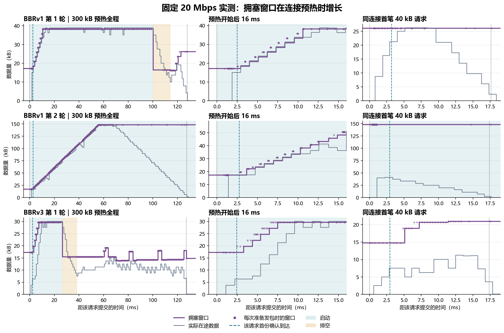

# QUIC BBRv1 与 BBRv3 的启动窗口实测

**每条连接只预热一次。** 在最新的速率补测中，每轮新建一条 QUIC 连接，先提交 **1 笔 300 kB** 预热请求，再在同一连接上用不同的 QUIC 流提交 **6 笔 40 kB** 正式请求。预热结束到首笔正式请求约隔 **872–880 ms**。每版 21 轮，合计 **42 笔预热、252 笔正式请求**。这里的预热指传输数据，没有运行模型推理。[请求计划](studies/pacing_loss/rate_experiment.py) · [连接与流的实现](v3/endpoint.c) · [逐轮结果](results/startup-windows/startup-runs.csv)

## 1. 启动时，拥塞窗口真的长起来了吗？

**两版都能看到确认返回后，拥塞窗口快速增长。** 拥塞窗口（cwnd）限制发送端允许同时在途的数据量。在途数据指已发送且尚未获确认的字节。42 轮首个握手数据报的发送记录中，窗口均为 **15.360 kB**。握手之后、300 kB 请求提交之前，窗口采样约为 **17.2 kB**。下面的增长倍数均用**预热开始前的窗口**作分母。各组在预热期间都使用固定 **20 Mbps** 的前向容量，回程直接转发，两向均不附加时延。速率波动条件的容量变化从实验第 1 s 才开始，晚于预热。[速率与回程设置](REPORT.ack-deadlines.zh-CN.md) · [逐轮窗口指标](results/startup-windows/startup-runs.csv)

**图 1** 的左列展示 300 kB 预热全程，中列放大预热头 16 ms，右列展示同一条连接的首笔 40 kB 正式请求。每格横轴都从该笔请求提交开始，纵轴为数据量（kB），各格量程随数据变化。紫线是约每 1 ms 采到的拥塞窗口，紫点是端点准备每个发包数据报时记录的窗口，灰线是在途字节数。蓝虚线表示首份覆盖该请求数据的确认（ACK）到达发送端，黑点线标出请求提交和接收端收齐。浅青色是启动阶段，浅黄色是排空阶段，即发送端压低发送速率让已有队列排出。阶段边界来自周期采样，表示首次观察到状态变化的时刻。[固定速率的六轮样本](results/startup-windows/fixed20-samples.csv) · [采样及发包观测代码](studies/pacing_loss/build.py)

| 固定 20 Mbps 的代表轮次 | 预热开始前窗口 | 预热启动阶段的窗口峰值 | 首次采到峰值 | 首次采到排空 | 首笔 40 kB 提交前的窗口及状态 |
|---|---:|---:|---:|---:|---|
| BBRv1 第 1 轮 | 17.179 kB | 38.191 kB | 10.607 ms | 100.385 ms | 26.117 kB，带宽探测 |
| BBRv1 第 2 轮 | 17.296 kB | 148.282 kB | 55.785 ms | 本轮未采到 | 148.282 kB，启动 |
| BBRv3 第 1 轮 | 17.296 kB | 29.656 kB | 7.496 ms | 26.694 ms | 14.757 kB，带宽探测的降速阶段 |

中列显示，两版的拥塞窗口都在首个预热 ACK 到达后快速增长。BBRv1 第 1 轮随后将窗口降到 **16.375 kB** 进入排空，BBRv3 第 1 轮降到 **15.425 kB**。BBRv1 第 2 轮的窗口则在预热中升到约 **148 kB** 后持平，采样状态一直为启动。该轮的首笔正式请求在首个业务 ACK 到达前就发出了 **33 个包、共 40,000 B 的业务数据**。同样比较固定速率第 1 轮，BBRv1 与 BBRv3 的首笔正式请求在自己的首个业务 ACK 到达前，分别发出了 **23,191 B** 和 **7,328 B**。正式请求是否能在一份确认回来前发完，要结合当时窗口和实际发包节奏看。[BBRv1 逐包发送与确认](results/rate-only-loss/bbr1/packets.csv.gz) · [BBRv3 逐包发送与确认](results/rate-only-loss/bbr3/packets.csv.gz)

## 2. 预热之后，两版都退出启动了吗？

**预热只执行一次，是否退出启动由拥塞控制器决定。** 固定 20 Mbps 第一轮的两版都已退出启动，这个结果在 BBRv1 的其他轮次并不普遍。下表覆盖七种速率计划在每版的全部 21 轮。预热时的容量相同，因此此处将这些轮次作为相同预热配置下的重复观测。[逐轮启动记录](results/startup-windows/startup-runs.csv) · [逐请求状态](results/startup-windows/formal-request-states.csv)

| 实测指标 | BBRv1 | BBRv3 |
|---|---:|---:|
| 预热期间窗口峰值范围 | 38.191–163.106 kB | 28.303–29.657 kB |
| 窗口峰值相对预热前的倍数，中位数 | 8.43 倍 | 1.71 倍 |
| 预热阶段采到退出启动的轮次 | 1/21 | 21/21 |
| 首笔 40 kB 提交前，仍采到普通启动的轮次 | 20/21 | 0/21 |
| 六笔正式请求合计，上传期间采到启动类状态 | 120/126 | 42/126 |

BBRv1 在 20 轮从预热开始至采样结束都保持普通启动状态。BBRv3 在 21 轮均于预热开始后 **22.287–29.008 ms** 首次采到排空。BBRv3 的 21 笔首笔正式请求在提交前都处于带宽探测阶段，其中 2 笔在上传期间采到了启动类状态。上表的启动类状态包括普通启动、长时延启动，以及 BBRv3 的恢复启动。控制器在复用连接内切换状态，应用仍按原计划只提交了一次预热。[BBRv3 状态编号说明](bbr3/README.md) · [逐请求状态](results/startup-windows/formal-request-states.csv)

## 3. 这是不是每个往返周期都把窗口翻倍？

这些曲线呈现了 **BBR 启动阶段的快速扩窗特性**。在本次 picoquic 实现中，发送端在满足窗口增长条件时，按新确认的字节数增加拥塞窗口。BBR 同时用较高的发包速率探测可用带宽，并根据交付速率是否还在增长决定何时退出启动。以本次实现的常规带宽判断为例，程序只在符合条件的反馈轮次里检查带宽估计，达到增长门槛会清零计数，连续三轮未达门槛才标记带宽探测已发满。每次 ACK 确认的字节数、实际在途量和窗口目标都可能不同，因此不能用每个往返周期严格翻倍去拟合图中的窗口。归档没有逐轮记录带宽增长计数，BBRv1 各轮退出时间的差异只能确认到状态和窗口变化。[BBRv1 窗口更新](https://github.com/private-octopus/picoquic/blob/37bb5d28aaea417649a6d4facc15f54de7d55829/picoquic/bbr1.c#L1046-L1068) · [BBRv1 带宽增长检查](https://github.com/private-octopus/picoquic/blob/37bb5d28aaea417649a6d4facc15f54de7d55829/picoquic/bbr1.c#L780-L796) · [BBRv3 窗口更新](https://github.com/private-octopus/picoquic/blob/37bb5d28aaea417649a6d4facc15f54de7d55829/picoquic/bbr.c#L729-L753) · [BBRv3 带宽增长检查](https://github.com/private-octopus/picoquic/blob/37bb5d28aaea417649a6d4facc15f54de7d55829/picoquic/bbr.c#L1949-L1968)

这里的启动轨迹来自新连接的 300 kB 首次业务上传。右列的 40 kB 请求使用已预热的连接，实测结论覆盖该复用场景。冷连接的第一笔业务如果只有 40 kB，其上传完成时处于哪个阶段，需要单独测量。

## 复算

在仓库根目录运行 `python studies/pacing_loss/startup_windows.py`。脚本用两版原始归档里的客户端请求日志、服务端完成日志、窗口采样、发包观测，以及逐包表中的 ACK 到达时间重建图 1 和三张数据表。所有时间差均来自同一台 WSL2 主机的单调时钟。[复算脚本](studies/pacing_loss/startup_windows.py) · [BBRv1 原始归档](results/rate-only-loss/bbr1/raw-evidence.tar.xz) · [BBRv3 原始归档](results/rate-only-loss/bbr3/raw-evidence.tar.xz)
