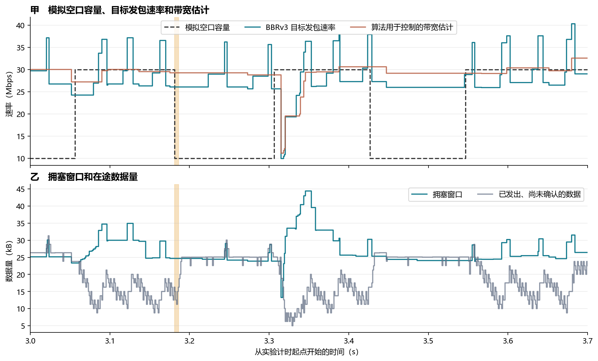
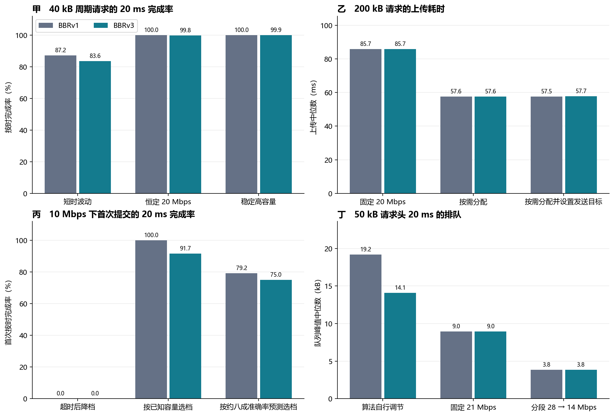
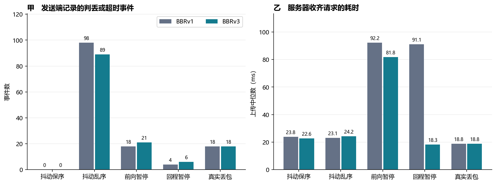
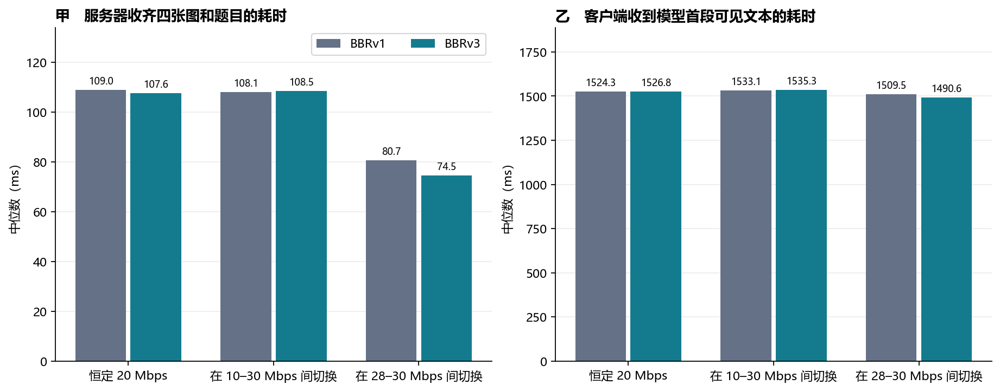

# QUIC BBRv3 在 6G-Testbed 上的复测报告

本报告用 picoquic 的 BBRv3 复测第三版的 A1–D1，并复测后续逐包判丢实验。原 BBRv1 报告和运行入口可继续使用。BBRv3 的构建、运行和采样入口位于 `bbr3/`，本次结果位于 `results/bbr3/`。BBRv3 是拥塞控制算法版本，第三版则是原报告的版本号。[新复现说明](bbr3/README.md) · [原 BBRv1 报告](REPORT.v3.zh-CN.md) · [原判丢报告](REPORT.loss-detection.zh-CN.md)

## 实验怎样做

两个 QUIC 端点通过 WSL2 的三套隔离网络命名空间和两对虚拟网卡通信。6G-Testbed 控制传播时延，软件中继按预设的毫秒级容量逐包转发。中继分别记录进入队列和离开队列的 IP 字节与时间。模拟空口容量是软件中继在给定时段内的服务预算。模型推理与传输基准分开执行，软件容量配置也不包含真实基站调度或射频资源。[网络复现说明](v3/README.md)

两种算法都来自固定的 picoquic 提交 `37bb5d28`。BBRv3 端点选用该实现的 `picoquic_bbr_algorithm`。A1–D1 沿用原随机种子、容量计划、业务数据量和采样口径。C1 的 24 个 JPEG 请求文件与旧清单的字节数和 SHA-256 一致。图表中 A1–D1 和判丢对照的 BBRv1 数据来自已发布的原始实验。在线模型对照另行用两个端点在本次实验中实测。绝对时延可能受不同轮次的主机调度影响。[BBRv3 源码](https://github.com/private-octopus/picoquic/blob/37bb5d28aaea417649a6d4facc15f54de7d55829/picoquic/bbr.c) · [本次运行环境](results/bbr3/bursts/environment.json)

本次 A1–D1 共跑 **21 个条件 × 3 轮**。**12,322 次实际提交**均完整到达，提交数包含 C1 实际执行的重试。中继没有丢包。逐轮计算实际出队相对预约的延迟和任务提交相对计划的延迟，再取各轮第 99 百分位数的最大值，分别为 **0.340 ms** 和 **0.489 ms**。原 BBRv1 入口也用原二进制复跑了 D1 原生发包条件，全部 48 笔正式请求与 1 笔预热均完整到达。这次复跑只用于验证旧入口。[逐轮数据](results/bbr3/bursts/runs.json)

**目标发包速率（pacing rate）**是 QUIC 发包器用来安排发送间隔的速率。它和中继实际收到的数据速率分别统计。**拥塞窗口（cwnd）**约束已发出但尚未获确认的数据量。**上传耗时**从提交请求到服务器收齐所有请求字节。**20 ms 完成率**以所有正式请求为分母。**队列峰值**是从提交请求后的头 20 ms 内，中继积压数据最多时的字节量。A1 持续待发对照另统计第 3 s 至第 6 s 的队列第 95 百分位数，即该时间段内约 95% 的采样队列深度不超过的值。

## A1。BBRv3 是否能跟上毫秒级容量切换？

图 1 的横轴为实验开始后的时间。甲图黑色虚线是配置的模拟空口容量，青色线是 QUIC 发包器使用的目标速率，橙色线是 BBRv3 用来调速的带宽估计。乙图青色线是拥塞窗口，灰色线是当前在途数据量。橙色背景标出第一次 30 → 10 Mbps 降档后的头 5 ms。该单轮用长驻留便于观察控制变化，短时波动组的整体效果见后文统计。

在 **3.181364 s**，模拟空口容量从 30 Mbps 降为 10 Mbps。随后 5 ms 内的五个端点采样都记录到 **26.085 Mbps** 的目标发包速率，带宽估计维持 **29.276 Mbps**，窗口维持 **24.682 kB**。当时处于探测带宽的降速阶段，源代码使用 0.90 的速率系数和 1% 的速率余量，`29.276 × 0.90 × 0.99 ≈ 26.085 Mbps`。软件中继实际收到 **16.64 kB**、转发 **6.40 kB**，队列从 **3.84 kB** 增至 **14.08 kB**，增加 **10.24 kB**。同一容量计划的旧 BBRv1 单轮在对应 5 ms 内增加了 **17.92 kB**。BBRv3 在这一次降档里积压较少，仍然没有在头 5 ms 内把发包目标降到当时的 10 Mbps 容量。[本轮逐包核算](results/bbr3/a1-drop-window.csv) · [BBRv1 对应记录](results/cc-bsr/a1-queue.csv)

同一轮在第 3 s 至第 6 s 记录到 **354 次目标发包速率变化**，全部发生在收到确认消息之后。其中 169 次同时观测到速率系数变化、带宽估计不变，167 次观测到带宽估计变化、速率系数不变，另有 18 次两者同时变化。这个统计只描述控制器实际改写发包目标的事件。即使在容量较稳的时段，BBRv3 也会主动改变探测速率。[内部事件计数](results/bbr3/bbr3-native-change-counts.csv) · [逐事件数据](results/bbr3/bbr3-native-events.csv.gz)

### 持续待发的组间比较

表中每格按 **BBRv1 → BBRv3** 排列。发送端持续有待发数据。先统计每轮第 3–6 s，再取三轮中位数。目标与容量的差值在同一采样时刻计算并取绝对值，队列深度来自中继。

| 模拟空口 | 实际平均出队速率（Mbps） | 发包目标与容量差值中位数（Mbps） | 队列第 95 百分位数（kB） | 拥塞窗口中位数（kB） |
|---|---:|---:|---:|---:|
| 10–30 Mbps，单档持续 5–10 ms | 19.99 → 19.99 | 12.15 → 10.01 | 20.48 → 29.44 | 22.69 → 33.68 |
| 恒定 20 Mbps | 20.00 → 20.00 | 4.87 → 1.76 | 14.16 → 8.96 | 21.06 → 21.86 |
| 28–30 Mbps，单档持续 5–10 ms | 29.00 → 29.00 | 7.20 → 1.85 | 20.48 → 11.52 | 29.69 → 27.76 |
| 10–30 Mbps，单档持续 120–180 ms | 19.85 → 19.02 | 11.87 → 6.56 | 24.32 → 23.12 | 25.75 → 24.60 |

BBRv3 在四种条件下都缩小了**目标发包速率与当时容量的差值中位数**。在均值约 20 Mbps 的短时波动条件下，它维持了与 BBRv1 相同的出队速率，同时使用更大的拥塞窗口，队列尾部也更深。稳定高容量组的目标与容量差值只有 **1.85 Mbps**，但目标发包速率的第 5 至第 95 百分位数仍覆盖 **25.91–36.67 Mbps**。因此“目标多数时间接近容量”和“目标几乎不波动”是两个不同的实验命题。前者在稳定高容量组得到数据支持。[四种容量的完整对照](results/bbr3/a1-saturated-comparison.csv)

## A1–D1。网络配合方案换用 BBRv3 后有什么变化？

图 2 灰色为原 BBRv1，青色为本次 BBRv3。甲图统计 40 kB 周期请求在 20 ms 内完整到达的比例。乙图统计 200 kB 请求的上传耗时中位数。丙图统计空口容量为 10 Mbps 时，首次提交的数据在 20 ms 内完成的比例，补发结果另计。丁图统计 50 kB 请求头 20 ms 内的中继队列峰值，柱高为各请求峰值的中位数。各子图横轴列出对应的网络或发送策略，柱顶数字采用各子图纵轴的单位。[完整用例对照表](results/bbr3/burst-comparison.csv)

### A1。稳定容量能提高短请求的按时完成率吗？

对每 20 ms 提交一笔的 40 kB 请求，BBRv3 的 20 ms 完成率在短时波动、恒定 20 Mbps 和稳定高容量三组分别为 **1,003/1,200（83.58%）**、**1,197/1,200（99.75%）** 和 **1,199/1,200（99.92%）**。三组的上传耗时第 99 百分位数分别为 **22.41、18.29、13.10 ms**。短时波动组的 BBRv1 原结果是 **1,046/1,200（87.17%）** 和 **21.89 ms**。稳定容量对尾部交付仍有价值，BBRv3 自身的速率差缩小也未转化为该波动组的完成率提升。

### B1。按任务给容量后，额外设置发包目标还有作用吗？

在 BBRv3 下，固定 20 Mbps 改为按需分配后，200 kB 请求的上传中位数从 **85.72 ms 降至 57.62 ms**，1 MB 请求从 **423.63 ms 降至 283.42 ms**。两种尺寸的宽限时限分别为 70 ms 和 310 ms，两组的按时完成均从 **0/15 升至 15/15**。30 Mbps 在 20 ms 内的名义服务量只有 75 kB，所以 200 kB 和 1 MB 请求仍超过 20 ms 时限。

对于同为 30 Mbps 分配的 200 kB 请求，额外设置发包目标及窗口下限后，头 20 ms 内发包目标连续三个采样点落在分配速率上下 10% 的请求从 **11/15 增至 15/15**。中继队列峰值中位数从 **10.24 kB 降至 6.40 kB**，上传中位数是 **57.62 ms 与 57.72 ms**。双向传播时延各增加到 6 ms 的补测中，设置目标前后 200 kB 请求的上传第 99 百分位数为 **121.98 ms 与 66.22 ms**。该条件每组只有 15 笔请求，尾部分位数主要反映少数慢样本。

### C1。提前选输入大小还有价值吗？

10 Mbps 条件下，超时后降档策略的高档首发 **0/72** 在 20 ms 内完成。72 笔请求均触发低档重试，其中 **64 笔**在重试开始后 20 ms 内完成。按已知容量提前选低档时，首发 **66/72** 按时完成。按约八成准确率的预测选档时，首发 **54/72** 按时完成，实际选低档 **57/72**。两组按时上传且独立模型评分正确的请求分别为 **49/72** 和 **41/72**。该指标把上传与既有模型评分配对，在线首词时延在下文单独测量。

在同一 10 Mbps 条件下，已知容量选档的旧 BBRv1 数据是 **72/72**。这次 BBRv3 即使选对档位也有六笔超过时限。容量信息帮助应用减少需要发送的字节，但传输层仍要在时限内把这些字节送到。

### D1。分段发包可以少排队，是否也更快？

每个请求的模拟空口头 10 ms 是 30 Mbps，接着 10 ms 是 15 Mbps。固定 21 Mbps 与分段 28 → 14 Mbps 在 20 ms 内的名义发送量相同，都是 52.5 kB。对 50 kB 请求，头 10 ms 的实际转发量中位数从 **26.88 kB 增至 35.84 kB**，上传中位数从 **24.36 ms 降至 20.29 ms**，说明同样的名义发送量按容量时序分配后能更早转发。

与 BBRv3 原生调速相比，分段发包把 50 kB 请求的队列峰值中位数从 **14.07 kB 降至 3.84 kB**，上传中位数则由 **19.80 ms 增至 20.29 ms**，按时完成数由 **60/72 降为 0/72**。改用 40 kB 请求后，两组均为 **72/72**，队列峰值中位数由 **10.12 kB 降至 3.84 kB**。因此，对留有传输余量的任务，分段发包可以在不损失按时完成率的情况下减小排队。对接近时限的 50 kB 任务，需要同时检查分段策略的服务余量和队列收益。[首段实际转发统计](results/bbr3/d1-first-window.csv)

## 判丢与超时。换算法以后，迟到包还会被提前补发吗？

图 3 每种条件包括 18 笔测量请求。甲图的纵轴是发送端记录的包号判丢、时间阈值判丢和探测超时事件的合计数。乙图的纵轴是完整上传的耗时中位数。两个子图的横轴使用相同的网络干预，均在图中给出中文名称。图中只有“真实丢包”条件明确丢弃包，其他条件延迟转发。[完整判丢对照表](results/bbr3/loss-comparison.csv)

本次判丢补测的 **27 轮、162 笔任务**均完成。测量任务发出 **4,969 个**前向数据包，其中 **4,951 个**最终到达，余下 18 个是中继主动丢弃的原包。发送端记录到 **188 次**前向测量包的判丢或超时恢复，其中 **170 个**原包最终仍到达。双端日志配对的 16,164 个 QUIC 包还包含预热、反向和控制流量。逐包到达结果与双端网卡抓包一致。[数据校验](results/bbr3/loss/validation.json)

| 干预条件 | BBRv1 → BBRv3 的发送端事件数 | BBRv3 的触发方式 | BBRv3 的原包到达情况 |
|---|---:|---|---|
| 前向额外延迟 0–5 ms，保持包序 | 0 → 0 | 无 | 全部到达 |
| 前向额外延迟 0–5 ms，允许乱序 | 98 → 89 | 88 次包号阈值，1 次时间阈值 | 89 个原包最终都到达 |
| 前向保序暂停 80 ms | 18 → 21 | 探测超时 | 21 个原包在事件后到达 |
| 回程保序暂停 80 ms | 4 → 6 | 探测超时 | 6 个原包在事件前已经到达 |
| 两包请求首包额外延迟 35 ms | 18 → 18 | RACK 时间阈值 | 18 个原包在事件后到达 |
| 中继明确丢弃一个前向包 | 18 → 18 | 包号阈值 | 18 个原包未到达 |

允许乱序时，BBRv3 的前向最大单向时延为 **14.23 ms**，判丢时有效超时值的中位数为 **18.62 ms**，实际判丢年龄的中位数为 **7.53 ms**。判丢年龄从原包发出计到发送端采取恢复动作。包号阈值和 RACK 可以在探测超时到期之前触发恢复。换拥塞控制算法会改变发包和确认时序，逐包恢复仍由相同的 picoquic 判丢代码处理。[判丢与超时指标定义](REPORT.loss-detection.zh-CN.md#三个计时指标的定义) · [本次事件表](results/bbr3/loss/loss-events.csv)

回程暂停组的上传耗时中位数从旧 BBRv1 的 **91.11 ms** 降到 BBRv3 的 **18.32 ms**，但 BBRv3 的第 95 百分位数仍有 **87.23 ms**。逐任务配对显示，BBRv3 有 **15/18** 笔请求在该请求的第一份确认到达发送端前，服务器就已收齐数据。这 15 笔的首包拥塞窗口中位数为 **52.31 kB**，可以容纳整个 40 kB 请求。BBRv1 的首包窗口中位数为 **20.69 kB**，提前收齐数为 **0/18**。服务器收齐请求与发送端收到确认发生在不同时间，这也解释了 BBRv3 仍记录到 6 次超时恢复。[回程暂停逐任务确认时序](results/bbr3/ack-pause-requests.csv)

## 在线 MiniCPM-o。发包策略能改变多少首词时延？

本次还把在线推理链路接到 picoquic。客户端通过可靠 QUIC 流上传题目与四张过去帧。服务器收齐请求后调用本机 **MiniCPM-o 2.6**，再沿同一条流返回模型的可见文本。12 道题来自第二版，完整请求大小为 **190.20–390.74 kB**，逐题 SHA-256 与第二版公开记录一致。每种算法在三个代表性容量条件下各跑 12 笔，共 **72 笔**。两种算法使用同一个模型进程和相同的请求顺序，各配置交替安排先测的算法。网络条件采用 A1 的容量配置，比较范围是本节的三个条件。[逐题结果](results/bbr3/online-requests.csv) · [模型及端点构建记录](results/bbr3/online-environment.json)

图 4 的横轴是三种模拟空口容量。甲图统计客户端提交请求到服务器收齐的耗时。乙图统计从同一提交时刻到客户端收到第一段非空白可见文本的耗时，也就是本文的**首词时延**。柱高是 12 道题的中位数，纵轴单位均为 ms。灰色和青色分别对应 BBRv1 和 BBRv3。逐题表另外记录了服务器收齐到调用模型的时间、模型调用到产生可见文本的时间，以及可见文本从模型产生到客户端收到的时间。

| 模拟空口 | 上传耗时中位数（ms），BBRv1 → BBRv3 | 首词时延中位数（ms），BBRv1 → BBRv3 |
|---|---:|---:|
| 恒定 20 Mbps | 108.97 → 107.65 | 1,524.31 → 1,526.85 |
| 在 10–30 Mbps 间切换 | 108.07 → 108.46 | 1,533.09 → 1,535.29 |
| 在 28–30 Mbps 间切换 | 80.67 → 74.48 | 1,509.48 → 1,490.58 |

72 笔请求均收到了可见文本。每种算法在每个配置均答对 **9/12**。从开始调用模型到产生首段可见文本的中位数在各组约为 **1.41–1.43 s**，明显长于上传。两种约 20 Mbps 的条件下，首词时延中位数只差 **2–3 ms**。稳定高容量组的中位数差为 **18.90 ms**。同题配对后，该组的上传耗时差中位数为 **−0.92 ms**，而模型阶段的差值中位数为 **−21.45 ms**。本次每组只有 12 道题，首词时延差异还包含模型运行时间波动。[分项中位数](results/bbr3/online-summary.csv) · [同题配对差值](results/bbr3/online-paired.csv)

同题对照也找到了少数明显的上传差异。恒定 20 Mbps 条件下，第 7 个视频的第 1 题在 BBRv1 下上传用了 **254.32 ms**，在 BBRv3 下用了 **151.01 ms**。BBRv1 在该请求的上传窗口里有 **191 个采样点**处于最小往返时延探测状态，窗口最小降到 **5,008 B**。在线 36 笔 BBRv1 请求中有 7 笔的上传窗口采到这个状态，BBRv3 的 36 笔均未采到。当前 picoquic BBRv3 实现允许在短期时延仍接近历史最小值时刷新估计，也在空闲恢复时抑制探测进入。逐请求日志验证了两种实现的状态差异，具体是哪一条条件抑制了每次探测仍需记录内部触发值。[逐题窗口与探测状态](results/bbr3/online-transport-state.csv) · [BBRv3 的最小往返时延更新](https://github.com/private-octopus/picoquic/blob/37bb5d28aaea417649a6d4facc15f54de7d55829/picoquic/bbr.c#L1346-L1380)

## 数据与复现

- [A1–D1 分组摘要](results/bbr3/bursts/task-summary.csv) · [逐任务表](results/bbr3/bursts/tasks.csv.gz) · [B1、D1 毫秒分桶时序](results/bbr3/bursts/BD-curves.csv.gz) · [所有轮次已采集的双端和中继记录](results/bbr3/bursts/raw-evidence.tar.xz)
- [判丢逐包表](results/bbr3/loss/packets.csv.gz) · [判丢和补发表](results/bbr3/loss/loss-events.csv) · [完整补测原始记录](results/bbr3/loss/raw-evidence.tar.xz) · [配对校验](results/bbr3/loss/validation.json)
- [A1 控制器逐事件记录](results/bbr3/bbr3-native-events.csv.gz) · [A1 端点采样](results/bbr3/bbr3-native-samples.csv.gz) · [A1 降档中继逐包记录](results/bbr3/bbr3-native-wire.csv.gz)
