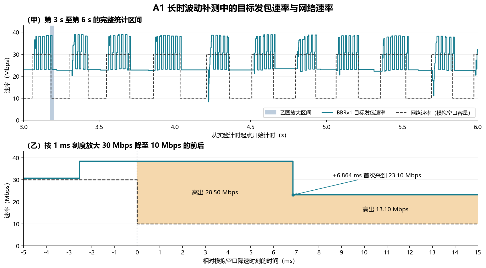
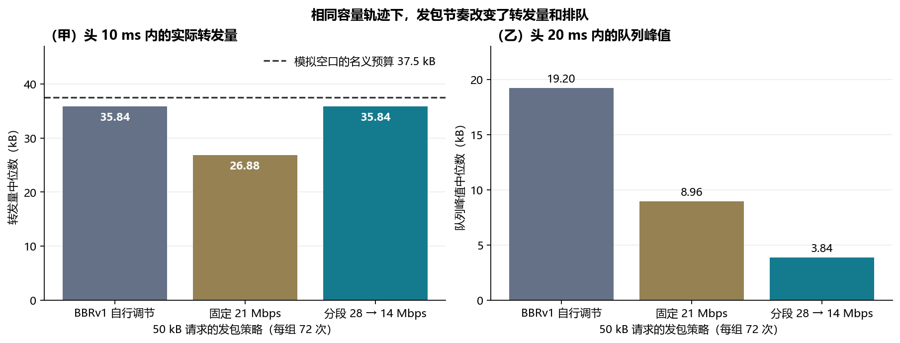

# 让 QUIC 发包跟上 5G 上行调度

本文把 **CC-BSR** 用作研究方向的简称，指利用缓冲区状态报告（Buffer Status Report，BSR）及对应的上行授权辅助拥塞控制。Wu 等人在 SIGCOMM 2026 发表的具体算法叫 **GBR-CC**。其中 GBR 指**授权量与上报待发量的比值**，3GPP 服务质量配置中的保障比特率也缩写为 GBR，两者含义不同。本文用现有 QUIC Testbed 的逐包记录量化失配，再用论文全文分析双控制环方案。作者的商用网络结果与本文的模拟空口实验分别列出。[论文全文](https://qiangwu769.github.io/papers/sigcomm26-gbr-cc.pdf) · [论文 DOI](https://doi.org/10.1145/3789240.3829199)

## 1. QUIC 的哪些机制跟不上无线调度？

Google 最初用 QUIC 改善通用互联网的 HTTPS 传输，早期部署已经包括移动端 YouTube。QUIC 标准提供加密、多路复用和连接迁移，也允许实现选择拥塞控制算法。这里的无线适配缺口是，**常规端到端拥塞控制可以从接收端确认、往返时延、丢包或显式拥塞标记推断路径状态，但这些输入没有告诉发送端，基站此刻给本终端分配了多少上行服务。** 采用相同反馈机制的 TCP 也可能出现类似失配。本文实验采用 picoquic 的 BBRv1，结论的实测范围以这一实现为准。[Google 的 QUIC 设计与部署论文](https://research.google/pubs/the-quic-transport-protocol-design-and-internet-scale-deployment/) · [QUIC 协议规范 RFC 9000](https://datatracker.ietf.org/doc/html/rfc9000#section-1) · [拥塞控制 RFC 9002 第 7 节](https://datatracker.ietf.org/doc/html/rfc9002#section-7)

**目标发包速率（pacing rate）**决定发送端给包留出多短的发送间隔。**拥塞窗口（cwnd）**限制已发送、尚未获确认的在途字节数。应用有数据可发、接收端流量控制有余量、拥塞窗口还有空间时，实际发送才可能接近目标速率。BBRv1 在带宽探测阶段用历史交付速率估计乘以探测系数来设定目标速率。容量降下来以后，新反馈需要时间返回，带宽估计还可能暂时保留历史高值。此时如果发送端仍有窗口空间，发包速度就可能超过当时的服务速度。[本项目的发包节奏与拥塞窗口报告](REPORT.pacing.zh-CN.md) · [实验所用的 picoquic BBRv1 源码](https://github.com/private-octopus/picoquic/blob/37bb5d28aaea417649a6d4facc15f54de7d55829/picoquic/bbr1.c)

用一个时间段的字节账本可以解释两种损失。设 `Q` 为期初的排队字节，`A` 为进入队列的字节，`D` 为实际转发的字节，`S` 为链路在该时段最多可服务的字节。没有丢包时，期末队列为 `Q + A − D`，且 `D ≤ min(S, Q + A)`。持续送入的数据超过当时的服务能力，就会形成积压。例如，实际入队速率维持 30 Mbps、链路降到 10 Mbps 并保持 8 ms，理想连续模型中的积压增量为 20 kB。反过来，即使应用还有待发数据，如果发送端一时只送入少量数据且队列已经排空，链路也用不满高容量时段。后来的容量可以补送字节，已经过去的请求时限无法补回。

### 实验 A1 显示容量降档后如何形成积压

第三版 Testbed 使用真实 QUIC 数据包。软件中继按预设速率曲线转发上行网际协议（IP）数据包，并记录每个数据包的入队和出队时间。回程不做速率整形。软件中继复现了毫秒级服务容量变化，设备和基站之间的 BSR、授权以及真实射频资源分配需要在后续蜂窝实验中采集。[环境与复现方法](v3/README.md) · [第三版报告](REPORT.v3.zh-CN.md)

| A1 指标 | 10–30 Mbps 短时波动，单档 5–10 ms | 恒定 20 Mbps |
|---|---:|---:|
| 持续待发时的平均模拟空口容量 | 20.0 Mbps | 20.0 Mbps |
| 持续待发时的实际平均出队速率 | 20.0 Mbps | 20.0 Mbps |
| 目标发包速率与当时容量的绝对差中位数 | 12.15 Mbps | 4.87 Mbps |
| 中继队列第 95 百分位数 | 20.48 kB | 14.16 kB |
| 周期提交 40 kB 请求时，20 ms 内上传完成 | 1,046/1,200（87.17%） | 1,200/1,200（100%） |
| 40 kB 请求的上传耗时第 99 百分位数 | 21.89 ms | 18.23 ms |

持续待发的比较先统计每轮第 3 至第 6 s，再取三轮的中位数。队列第 95 百分位数表示约 95% 的采样队列深度不超过该值。两组平均出队速率相近，容量波动组的队列第 95 百分位数高出约 **45%**。周期请求来自另一组负载，每隔 20 ms 提交一个请求，上传耗时统计到服务器收齐请求为止。该组使用同一拥塞控制算法，完成率差异反映容量时序及发送端响应的共同影响。[逐轮容量、发包与队列统计](results/v3/runs.json) · [逐组请求统计](results/v3/task-summary.csv)



**图 1** 的青色实线是 BBRv1 的目标发包速率，黑色虚线是模拟空口配置的网络速率，纵轴单位均为 Mbps。甲图按实验开始后的时间（s）展示完整统计区间，浅蓝色区域是乙图的放大范围。乙图以模拟空口降速时刻为 **0 ms**，按 **1 ms** 刻度展示降速前 5 ms 至降速后 15 ms。浅橙色区域的垂直高度表示降速后目标发包速率高出模拟空口容量的幅度。图中使用长时波动组的一轮，表中的组间统计使用短时波动组。

在 **3.181364 s**，模拟空口从 30 Mbps 降到 10 Mbps。随后 5 ms 内，目标发包速率的采样值仍约为 **38.50 Mbps**，比模拟空口容量高 **28.50 Mbps**。这 5 ms 内，中继实际收到 **24.32 kB**，转发了 **6.40 kB**，队列从 **11.52 kB** 增至 **29.44 kB**，增加的 **17.92 kB** 等于入队量减去出队量。降速后 **6.864 ms**，首次采到目标发包速率降为 **23.10 Mbps**，仍比模拟空口容量高 **13.10 Mbps**。这次下调来自探测系数由 1.25 降为 0.75，瓶颈带宽估计仍为 **30.80 Mbps**。[逐包统计](results/cc-bsr/a1-queue.csv) · [目标发包速率的变更归因](results/v3/A1-pacing-changes.csv) · [原始记录](results/v3/trace-evidence.tar.xz)

### 实验 D1 显示固定发包速率如何错过高容量时段

每个 50 kB 请求面对同一条容量曲线，头 10 ms 为 30 Mbps，接下来的 10 ms 为 15 Mbps。固定 21 Mbps 与分段 28 → 14 Mbps 在 20 ms 内的**名义发送量**都为 52.5 kB，也就是把目标速率按时间积分得到的字节量。两组都保留 BBRv1 的拥塞窗口约束。另设一组由 BBRv1 自行决定发包速率，每种策略共 72 个请求。[原始时序](results/v3/BD-curves.csv.gz) · [D1 设计与实现](REPORT.v3.zh-CN.md)



**图 2** 的横轴列出三种策略，纵轴单位均为 kB。甲图逐任务累计从提交开始的头 10 ms 内中继实际转发的 IP 字节，再取 72 个任务的中位数。虚线 **37.50 kB** 是按 30 Mbps 连续服务 10 ms 算出的名义预算。乙图对每个任务找出头 20 ms 内的中继队列峰值，再取各组中位数。IP 字节包含协议头，名义预算与实际转发量之差会受到整包发送和时间对齐影响。该差值衡量模拟链路首段未兑现的服务机会，真实小区的资源块利用率还取决于基站是否将机会分配给了其他终端。[统计表](results/cc-bsr/d1-service.csv) · [统计与制图脚本](studies/cc_bsr/analyze.py)

| 发包策略 | 头 10 ms 的实际转发量中位数 | 占首段名义预算 | 头 20 ms 的队列峰值中位数 | 上传耗时中位数 | 20 ms 内完成 |
|---|---:|---:|---:|---:|---:|
| BBRv1 自行调节 | 35.84 kB | 95.57% | 19.20 kB | 19.67 ms | 64/72 |
| 固定 21 Mbps | 26.88 kB | 71.68% | 8.96 kB | 24.30 ms | 0/72 |
| 分段 28 → 14 Mbps | 35.84 kB | 95.57% | 3.84 kB | 20.26 ms | 0/72 |

固定 21 Mbps 时，头 10 ms 的实际转发量比同名义发送量的分段方案少 **8.96 kB**，上传中位数慢 **4.04 ms**。分段方案和 BBRv1 自行调节都在首段转发了 35.84 kB。分段方案的队列峰值低约 **80%**，但其 50 kB 请求都错过 20 ms 时限，而 BBRv1 自行调节完成了 64 个。把请求改为 40 kB 后，两组都在 20 ms 内完成全部 72 个请求，分段方案的队列峰值中位数仍从 15.36 kB 降至 3.84 kB。研究目标应同时检查**请求是否按时交付**和**发送造成多少积压**，单看其中一项会改变对策略的判断。[逐组请求统计](results/v3/task-summary.csv)

## 2. 核心问题是反馈滞后和拥塞位置难以区分

基站掌握当前为终端安排了哪些上行时隙、每次授权可以容纳多少字节。终端上的传输算法看到的则是经过空口、回传网络和服务器后的确认结果。**两个观测位置看到的是不同时间、不同范围的状态。** 当容量档位持续 5–10 ms 时，发送端即使已经收到确认，确认反映的也可能是上一个容量档位。BBRv1 的带宽滤波还可能延长旧样本影响控制的时间。相同的往返时延（RTT，即发出数据到收到确认的往返时间）上升，既可能来自终端等待上行授权，也可能来自无线重传、回传排队或确认路径延迟。仅靠 RTT 上升难以区分这些情况。

因此，在同时存在**快速变化的上行调度**和**可能拥塞的端到端路径**时，控制器需要两种反馈。第一种反馈回答“眼前这几毫秒能向空口送多少数据”。第二种反馈回答“即使空口还有授权，后续路径还能承受多少流量”。只观察授权会遗漏回传瓶颈。只观察端到端结果会把局部变化和远端拥塞混在一起，并让短任务在控制稳定前就已经接近时限。双环设计的理由是分别利用这两类信息。

## 3. GBR-CC 论文做了什么，AI 上传还需要做什么？

### 论文如何闭合两个控制环

终端通过 **BSR** 向基站报告某个逻辑信道组还有多少待发数据。逻辑信道组是无线接入层汇总多个逻辑信道需求的单位，报告的字节量以索引档位编码。基站另行发送**上行授权（Grant）**，指明终端可用的上行资源。论文把一条 BSR 与相应时段内的授权对齐，以授权字节量除以上报的待发字节量。论文的商用网络样本中，BSR 常约每 5 ms 更新，测得的时分双工（TDD，即上下行分时使用资源）报告到授权延迟低于 5.5 ms。实际更新间隔取决于网络配置和是否有待发数据。[3GPP TS 38.321 第 5.4.5 和 6.1.3.1 节](https://www.etsi.org/deliver/etsi_ts/138300_138399/138321/18.01.00_60/ts_138321v180100p.pdf) · [论文第 2.2 节及附录 D](https://qiangwu769.github.io/papers/sigcomm26-gbr-cc.pdf#page=3)

| 控制环 | 观测信号 | 论文给出的调节方法 |
|---|---|---|
| 无线内环 | 终端的授权与上报待发量之比 | 把比值映射为速率乘数。论文选择经验目标 0.2。目标附近保持速率基本不变，明显低于目标时减速，明显高于目标时逐步探测更多服务。通用版本的单样本乘数约在 0.99–1.01 之间。 |
| 端到端外环 | 接收端反馈反映的单向时延增长趋势，以及授权比值是否持续高于目标 | 论文第 4.1.2 节描述的切换条件是，检测到时延过载，且授权比值已连续 100 ms 高于目标。外环使用 GCC 的基于时延的乘法降速。队列消退、过载信号解除后，控制回到无线内环。GCC 是 Google 的实时媒体拥塞控制算法。 |

公开的 MsQuic 发送端实现还用比值调整拥塞窗口，窗口的基础计算为 **目标发包字节速率 × 基础往返时延 × 2**，并应用实现的下限。基础往返时延取较低的已观测往返时间，避免排队把窗口反向放大。该源码在确认处理路径里读取最新比值并按样本序号去重。论文说明这里还会检查样本是否超过 10 ms，公开实现的这一更新分支则按序号识别新样本。复现实验需要单独测量**授权产生、样本到达、发包配置真正改变**之间的时差，特别是连接刚开始上传时还没有确认的情况。[论文第 4.1 节](https://qiangwu769.github.io/papers/sigcomm26-gbr-cc.pdf#page=7) · [作者发送端窗口计算](https://github.com/NEMO-LAB-repo/GBR-CC_sender/blob/b35aeefffcfbed8e3b29c68380532de92789f9b2/src/core/bbr.c#L279-L306) · [作者发送端确认处理](https://github.com/NEMO-LAB-repo/GBR-CC_sender/blob/b35aeefffcfbed8e3b29c68380532de92789f9b2/src/core/bbr.c#L1532-L1572)

作者在美国三家运营商的 LTE 和 5G 上行采集了数据，并用商用终端和云端接收机评估。论文摘要报告，相比 BBR，GBR-CC 的平均吞吐量提高约 **5%**，往返时延中位数减半。对接 WebRTC 视频通话后，相比 GCC，论文报告平均吞吐量提高约 **50%**，播放时延中位数下降 **32–53%**，卡顿率下降约 **60%**。作者还用同小区两部终端检查了竞争场景。视频通话和持续上传的这些结果说明无线反馈可以改善特定上行业务。多模态 AI 的 20 ms 上传完成率、首词时延和识别质量仍需按任务测量。[论文第 5 节，评估与竞争实验](https://qiangwu769.github.io/papers/sigcomm26-gbr-cc.pdf#page=9)

### 面向 20 ms 上传窗口的方案与验证

**5 ms 能看到信号，与 5 ms 能调到合适的速率，是两件事。** 按论文内环的纯乘法更新计算，假设每 5 ms 都及时得到一个样本，每次都按最强约 1% 减速，20 ms 内完成四次更新后，30 Mbps 仍约为 **28.82 Mbps**。若新容量是 15 Mbps，在相同假设下需要约 **69 次更新，即 345 ms** 才减到 15 Mbps 以下。这个计算只覆盖论文的渐进式内环，外环降速和切换暂停属于不同分支。它说明如果要跟踪 D1 这种任务内骤降，除了验证信号到达够快，还要验证控制动作能否在短窗口内产生足够大的变化。[论文式 2 和第 4.1.2 节](https://qiangwu769.github.io/papers/sigcomm26-gbr-cc.pdf#page=8)

1. **无线内环按短窗口的可用字节数给发包器配额。** 终端先用授权字节、适用时隙、样本时间和当前队列估计下一小段能服务的数据量。已入队字节先占用预算，剩余部分用于准许新的数据进入。授权只能反映已经给出的分配，后续容量预测应带上有效期与置信度。BSR 接近零时，大比值可能只是分母太小。此时要结合应用是否有待发数据、是否已用完拥塞窗口，以及最近实际授权和转发了多少字节，再决定是否提高发包速率。无线重传、填充和协议头也应从可承载新业务数据的预算里单独记账。
2. **端到端外环继续约束在途数据和全路径拥塞。** 第一版原型保留原 QUIC 拥塞窗口、流量控制和丢包恢复，并用端到端控制器限制较长时间段内的总发送量。无线内环可以在这段时间内把有限的字节额度安排到高容量时段，单次发送仍受拥塞窗口约束。局部样本过期时撤销本地配额，恢复原生发包节奏。把更新接到发包调度事件上，并记录是否仍因确认、窗口或应用供给而无法使用新授权。后续再单独试验联动窗口，检验窗口过小会不会错过高容量，窗口过大又会不会把排队移到终端协议栈或回传链路。
3. **把首发时机和后续跟踪分开测试。** BSR 汇报已经排队的需求，刚开始的图片或音频上传可能在第一次有效 BSR 之前就需要发包。利用任务大小、剩余时限和近期授权历史初始化第一段的发包配额，是待测的前馈方案。前馈是指发送端在该任务的拥塞反馈返回前调整行为。对于连接复用的连续任务，另测近期授权能否帮助下一次请求。对于首次上传、长空闲后恢复和切换场景，分别测可用信号覆盖率与冷启动时延。
4. **在相同容量轨迹上比较控制器，并加入真实多用户验证。** 在 Testbed 重放同一容量轨迹和任务到达时间，比较原生 BBRv1、只使用无线控制、双环控制、提前知道完整容量轨迹的参考策略。同步比较固定总容量下的授权相位，加入慢回传、回程确认抖动、5–10 ms 容量切换和信号过期。用相同的 40 kB、50 kB 请求及不同端到端往返时延记录 20 ms 完成率、上传时延第 99 百分位数、各段队列、转发字节数和重传量。接入本地多模态模型后，再测从请求提交到用户看到第一个生成词元的时延，以及改变上传内容时的回答准确率。最后用真实终端和基站采集授权、空口新传字节和其他终端得到的资源份额，验证收益是否来自有效使用授权，还是来自更激进地占用共享资源。

**建议作为下一阶段的研究问题。** 在相同授权轨迹、任务数据量和共享资源条件下，双环控制能否让更多 20 ms 内必须完成的请求按时交付，同时降低队列尾部，并在回传成为瓶颈时保持竞争流的服务份额？D1 的分段结果可以充当提前知道容量轨迹的参考。本文的结果来自既有记录的再分析，双环原型及其在本 Testbed 的性能仍待验证。

## 复算本报告的逐包结果

在仓库根目录运行下列命令。脚本从第三版公开记录生成 A1 的毫秒放大图，重算降速后 5 ms 的入队、出队和队列数据，并生成 D1 首段的转发量统计及配套中文图。制图需要 Matplotlib 和简体中文字体，可用 `--font` 指定字体文件。

```bash
python studies/cc_bsr/analyze.py
```
