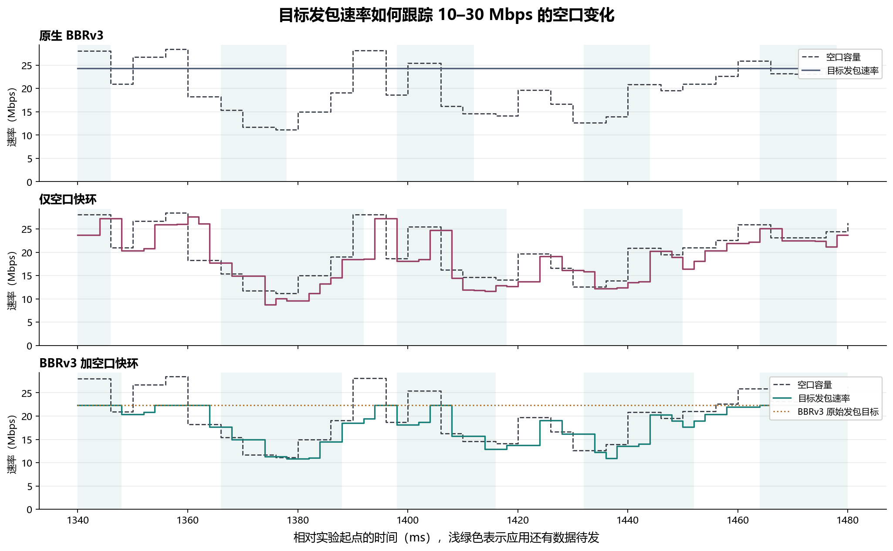
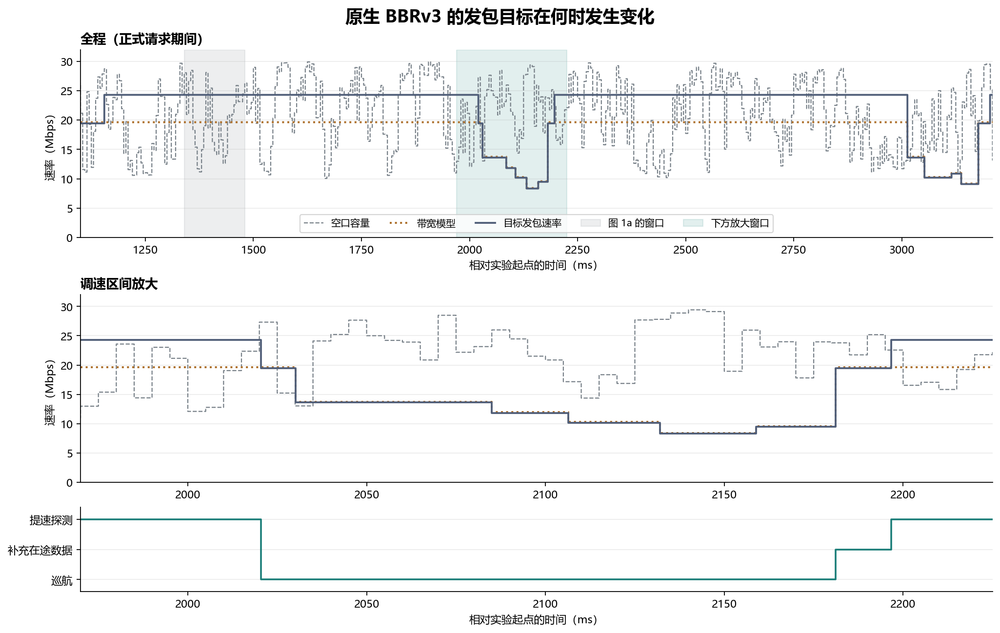
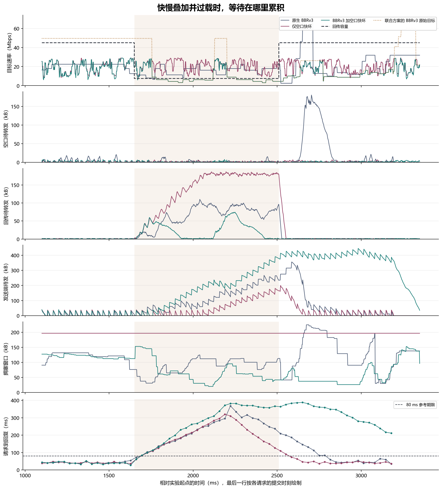
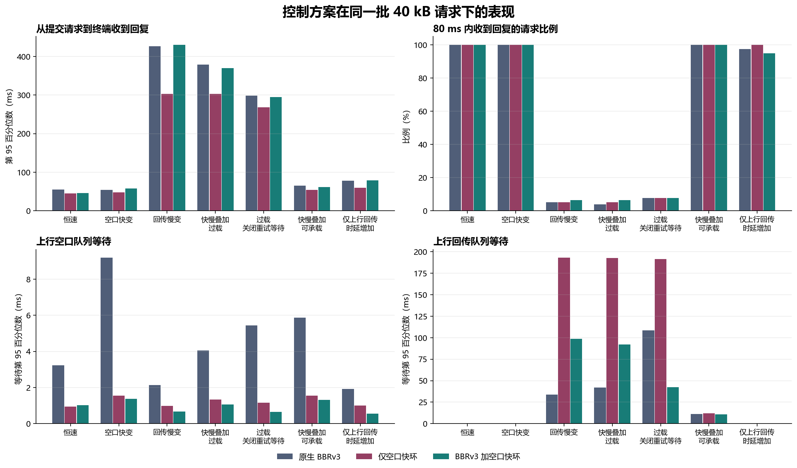
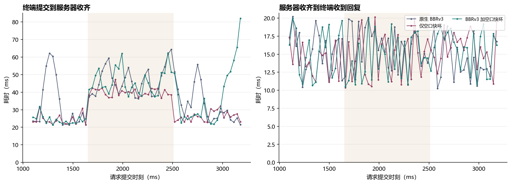
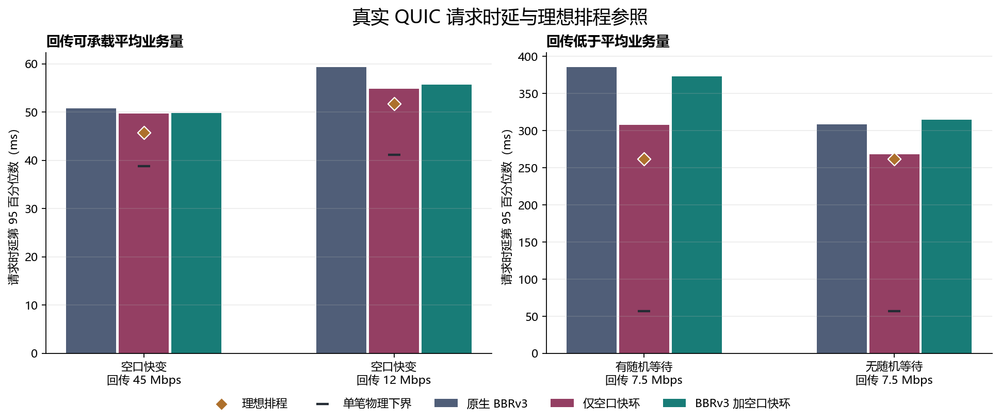

# 原生 BBRv3 加空口快环，能否同时适配空口和上行回传

本次在本地 6G-Testbed 上实测原生 BBRv3、仅空口快环、BBRv3 加空口快环三种方案。终端每隔 33 ms 在同一条 QUIC 连接上提交一笔 40 kB 请求。实验用有短时相关性的随机速率近似空口波动，并在空口之后、服务器之前设置独立的上行回传。联合方案由原生 BBRv3 根据 QUIC 确认适应回传，快环只读取空口侧信息。

**空口快环减轻了毫秒级空口排队，BBRv3 能对持续的回传瓶颈降速。** 加入快环后，单独空口快变时的空口排队第 95 百分位数由 9.19 ms 降到 1.38 ms。快慢叠加且回传过载时，联合方案把仅空口快环的回传排队第 95 百分位数由 192.95 ms 降到 92.10 ms，原生 BBRv3 在同一条件下为 42.19 ms。队列改善取决于观测的链路，三种方案都存在无法按时完成的条件。

## 1. 三种方案如何控制发包

| 方案 | 反馈来源 | 目标发包速率和拥塞窗口 |
|---|---|---|
| 原生 BBRv3 | QUIC 确认、交付速率、往返时延、判丢和重传相关反馈 | 由原生 BBRv3 计算目标发包速率和拥塞窗口 |
| 仅空口快环 | 空口过去 1 ms 的可用容量和空口队列 | 空口快环计算目标发包速率，拥塞窗口固定为 192 KiB，保留 QUIC 确认、判丢和重传 |
| BBRv3 加空口快环 | 前两组的反馈，空口信息仍只来自空口这一段 | 目标发包速率取 BBRv3 目标与空口上限的较小值，拥塞窗口继续由原生 BBRv3 调整 |

**目标发包速率（pacing rate）**是传输层安排数据报发出的速率目标。实际发包还取决于应用是否有待发数据，以及拥塞窗口能否容纳更多数据。**拥塞窗口（cwnd）**约束已发出但尚未确认的数据量。**QUIC 确认（ACK）**由服务器返回，可用于估计端到端交付速率和往返时延。

空口快环约每 1 ms 读取一份过去 1 ms 的容量和当前空口待转发量。反馈在 1 ms 后可递送。快环将容量打 97% 折扣，超过 2,560 byte 的待转发量再按 8 ms 的目标排空时间从速率中扣除，上限范围为 1–30 Mbps。联合方案保留 picoquic 的 BBRv3 状态、发送量子、拥塞窗口、反馈和判丢行为。它记录 BBRv3 计算的原始目标、空口反馈给出的上限和最终使用的目标。仅空口环与其他两组的窗口策略不同，因此端到端比较同时包含窗口策略的影响。

GBR-CC 的作者将外环描述为用端到端时延趋势保守回退，以处理无线段以外的瓶颈，内环用无线授权与终端缓存状态报告推导出快速信号。本文采用同样的反馈分工，在 picoquic 上使用 BBRv3 承担外环功能。测试中以可用空口容量和队列近似无线遥测。[GBR-CC 论文项目页](https://paws.princeton.edu/publications/synchronizing-scheduler-dual-loop-congestion-control-5g-uplink-commodity-devices) · [作者实现](https://github.com/NEMO-LAB-repo/GBR-CC) · [本仓库的 MsQuic 复现](REPORT.gbr-cc-reproduction.zh-CN.md)

## 2. 上行回传与回程如何区分

- **上行空口容量。** 恒速条件为 20 Mbps。快变条件下，以 5 ms 为一档更新容量。先生成相邻档位有短时相关性的标准正态序列 `z[t] = 0.65 × z[t−1] + sqrt(1−0.65²) × ε[t]`，从标准正态分布独立采样 `ε[t]`。再用 `20 + 10 × erf(z[t]/sqrt(2))` 将容量映射到 10–30 Mbps。这个映射使单个档位的边际分布在 10–30 Mbps 均匀，相邻档位仍保留相关性。三个种子在方案之间配对。正式请求时段内合计 1,266 档，容量范围为 10.01–29.99 Mbps，平均 20.33 Mbps，三个种子的相邻档相关系数为 0.636–0.654。
- **无线重试等待。** 上行每个数据报进入空口前先抽签，有 10% 的概率等待 5 ms，然后重新抽签，因此允许连续等待 10 ms 或更长。每次等待至少 5 ms、10 ms、15 ms 的理论概率分别为 10%、1%、0.1%。这是对无线重试延迟和重排的近似，空口中继随后仍转发该数据报。
- **上行回传容量与传播时延。** 数据报离开空口后，进入基站至服务器链路的独立先进先出队列。基础可用容量为 45 Mbps，基础传播时延为 4 ms。降速对照在 1,650–2,510 ms 把容量调到 7.5 Mbps 或 12 Mbps，排队时延由服务速率和流量自然产生。另一组保持容量为 45 Mbps，把这个时间段内从回传出队的数据报的传播时延提高到 19 ms。
- **回程。** 服务器发往终端的回复和确认始终使用 10–20 ms 的逐包均匀时延，无带宽限制或额外排队。回程配置在各组相同。

| 网络配置 | 上行空口容量 | 上行回传容量 | 上行回传传播时延 | 无线重试 |
|---|---|---|---|---|
| 恒速 | 20 Mbps | 45 Mbps | 4 ms | 有 |
| 空口快变 | 10–30 Mbps，5 ms 一档 | 45 Mbps | 4 ms | 有 |
| 回传慢变 | 20 Mbps | 45 → 7.5 → 45 Mbps | 4 ms | 有 |
| 快慢叠加，过载 | 10–30 Mbps，5 ms 一档 | 45 → 7.5 → 45 Mbps | 4 ms | 有 |
| 过载，关闭重试 | 10–30 Mbps，5 ms 一档 | 45 → 7.5 → 45 Mbps | 4 ms | 无 |
| 快慢叠加，可承载 | 10–30 Mbps，5 ms 一档 | 45 → 12 → 45 Mbps | 4 ms | 有 |
| 仅上行回传时延增加 | 20 Mbps | 45 Mbps | 4 → 19 → 4 ms | 有 |

每轮预热 300 kB 后提交 64 笔正式请求。服务器收到一笔请求的全部 40,000 byte 后立即回传 1 byte。端到端时延从应用提交请求到终端收到回复。实验使用 AI 业务的数据量和请求间隔，服务端以即时回复隔离网络开销。三种方案使用相同的容量时序和随机数种子，数据报的实际发送数量和时刻可以不同。每组各跑三轮，共 63 轮、4,032 笔正式请求。

## 3. 只有端到端探测时，能跟到多快的空口变化

**图 1a。** 横轴为实验时间，纵轴为 Mbps。虚线是空口容量，实线是发送端实际使用的发包目标，浅绿色表示应用仍有数据等待首次发送。联合方案的橙色点线是空口限速前的 BBRv3 原始目标。曲线取第一轮的 2 ms 采样。在 1,340–1,480 ms 内，空口容量在 11.17–28.48 Mbps 之间变化。131 个原始端点采样和 153 个逐包发送记录均显示，原生 BBRv3 的发包目标保持在 24.308 Mbps。空口快环能在短暂滞后后降速。空口恢复到 25 Mbps 以上时，联合方案的实际目标又受当时约 22 Mbps 的 BBRv3 原始目标限制。

**图 1b。** 上图延长到同一轮的整个正式请求时段（1,100–3,210 ms）。灰色背景标出图 1a 的窗口，浅绿色背景标出下方放大的 1,970–2,225 ms 调速区间。灰色虚线是实验配置的空口容量，橙色点线是 BBRv3 调速所用的带宽模型，蓝色实线是目标发包速率。最下方绿线是该时段记录到的带宽探测阶段。发包目标、带宽模型和探测阶段均来自约 1 ms 间隔的原始端点日志。

| 首次记录到变化的时刻（ms） | BBRv3 带宽模型（Mbps） | 带宽探测阶段 | 目标发包速率（Mbps） |
|---:|---:|---|---:|
| 2,020.452 | 保持 19.64 | 从提速探测进入巡航 | 24.31 → 19.45 |
| 2,030.082 | 19.64 → 13.75 | 保持巡航 | 19.45 → 13.61 |
| 2,131.984 | 10.29 → 8.42 | 保持巡航 | 10.18 → 8.33 |
| 2,181.103 | 9.57 → 19.64 | 进入补充在途数据阶段 | 9.48 → 19.45 |
| 2,196.632 | 保持 19.64 | 再次进入提速探测 | 19.45 → 24.31 |

picoquic 在这些阶段用带宽模型乘以阶段系数，再乘以 0.99 的速率余量因子。2,020 ms 左右的第一次下调来自阶段系数由 1.25 降到 1.0。随后的巡航阶段，系数保持 1.0，带宽模型变化仍会改变目标速率。全程图中约 3,013 ms 处还出现了第二次明显下调，目标由 24.31 Mbps 降到 13.61 Mbps。这个时间尺度上的调速与图 1a 的平台同时存在，因为 BBRv3 按端到端模型和探测阶段调速，5 ms 一档的空口容量由测试链路单独施加。[本次锁定的 picoquic BBRv3 源码](https://github.com/private-octopus/picoquic/blob/37bb5d28aaea417649a6d4facc15f54de7d55829/picoquic/bbr.c#L982-L1003)

| 空口快变、回传容量 45 Mbps | 发包目标与空口容量的平均绝对差（Mbps） | 空口排队 P95（ms） | 请求端到端 P95（ms） |
|---|---:|---:|---:|
| 原生 BBRv3 | 7.31 | 9.19 | 53.76 |
| 仅空口快环 | 2.13 | 1.55 | 48.05 |
| BBRv3 加空口快环 | 4.18 | 1.38 | 57.94 |

P95 指第 95 百分位数。发包目标与空口容量的平均绝对差只统计还有应用数据待发的样本。原生 BBRv3 的上行数据报从发出到收到确认的中位数为 23.27 ms，跨过约四到五档空口容量。联合方案在约一半的有待发数据的采样中由空口上限决定发包目标。它压低了空口排队，但上下两头都受限制的发包目标会改变终端提交后的等待和跨空口高容量阶段的发包量。三种方案在 80 ms 内都完成了这一组的 78 笔请求。该负载下，联合方案改善了空口队列，端到端 P95 仍比原生 BBRv3 高 4.18 ms。

## 4. 回传开始拥塞时，仅空口快环和原生 BBRv3 有何区别

**图 2。** 横轴为实验时间。浅棕色区间内，上行回传容量为 7.5 Mbps。第一行的灰色虚线是回传容量，橙色点线是联合方案的 BBRv3 原始目标，彩色实线是各方案实际使用的发包目标。第二、三行是还未完成转发的空口与回传 IP 数据量。第四行是应用已提交而 QUIC 尚未首次发出的字节。第五行是拥塞窗口，紫线对应仅空口快环的固定窗口 192 KiB，约为 196.61 kB。第六行每个点是一笔请求的端到端时延，按提交时刻排列。虚线为 80 ms 参考期限。

在空口保持 20 Mbps、只有回传容量下降的配置里，原生 BBRv3 的发包目标中位数由 **25.77 Mbps 降至 6.77 Mbps**。仅空口快环则在变化前后都维持 **19.40 Mbps**，它感知到的空口并未变慢。这两组的回传排队 P95 分别为 34.01 ms 和 193.13 ms。联合方案也会降速，但三轮的目标中位数分别为 16.13、6.78 和 10.75 Mbps，说明端到端反馈的反应程度存在轮次差异。

在空口快变与回传降速叠加的配置里，联合方案的回传排队 P95 为 92.10 ms，低于仅空口快环的 192.95 ms，但高于原生 BBRv3 的 42.19 ms。图 2 的第一轮展示了两处瓶颈如何交换。联合方案的 BBRv3 降低发包目标后，回传队列可以回落，但终端还有大量请求数据等待发送。空口被限速后，BBRv3 所看到的交付样本和拥塞反馈也会随之变化，所以联合方案的目标曲线与单独运行的 BBRv3 不同。三轮数据支持这个差异的存在，具体差值还受当时的 BBRv3 状态及确认到达时序影响。

**图 3。** 左上是每笔请求提交到回复的 P95，右上是 80 ms 内收到回复的比例，左下是空口入队到开始服务的逐包等待 P95，右下是回传入队到开始服务的逐包等待 P95。请求指标合并三轮在对比区间提交的任务，逐包等待在每轮计算 P95 后取三轮中位数，包的归属按进入上行中继的时刻确定。以下各格依次列出 **请求端到端 P95 / 回传队列等待 P95**，单位均为 ms。

| 网络配置 | 原生 BBRv3 | 仅空口快环 | BBRv3 加空口快环 |
|---|---:|---:|---:|
| 恒速 | 55.45 / 0.00 | 45.39 / 0.00 | 46.33 / 0.00 |
| 空口快变 | 53.76 / 0.00 | 48.05 / 0.00 | 57.94 / 0.00 |
| 回传慢变 | 426.89 / 34.01 | 303.45 / 193.13 | 430.27 / 98.64 |
| 快慢叠加，过载 | 379.28 / 42.19 | 303.29 / 192.95 | 370.11 / 92.10 |
| 过载，关闭重试 | 298.22 / 108.65 | 268.01 / 191.72 | 294.39 / 42.59 |
| 快慢叠加，可承载 | 64.82 / 11.04 | 53.73 / 12.13 | 61.62 / 10.75 |
| 仅上行回传时延增加 | 77.65 / 0.00 | 59.95 / 0.00 | 79.23 / 0.00 |

回传为 12 Mbps 时，三种方案都在 80 ms 内完成全部请求，仅空口快环取得最低的请求 P95，联合方案取得略低的回传排队 P95。回传为 7.5 Mbps 时，应用平均仍提交 9.70 Mbps，未计入包头和重传。860 ms 内提交的 26 笔请求共 1,040 kB，而回传最多只能服务 806.25 kB。快慢叠加过载时，三种方案各有 3、4、5 笔在 80 ms 内完成，每组分母为 78。此时把数据留在终端还是先送进回传，主要改变等待的位置，容量缺口仍然存在。

关闭逐包重试后，混合过载的原生 BBRv3 请求 P95 从 379.28 ms 变为 298.22 ms，但回传排队 P95 从 42.19 ms 升到 108.65 ms。逐包等待改变了重排、确认和拥塞控制的时序，所以移除 5 ms 随机等待后的业务差值包含整条反馈链的变化。

## 5. 上行回传单纯变慢，BBRv3 如何反应

**图 4。** 左图是应用提交到服务器收齐请求的耗时，右图是服务器收齐到终端收到回复的耗时。每个点对应一笔请求。浅棕色区间内，离开回传队列的数据报的传播时延由 4 ms 提高到 19 ms。右图的散布仍在约 10–20 ms，符合始终相同的回程配置。

这一组的回传队列等待 P95 都为 0 ms。仅空口快环在变化前后都将发包目标维持在 19.40 Mbps，上传耗时中位数由 24.06 ms 升到 39.73 ms，增加 15.67 ms，接近增加的传播时延。原生 BBRv3 的确认耗时中位数由 23.26 ms 升到 37.38 ms，同时发包目标中位数从 20.45 Mbps 降到 12.90 Mbps。联合方案的发包目标则从 19.40 Mbps 降到 12.53 Mbps。这表明新增的回传传播时延会影响端到端反馈和发包行为，即使回传队列没有形成。BBRv3 能根据交付、往返时延和恢复事件响应变化，单凭这些信息无法定位是哪一段发生了变化。

## 6. 仅空口快环在端到端时延上是否不够用

现有数据只能说**仅空口快环在回传拥塞时会留下更长的回传队列**。对于每 33 ms 一笔 40 kB 请求的单流业务，仅空口快环在许多条件下的请求尾时延反而更短。联合方案缩短某一段队列后，请求还可能在终端等待发包。因此，比较控制策略的增益应以请求端到端时延和达标率为准。

### 怎样得到理想传输层的时延参照

为计算改进空间，固定请求提交时刻、空口容量曲线、回传容量和单向时延，计算两个量。

1. **单笔物理时延下界。** 让一笔请求独享两段链路，以 bit 为单位在两段间即时接续。忽略包头、逐包重试、其他请求和协议处理，并取最短回复时延 10 ms。恒定 20 Mbps 空口和 45 Mbps 回传的例子中，40 kB 的发送至少需要 16 ms，再加 4 ms 上行传播和 10 ms 回程，物理下界为 30 ms。该下界描述单笔请求最快能完成到什么程度，持续时间内的多笔请求还要竞争同一份容量。
2. **理想调度在全负载下的时延。** 保留每 33 ms 提交 40 kB 的全负载，以每满包 1,218 byte 请求数据、62 byte 包头近似实测的 1,280 byte IP 报文。开启随机等待时，每个数据报在空口服务前按 10% 概率等待 5 ms，等待后再次抽签。理想控制器已知两段容量、传播时延和该包的等待结果。它按数据报通过随机等待的先后顺序预留最早可用的回传服务时刻，再反推空口服务时刻与终端交包时刻。该排程在回传能够接收之前才安排空口发送，尽量把可以避免的回传排队移到发送端。回复仍按 10–20 ms 均匀抽样。这是给定链路模型下可排出的发送计划，提供了一个性能参照。实际 QUIC 还受拥塞窗口、确认与重传影响，实际发送端也无法提前知道随机等待结果。

用同一链路配置和三个配对种子另跑了 36 轮 QUIC，共 2,304 笔请求。空口快变、叠加过载、叠加但可承载三组都开启逐包随机等待，同时重跑关闭等待的过载组。真实 QUIC 数据和理想排程按同一个比较阶段汇总。理想排程对等待和回复按相同的分布重新抽样，实际 QUIC 的包数、确认流量和每个包的随机结果不同。

**图 5。** 三种颜色的柱条对应三种实际 QUIC 控制方式。橙色菱形是有相同业务负载和随机等待规则的理想排程。短横线是单笔物理下界。纵轴为应用提交到收到回复的第 95 百分位数（P95）。左右面板使用不同纵轴范围，以同时看清可承载和过载条件下的差距。每个配置和控制方式由比较阶段的 78 笔请求汇总。

| 条件 | 单笔物理下界 P95（ms） | 理想排程 P95（ms） | 原生 BBRv3 P95（ms） | 仅空口快环 P95（ms） | 当前双环 P95（ms） | 当前双环高于理想排程（ms） |
|---|---:|---:|---:|---:|---:|---:|
| 空口快变，回传 45 Mbps，有随机等待 | 38.77 | 45.75 | 50.75 | 49.66 | 49.84 | 4.09 |
| 空口快变，回传 12 Mbps，有随机等待 | 41.14 | 51.70 | 59.31 | 54.84 | 55.71 | 4.00 |
| 空口快变，回传 7.5 Mbps，有随机等待 | 56.67 | 261.98 | 385.22 | 307.45 | 372.60 | 110.62 |
| 空口快变，回传 7.5 Mbps，无随机等待 | 56.67 | 261.98 | 308.36 | 268.26 | 314.72 | 52.75 |

表格先用未四舍五入的数据计算差值，再统一保留两位小数。

- **回传可承载时，先看超过仅空口快环还有多少空间。** 在回传为 45 Mbps 和 12 Mbps 的两组里，当前双环离理想排程分别约 4.09 ms 和 4.00 ms。仅空口快环离理想排程分别约 3.91 ms 和 3.14 ms，三种实际方案在这两组都满足 80 ms 期限。对这条单流来说，只有当联合方案把请求 P95 分别降到 49.66 ms 和 54.84 ms 以下，才能体现超越仅空口快环的时延收益。
- **回传过载时，当前双环有较大改进空间，80 ms 仍主要受容量限制。** 有随机等待时，当前双环的 P95 比仅空口快环高约 65.15 ms，比理想排程高约 110.62 ms。虽然双环把回传排队 P95 从仅空口快环的 192.68 ms 降到 97.58 ms，端到端尾时延仍更长。理想排程本身的 P95 也有 261.98 ms，仅有 6/78 笔在 80 ms 内完成。单笔物理下界 56.67 ms 假设该请求独占链路，因此不能用它判断连续提交的这批请求是否能在 80 ms 内交付。
- **逐包随机等待已经在实际链路生效。** 以有随机等待的过载组为例，双环的三轮合计记录到 7,525 个上行数据报，含预热和协议流量。其中 756 个至少等待一次，77 个至少等待两次，分别占 10.05% 和 1.02%。在理想排程中，7.5 Mbps 的回传可以连续服务，开启随机等待后的 P95 仍为 261.98 ms。实际 QUIC 有等待和无等待两组的双环 P95 分别为 372.60 ms 和 314.72 ms。随机等待会改变分组重排和确认到达时机，因此这两个实测值之差包含传输层控制和恢复行为的变化。

## 7. 对联合设计的结论

**原生 BBRv3 适合承担端到端的持续拥塞反馈，空口快环适合限制毫秒级的空口突发。** 两路信号互补，但本次用的取较小值规则也会压住短时高速机会，并改变 BBRv3 的交付样本。可承载条件下，它可以用较低的空口排队换来更长的单流请求尾时延。容量不足时，任何发包控制都需要应用准入、降低请求体积或增加回传容量来补上服务缺口。

若要把这两路反馈用于有截止期限的业务，后续可以测试让 BBRv3 约束较长时间窗内的累计发送字节，同时让空口快环决定窗口内何时发。这个设计允许在空口高容量时段使用已积累的发送额度，也能维持较长时间尺度的回传约束。当前数据验证的是短时限速与端到端探测的分工，以及简单速率取小规则的局限。上述累计额度策略尚未进入本次实测。

## 数据与复现

- [逐请求时间](results/cross-layer-bbr-radio/tasks.csv) · [按配置和阶段汇总](results/cross-layer-bbr-radio/summary.csv) · [逐轮数据](results/cross-layer-bbr-radio/runs.csv) · [2 ms 采样时序](results/cross-layer-bbr-radio/timeline.csv.gz)
- [随机等待复测和理想排程数据](results/cross-layer-latency-floor) · [复测汇总](results/cross-layer-latency-floor/summary.csv) · [理想排程逐请求结果](results/cross-layer-latency-floor/latency-reference-tasks.csv)
- [原生 BBRv3 原始数据](results/cross-layer-bbr-radio/bbr/raw-evidence.tar.xz) · [仅空口快环原始数据](results/cross-layer-bbr-radio/radio/raw-evidence.tar.xz) · [联合方案原始数据](results/cross-layer-bbr-radio/bbr_radio/raw-evidence.tar.xz)
- [构建和复跑](studies/cross_layer/README.md) · [锁定版本的 BBRv3 源码](https://github.com/private-octopus/picoquic/blob/37bb5d28aaea417649a6d4facc15f54de7d55829/picoquic/bbr.c) · [上一版回传直接遥测报告](https://github.com/qinyishcn/quic-testbed-lab/blob/0f2683472fa9660180b0af6e92710914cfade8bc/REPORT.cross-layer-loops.zh-CN.md)
