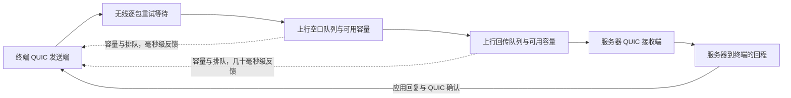
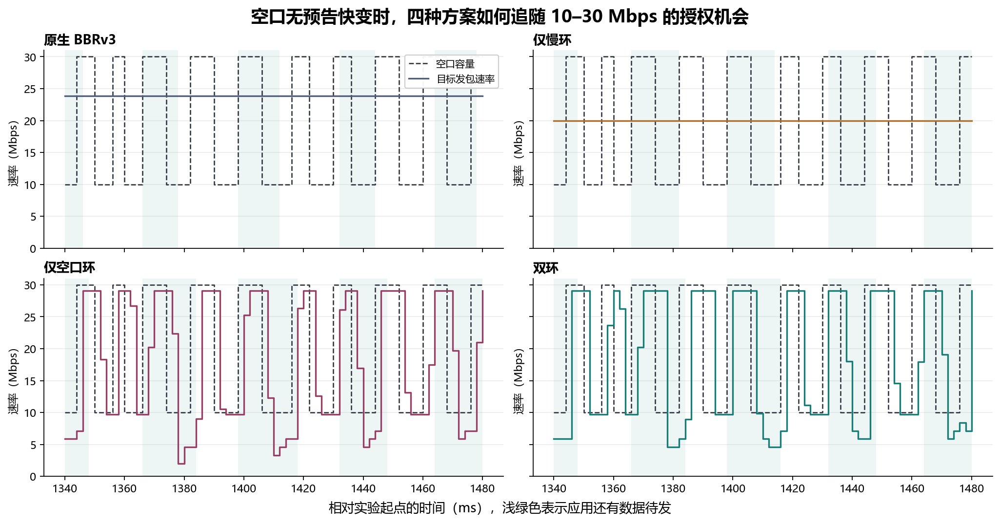
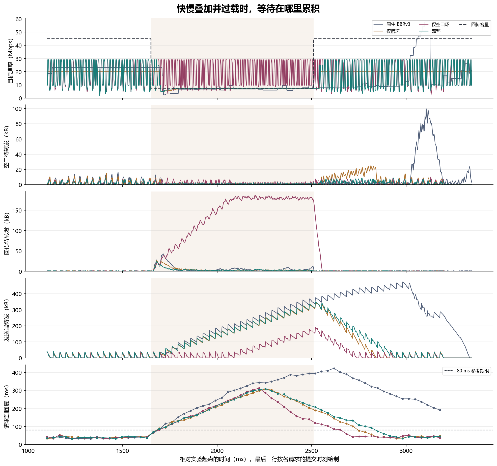
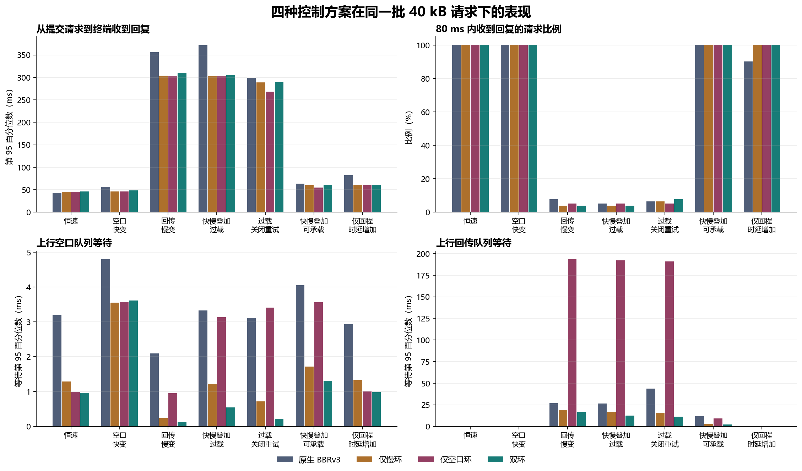
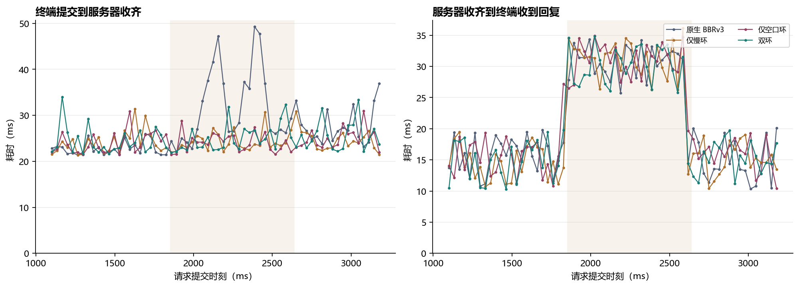

# 空口快速波动与回传拥塞下，QUIC 单环和双环能控制什么

本报告在本地 6G-Testbed 上运行了 **84 轮实际 QUIC 传输，共 5,376 笔 40 kB 请求**。终端每隔 33 ms 提交一笔请求。本文比较原生 BBRv3、仅回传慢环、仅空口快环和双环，并把上行空口排队、上行回传排队、逐包重试等待和下行回复耗时分开记录。

1. **原生 BBRv3 能跟随持续的回传降速，难以逐段跟随 5–9 ms 的空口速率切换。** 上行回传从 45 Mbps 降到 7.5 Mbps 时，原生 BBRv3 的目标发包速率中位数从 23.07 Mbps 降到 7.03 Mbps。空口单独在 10 Mbps 和 30 Mbps 之间切换时，原生 BBRv3 的目标发包速率与空口容量的平均绝对差为 10.24 Mbps。接入空口快反馈后，仅空口环把这个差值降到 7.31 Mbps。
2. **仅空口环可以跟踪空口，仍可把回传队列推到很长。** 空口快变、上行回传降到 7.5 Mbps 时，仅空口环的回传排队第 95 百分位数为 192.16 ms，双环为 12.36 ms。代价是等待的一部分转移到了终端发送端。在同一条件下，只有 3–4 笔请求能在 80 ms 内完成，每组有 78 笔。
3. **双环可以同时控制两段排队，仍需要容量和回复时延预算。** 回传降到仍可承载此业务的 12 Mbps 时，双环把仅空口环的回传排队第 95 百分位数从 9.35 ms 降到 2.12 ms，但请求端到端第 95 百分位数由 54.71 ms 升到 60.87 ms。单独给回复路径增加 15 ms 时延时，四种方案的回复耗时中位数都升到约 30–31 ms。

## 1. 怎样把不同来源的时延分开

- **上行空口**为终端到基站的一段。测试用 10 Mbps 和 30 Mbps 两档模拟扇区扫过时的低速和高速阶段。每对高低阶段等长，每段随机持续 5–9 ms，长期平均容量为 20 Mbps。两档阶跃使响应滞后一目了然，真实空口可能出现连续变化、预测信息或多用户调度。
- **上行回传**为基站到服务器的一段，有独立的先进先出队列。回传容量通常为 45 Mbps，在 1,650–2,510 ms 的低速阶段降到 7.5 Mbps 或 12 Mbps。这里的容量是本流可用的剩余服务速率，实验通过直接调节服务速率形成排队。
- **无线逐包重试等待**在空口入队前发生。每个客户端到服务器的 UDP 数据报先抽签，命中 10% 概率就等待 5 ms。等待结束后重新抽签，可以连续等待。理想模型中，等待至少 5、10、15 ms 的概率分别为 10%、1%、0.1%，额外等待的期望为 0.556 ms。这是对无线侧等待和数据报重排的近似。实验中继没有主动丢弃这些数据报。快慢叠加过载时，双环三轮共收到 7,536 个上行数据报，其中 762 个至少等待一次、78 个至少等待两次、7 个等待三次。
- **回程**为服务器到终端的方向。服务器发出的回复数据报和 QUIC 确认都经过这一路径。每个回程数据报的时延独立从 10–20 ms 均匀抽样。仅回程增时配置在 1,850–2,640 ms 期间把这一范围抬到 25–35 ms，隔离回程变化对业务回复和发送端反馈的影响。每个上行数据报在两段服务之后还有固定的 4 ms 传送时间。

| 网络配置 | 上行空口容量 | 上行回传容量 | 无线重试等待 | 回程数据报时延 |
|---|---|---|---|---|
| 恒速 | 20 Mbps | 45 Mbps | 每次判断有 10% 概率等待 5 ms | 10–20 ms |
| 空口快变 | 10 / 30 Mbps，每段 5–9 ms | 45 Mbps | 同上 | 10–20 ms |
| 回传慢变 | 20 Mbps | 45 → 7.5 → 45 Mbps | 同上 | 10–20 ms |
| 快慢叠加，过载 | 10 / 30 Mbps，每段 5–9 ms | 45 → 7.5 → 45 Mbps | 同上 | 10–20 ms |
| 过载，关闭重试 | 10 / 30 Mbps，每段 5–9 ms | 45 → 7.5 → 45 Mbps | 关闭 | 10–20 ms |
| 快慢叠加，可承载 | 10 / 30 Mbps，每段 5–9 ms | 45 → 12 → 45 Mbps | 每次判断有 10% 概率等待 5 ms | 10–20 ms |
| 仅回程时延增加 | 20 Mbps | 45 Mbps | 同上 | 10–20 → 25–35 → 10–20 ms |

每笔业务用一条可靠的双向 QUIC 流上传 40,000 byte。服务器收到全部数据后立即回复 1 byte。端到端时延从**应用提交请求**开始计时，包含发送端候发、上传和回复。这个网络业务模型保留了小型 AI 请求的上传规模和节奏，服务器端不运行模型推理。每轮在同一连接上进行一次 300 kB 预热，随后提交 64 笔正式请求。应用平均提交速率为 9.70 Mbps，尚未计入 QUIC、UDP 和 IP 开销。实验复用 6G-Testbed 的 Linux 网络命名空间和虚拟网卡，两个上行队列由中继按各自的服务速率运行。每组使用三组配对种子，轮换四种控制方案的执行顺序。各方案共享外生空口时序、回传曲线和随机数种子。由于包数和发送时刻会随控制方案变化，同一随机数不一定作用于同一笔业务或同一数据报。

## 2. 四种方案分别看得到什么

**目标发包速率（pacing rate）**决定发送端安排数据报的快慢。**拥塞窗口（cwnd）**限制发送端允许在途且尚未确认的数据量。**QUIC 确认（ACK）**由接收端返回。发送端可据此计算交付速率和往返时延，但单靠确认无法直接分解空口、回传和回程各自的贡献。

| 方案 | 发送端使用的反馈 | 速率和窗口控制 |
|---|---|---|
| 原生 BBRv3 | QUIC 端到端确认、交付速率、往返时延和恢复事件 | 使用 picoquic 的 BBRv3，保留原生目标发包速率和拥塞窗口调整 |
| 仅回传慢环 | 每 20 ms 读取一次上行回传容量和队列，反馈延迟 20 ms | 回传反馈给出发送上限，空口上限固定为已知长期平均值 20 Mbps |
| 仅空口快环 | 每 1 ms 读取一次空口容量和队列，反馈延迟 1 ms | 空口反馈给出发送上限，缺少回传反馈，回传上限固定为 30 Mbps |
| 双环 | 同时读取上述两路反馈 | 发包目标取两个上限中的较低值 |

三个遥测方案共用 192 KiB 的拥塞窗口和同一套 QUIC 确认、判丢与重传逻辑。采用相同的窗口是为了控制变量，方便看清删掉某一路反馈的影响。原生 BBRv3 是现有协议基线。将它和三个遥测方案比较时，差异也包含窗口控制不同。慢环直接收到中继测得的上行回传容量和队列，因此比依靠端到端确认推断回传状态的方案拥有更直接的输入。

空口环使用过去 1 ms 的平均可用容量作为输入，保留 3% 速率余量。空口待转发量超过 2,560 byte 时，控制器再扣掉预计在 8 ms 内排空的速率。回传慢环使用过去 20 ms 的平均可用容量，保留 5% 速率余量。回传待转发量超过 8,000 byte 时，控制器再扣掉预计在 60 ms 内排空的速率。两个上限均限制在 1–30 Mbps。中继只向控制器发布已经发生的容量和当前排队。快慢叠加过载时，双环从中继取样到端点接收反馈的中位数分别为 1.42 ms 和 20.42 ms。这里的设计借鉴 GBR-CC 将无线调度反馈和端到端控制分开处理的结构。[论文项目页](https://paws.princeton.edu/publications/synchronizing-scheduler-dual-loop-congestion-control-5g-uplink-commodity-devices) · [作者代码](https://github.com/NEMO-LAB-repo/GBR-CC) · [本仓库的 MsQuic 复现](REPORT.gbr-cc-reproduction.zh-CN.md)

## 3. 分别移除一个控制环后，哪一段出了问题

### 3.1 移除空口快环后，发包速率错过毫秒级容量变化

**图 1。** 四个面板对应四种控制方案。横轴是实验时间，纵轴是 Mbps。虚线是当时的空口容量，实线是目标发包速率。浅绿色表示应用仍有数据等待首次发送。在这段 140 ms 的放大图上，原生 BBRv3 维持在约 24 Mbps，仅慢环维持在 20 Mbps，两个带空口快环的方案能在空口切换后抬高或降低目标速率。部分降速台阶低于 10 Mbps，因为控制器还在主动减少空口队列。空口容量与目标速率都按 2 ms 取样绘图。

| 空口快变配置 | 目标速率与空口容量的平均绝对差（Mbps） | 空口排队 P95（ms） | 请求端到端 P95（ms） |
|---|---:|---:|---:|
| 原生 BBRv3 | 10.24 | 4.79 | 56.29 |
| 仅回传慢环 | 10.00 | 3.55 | 45.96 |
| 仅空口快环 | 7.31 | 3.57 | 46.45 |
| 双环 | 7.39 | 3.61 | 48.24 |

有应用数据待发的样本才参与速率差计算。这个指标衡量发送目标对空口容量的跟踪，实际吞吐还受数据是否待发、窗口和队列影响。在空口快变配置中，原生 BBRv3 的已确认上行数据报从发出到确认抵达发送端的中位数为 23.48 ms，覆盖了多个 5–9 ms 容量阶段。空口快反馈提高了速率跟踪精度。在 40 kB、每 33 ms 一笔且回传充足的负载下，四种方案都在 80 ms 内完成全部请求，仅慢环取得最小的请求端到端 P95。当前数据支持用空口快环改善速率匹配，业务是否因此变快还取决于负载和调度。

### 3.2 移除回传慢环后，空口可以发得很快，数据却堆在回传

**图 2。** 横轴为实验时间。浅棕色背景表示上行回传只有 7.5 Mbps 的时段。第一行的虚线表示回传容量，彩色线表示各方案的目标发包速率。第二和第三行分别给出空口和回传中继尚未完成转发的 IP 数据量。第四行给出应用已提交但 QUIC 尚未首次发出的业务数据量。最后一行每个点表示一笔请求，按该请求提交时刻绘制，虚线为 80 ms 参考期限。图中三处数据积压的位置不同，纵轴范围也不同。

仅空口环在回传降速以后继续追随空口，发送目标中位数仍有 18.83 Mbps。数据通过空口后在回传处集中排队，已确认上行包的确认耗时中位数升到 152.45 ms。双环把发送目标中位数收在 7.12 Mbps，回传排队 P95 从 192.16 ms 降到 12.36 ms。与此同时，双环发送端尚未首次发出的数据量 P95 高达 311.19 kB，仅空口环为 153.89 kB。四种方案都出现了很长的端到端时延。持续过载时，减少下游排队会把部分等待移到终端。

原生 BBRv3 在混合过载时也会降速，目标中位数从降速前的 24.10 Mbps 降到过载期的 6.75 Mbps，恢复阶段的中位数只有 9.78 Mbps。图 2 里，回传恢复到 45 Mbps 后，原生 BBRv3 的终端积压仍继续升高，之后才下降。此处的有效结论是原生 BBRv3 能感知持续的回传瓶颈，恢复滞后和业务过载仍会影响端到端时延。

### 3.3 回传能承载平均业务速率时，双环仍会带来队列和时延间的取舍

**图 3。** 左上比较请求端到端 P95，右上比较 80 ms 内收到回复的比例，左下和右下分别比较两个上行阶段的逐包排队 P95。各指标统计网络变化期间提交的请求或进入中继的数据报。恒速和空口快变也取同一个比较时段。快慢叠加并过载时，端到端时延已由回传容量缺口主导。可承载的 12 Mbps 回传条件则显示，在没有持续容量缺口时，降低回传队列仍会改变单流请求的端到端时延。

表中每格依次给出 **请求端到端 P95（ms） / 回传队列等待 P95（ms）**。P95 指样本的第 95 百分位数。任务指标合并三轮样本计算，逐包排队指标先在各轮算 P95 再取三轮中位数。发生包重排或尾包等待时，请求时延和逐包排队不应相加。

| 网络条件 | 原生 BBRv3 | 仅回传慢环 | 仅空口快环 | 双环 |
|---|---:|---:|---:|---:|
| 恒速 | 42.70 / 0.00 | 45.57 / 0.00 | 45.37 / 0.00 | 45.98 / 0.00 |
| 空口快变 | 56.29 / 0.00 | 45.96 / 0.00 | 46.45 / 0.00 | 48.24 / 0.00 |
| 回传慢变至 7.5 Mbps | 355.67 / 26.95 | 303.80 / 18.96 | 301.90 / 193.31 | 310.19 / 16.74 |
| 快慢叠加，过载 | 371.89 / 26.39 | 302.88 / 17.17 | 302.23 / 192.16 | 304.42 / 12.36 |
| 过载，关闭重试 | 299.48 / 43.60 | 289.15 / 15.89 | 268.02 / 190.88 | 289.67 / 11.37 |
| 快慢叠加，可承载 | 63.59 / 11.88 | 60.54 / 2.91 | 54.71 / 9.35 | 60.87 / 2.12 |
| 仅回程时延增加 | 82.09 / 0.00 | 60.75 / 0.00 | 60.31 / 0.00 | 60.94 / 0.00 |

回传降到 12 Mbps 时，四种方案都达到 80 ms 参考期限。仅空口环允许短时把数据推入回传，获得最低的单流请求 P95。双环收紧了发包节奏，同时取得最低的空口和回传排队 P95，分别为 1.31 ms 和 2.12 ms。这项对照给出了双环的实际收益及代价。降低共享回传队列可能惠及同一路径上的其他流量，多流是否受益仍需要独立验证。

关闭无线重试后，混合过载条件下仅空口环的回传排队 P95 仍有 190.88 ms，回传排队仍然很长。原生 BBRv3 的请求端到端 P95 则从 371.89 ms 降到 299.48 ms。当重试等待变化时，数据报乱序、确认和发送时刻也会变化。两次测试的 P95 差值反映整条链路和控制器一起变化后的结果，单个数据报的重试时间仍以逐包记录为准。

## 4. 回程变慢时，发包侧能够改变多少

**图 4。** 左图从终端提交计时到服务器收齐 40 kB，右图从服务器收齐计时到终端收到回复。每个点对应一笔请求，横轴为提交时刻。浅棕色背景标出回程额外增加 15 ms 的时段，右图个别点会因服务器收齐时间跨过边界而提前或延后进入高时延区。

四种方案的回传队列等待 P95 均为 0 ms。原生 BBRv3 的回复耗时中位数从 14.47 ms 升到 30.38 ms，另外三个方案在回程变慢时的中位数也在 30.62–30.74 ms。原生 BBRv3 的上行数据报确认耗时中位数从 23.35 ms 升到 37.17 ms，同时目标发包速率中位数从 23.13 Mbps 降到 13.81 Mbps。其上传耗时 P95 从 34.25 ms 升到 50.28 ms，72 笔请求中有 65 笔达到 80 ms 参考期限。双环 72 笔全部达标，上传耗时 P95 为 30.57 ms。这个对照表明，回程较慢可以经由确认路径影响上传，也直接增加回复耗时。空口和回传的速率控制可以缓解前一种影响，后一种影响需要回程本身留出时延预算。

## 5. 单环无法保证什么，双环能提供什么

**只有延迟的端到端反馈时，无法同时保证空口高速阶段的利用率和低速阶段的队列上界。** 设终端有数据待发，空口队列初始为空，未来 5 ms 的空口容量可能为 10 Mbps 或 30 Mbps，两种情况下发送端收到的历史信息相同。测试中新的上行数据报即使无排队也至少要经过 4 ms 上行传送和 10 ms 回程，当前 5 ms 阶段结束前无法靠它获得确认。按流体近似，高速状态要用到 90% 的容量，5 ms 内必须向空口提供至少 16.875 kB。低速状态在 5 ms 内只服务 6.250 kB，如果要求阶段结束时积压不超过 1.280 kB，就至多能提供 7.530 kB。控制器在两种情况下只能依据相同信息决定供给量，无法同时满足两个条件。空口授权或提前预测可以打破这两个状态在发送端的不可区分性。

**只有空口快反馈时，无法根据空口容量区分远端回传的不同状态。** 如果空口的授权和排队一样，45 Mbps 和 7.5 Mbps 的回传对该控制环暂时是一样的。实验中的仅空口环因此继续按无线能力发送。给它加一个始终生效的 7.5 Mbps 保守上限可以限制进入回传的速率，但会让它在回传正常时也低于本实验 9.70 Mbps 的平均业务供给。回传状态需要反馈给控制器，或由网络侧另行分配和保证。

**持续过载和回程物理时延需要单独的预算。** 回传容量为 7.5 Mbps 的 860 ms 内，最多能跨过回传 806.25 kB。期间提交的 26 笔请求合计 1,040 kB，上行回传至少缺 233.75 kB 的服务量。即使只看截止期限落在回传恢复前的 24 笔请求，960 kB 仍超过 806.25 kB。在忽略协议开销、旧任务、空口和回复耗时的有利假设下，这 24 笔也至少有 4 笔无法在 80 ms 内回复。若要在这一速率下长期支持同一种业务，仅按应用字节计算，请求间隔至少为 42.67 ms，或在 33 ms 间隔内将每笔上传压到 30.94 kB 以下。实际配置还要给包头、重传和短时波动留余量。

对后续联合设计，可以让毫秒级空口授权控制短时发包节奏，让较慢的回传队列或剩余服务能力限制平均注入速率，并由应用根据截止时间选择是否接纳请求或缩小上传。本文验证的是不同信号和不同时间尺度的互补性。一个控制器也可以融合两路信号并满足相同的因果约束。是否能给出端到端保证，最终取决于网络能提供的最小服务、反馈的新鲜度、应用供给和回程时延上界。

## 数据与复现

- [逐请求的提交、上传和回复时延](results/cross-layer-loops/tasks.csv) · [按网络条件和阶段聚合](results/cross-layer-loops/summary.csv) · [84 轮的逐轮指标](results/cross-layer-loops/runs.csv) · [2 ms 时序中的目标速率、拥塞窗口、在途数据和两段队列](results/cross-layer-loops/timeline.csv.gz)
- [原生 BBRv3 原始归档](results/cross-layer-loops/bbr/raw-evidence.tar.xz) · [仅回传慢环原始归档](results/cross-layer-loops/outer/raw-evidence.tar.xz) · [仅空口快环原始归档](results/cross-layer-loops/radio/raw-evidence.tar.xz) · [双环原始归档](results/cross-layer-loops/dual/raw-evidence.tar.xz)
- [构建、复跑和原始文件说明](studies/cross_layer/README.md) · [本次锁定的 picoquic BBRv3 源码](https://github.com/private-octopus/picoquic/blob/37bb5d28aaea417649a6d4facc15f54de7d55829/picoquic/bbr.c)
