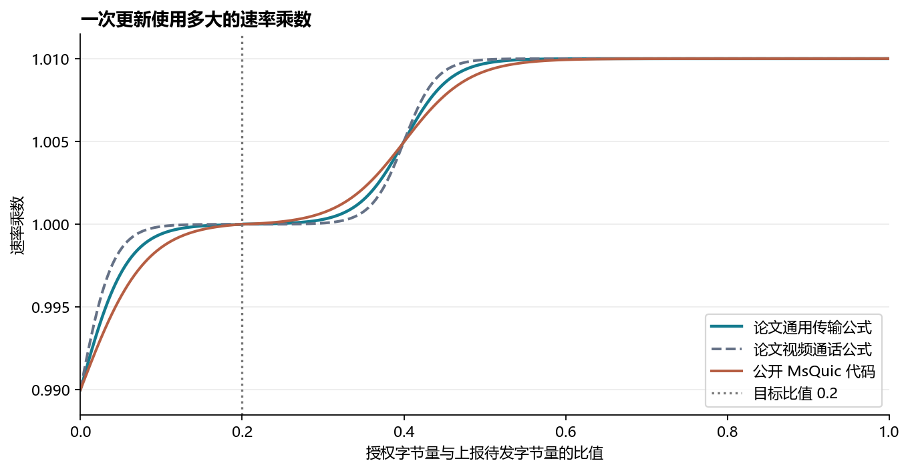
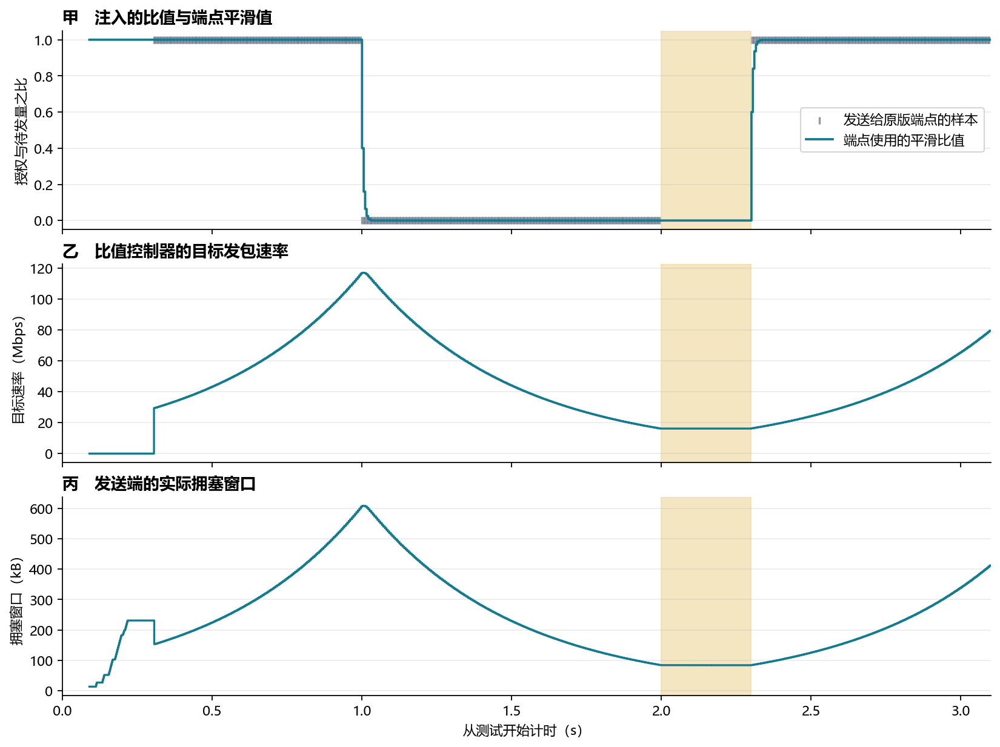
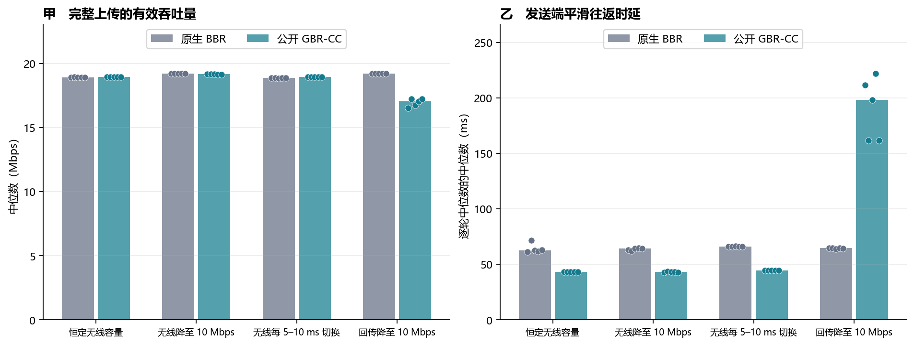
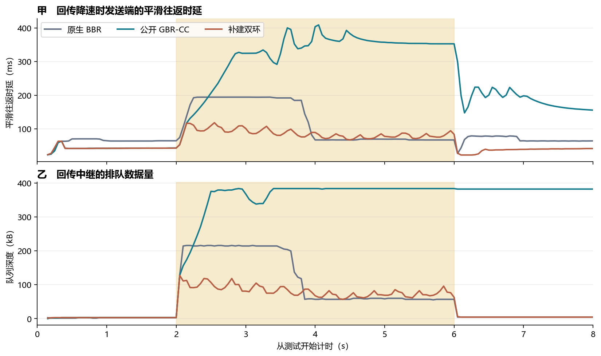

# GBR-CC 复现报告：用无线授权反馈调节 QUIC 上行

本次复现使用用户指定的 GBR-CC 仓库。GBR-CC 是 Wu 等人在 SIGCOMM 2026 提出的双环拥塞控制方案。它把上行授权量除以终端在缓冲区状态报告（BSR）中上报的待发量。这里的 GBR 指这个比值。复现实验在 6G-Testbed 中运行作者公开的 MsQuic 端点，用可重复的授权信号驱动真实 QUIC 上传，并单独验证论文描述的外环切换结构。[作者仓库与固定提交](https://github.com/NEMO-LAB-repo/GBR-CC/tree/53cb31a862ca75bd4ee4a500db4161a9b739348b) · [论文全文](https://qiangwu769.github.io/papers/sigcomm26-gbr-cc.pdf) · [本地复现步骤](studies/gbr_cc/README.md)

## 1. 公开代码和论文描述对应到哪里？

论文的无线内环根据授权比值调节发送速率。比值低表示上报的待发数据多于当前授权可承载的量。式（2）把上一次的速率乘以一个接近 1 的系数，经验目标比值是 0.2，单次调整约为 ±1%。论文的端到端外环在比值持续高于目标约 100 ms、同时检测到端到端时延过载时接管，并降低发送速率。论文使用 Google 拥塞控制（GCC）的时延趋势检测处理回传等其他瓶颈。[论文第 4.1 节](https://qiangwu769.github.io/papers/sigcomm26-gbr-cc.pdf#page=7)

公开端点在本地接收 Unix 数据报。数据报载荷是一个小端序双精度浮点数。发送端对原始比值先限制到 1，再用 `平滑比值 = 0.6 × 当前比值 + 0.4 × 上次平滑比值` 更新。控制器在处理 QUIC 确认消息时读取最新比值，用样本序号避免重复乘一次速率系数。公开实现的乘数曲线采用陡峭度 25 并做区间归一化，论文式（2）采用 35，视频通话版本采用 50。公开端点还把拥塞窗口的计算基准设为 `2 × 目标发包字节速率 × 基础往返时延`，并在发包路径应用窗口下限。[公开信号接收代码](https://github.com/NEMO-LAB-repo/GBR-CC/blob/53cb31a862ca75bd4ee4a500db4161a9b739348b/sender/src/perf/lib/cellular_ratio.c#L109-L148) · [速率系数和窗口计算](https://github.com/NEMO-LAB-repo/GBR-CC/blob/53cb31a862ca75bd4ee4a500db4161a9b739348b/sender/src/core/bbr.c#L170-L306)

图 1 横轴是授权字节量与上报待发字节量的比值，纵轴是一次更新乘到旧速率上的系数。纵轴大于 1 时加速，小于 1 时减速。竖虚线标出目标比值 0.2。图线由源码和论文公式计算，展示的是控制规则。

公开代码计算了确认时序的时延趋势，但当前提交的速率更新分支由新比值序号和乘数直接驱动。源码里没有发现论文描述的“时延过载且比值持续高于目标时转给外环”的接管分支。本次把作者公开版本和本地补建双环分别编译并测试。[公开趋势计算](https://github.com/NEMO-LAB-repo/GBR-CC/blob/53cb31a862ca75bd4ee4a500db4161a9b739348b/sender/src/core/bbr.c#L1408-L1447) · [公开速率更新分支](https://github.com/NEMO-LAB-repo/GBR-CC/blob/53cb31a862ca75bd4ee4a500db4161a9b739348b/sender/src/core/bbr.c#L1554-L1573)

## 2. Testbed 怎样产生授权信号并验证端点？

发送端和接收端均来自固定提交 `53cb31a`，OpenSSL 使用作者配套仓库锁定的提交 `3638fd4`。接收端在本机编译时需要把几类未使用变量、未使用参数和字符串截断警告从编译错误降为警告，接收端源码和发送端公开控制代码均用原版。测试使用同一台 WSL2 主机的三个隔离网络命名空间，两方向分别施加 10 ms 的基础传播时延。每轮只有一个上传流。[构建脚本](studies/gbr_cc/build.sh) · [正式实验环境与二进制哈希](results/gbr-cc-reproduction/formal-environment.json)

前向中继有两段独立队列，分别模拟无线接入和回传。每 5 ms 记录一次无线队列积压。在该窗口结束后，用该窗口配置的服务字节量除以窗口开始时的积压字节量，并把比值发送给原版 MsQuic。积压为空时，注入值约定为 1。无线授权只根据第一段队列生成，第二段可以独立降速。这个做法保留了“发送量影响下次上报”和“回传拥塞不会直接出现在无线授权里”这两项关系。真实基站的授权量还受调度策略、无线重传和其他终端竞争影响，本地授权量是根据配置容量构造的。[中继和授权生成代码](studies/gbr_cc/relay.py)

基线使用作者同一份发送端的 `-cc:bbr -cellular:0`。它接收相同格式的遥测，但由 MsQuic 的原生 BBR 调节发送。公开 GBR-CC 用 `-cellular:1`。每种正式配置轮换执行顺序，使用同样的容量轨迹。比值注入从测试开始约 300 ms 后启动，让两组先进行连接建立和初始估计。正式实验每轮发送 20 MB，以应用层确认字节数和完成时间计算有效吞吐量。往返时延统计取发送端确认日志中的平滑往返时延，同一确认时刻只取一次。各表以五轮中位数汇总。总计 **72 轮均完成**，其中公开程序对照 40 轮、三种控制器的外环对照 30 轮，另有两轮信号测试。[正式逐轮数据](results/gbr-cc-reproduction/rounds.csv)

### 授权信号是否确实改变了速率和窗口？

图 2 的横轴为实验计时。甲图的灰色刻度是注入的比值样本，青线是端点的平滑比值。乙图是比值控制器的目标发包速率。丙图是端点的拥塞窗口，即允许同时在途的未确认字节。黄色区间暂停注入 300 ms。各端点采样的横坐标通过第一份无线入队记录对齐连接起点，用于观察变化，样本是否被处理则直接以序号核对。

固定信号试验向公开 GBR-CC 发送了 **1,410 个**样本。端点确认日志记录了 **1,405 次**不同样本序号的调速更新。用源码公式重算后，单步目标速率误差的第 99 百分位数为 **0.84 B/s**，窗口公式误差最大 **1 B**。在 1 s 左右把注入值从 1 改为 0，目标速率从约 **114.23 Mbps** 逐步降到 **16.53 Mbps**。这组信号是为验证控制逻辑而设，目标速率可以超过配置的 30 Mbps 容量。[样本与公式复算](results/gbr-cc-reproduction/signal-validation.json) · [原生确认记录](results/gbr-cc-reproduction/signal-ack.csv.gz)

在停止注入后的第 **2.08–2.27 s**，端点仍处理了 **225 次**确认，始终使用编号 **339** 的旧样本，目标速率保持 **16.20 Mbps**。无线中继在该区间仍收到 **446 个 IP 数据报，共 669.00 kB**，其中可以包含重传。论文第 4.1.3 节描述的是样本超过 10 ms 后暂停发送。公开版本在这次停更注入下继续发包，因此不能把这一实现行为视为论文的切换暂停策略已复现。[注入记录](results/gbr-cc-reproduction/signal-grants.csv) · [代表轮次原始记录](results/gbr-cc-reproduction/representative-traces.tar.xz)

## 3. 原版程序能复现多少吞吐量和时延收益？

图 3 横轴列出四种网络条件。甲图的纵轴是每轮 20 MB 完整上传的有效吞吐量。乙图的纵轴是每轮发送端平滑往返时延的中位数。每个点对应一轮实测，柱高是五轮结果的中位数。时延和吞吐量使用各自的纵轴。

| 网络条件 | 原生 BBR → 公开 GBR-CC 有效吞吐量（Mbps） | 原生 BBR → 公开 GBR-CC 平滑往返时延中位数（ms） |
|---|---:|---:|
| 无线容量恒定 20 Mbps | 18.93 → 18.97 | 62.80 → 43.28 |
| 无线容量在 30 和 10 Mbps 之间每 5–10 ms 切换 | 18.88 → 18.97 | 65.93 → 44.38 |
| 无线容量从 30 降到 10 Mbps，4 s 后恢复 | 19.23 → 19.17 | 64.23 → 43.14 |
| 无线容量恒定 30 Mbps，回传从 30 降到 10 Mbps，4 s 后恢复 | 19.22 → 17.06 | 64.77 → 198.21 |

三种无线受限条件都复现了**在吞吐量接近时减少排队时延**的方向。平滑往返时延中位数降低约 **31–33%**，吞吐量差在 **0.5%** 以内。以 5–10 ms 无线容量切换为例，测试第 2.2–5.8 s 的无线队列第 95 百分位数从 **132.03 kB 降到 66.08 kB**。同样的公开算法在回传降速时变差，回传队列第 95 百分位数从 **216.00 kB 增到 384.00 kB**，并出现实际中继丢包。[完整对照汇总](results/gbr-cc-reproduction/summary.csv)

论文报告相对 BBR 的平均吞吐量提高约 5%，往返时延中位数减半。论文使用美国商用 LTE 和 5G 的静止及移动测试，上传量分别为 LTE 的 200 MB 和 5G 的 1 GB。本地测试用了 20 MB 和可控容量轨迹，得到相同的无线受限收益方向和不同的幅度。[论文第 5.1 节和图 11](https://qiangwu769.github.io/papers/sigcomm26-gbr-cc.pdf#page=9)

## 4. 补建的外环能否处理回传瓶颈？

本地补建版本复用公开实现的无线内环。在比值高于 0.2 持续至少 100 ms 时，使用公开端点已有的确认时序趋势判断时延是否仍在增长。如果趋势斜率高于 0.05，平滑往返时延比最小往返时延高至少 10 ms，且条件持续 15 ms，则进入外环并把目标速率乘以 0.85。外环每 100 ms 最多再降速一次。在过载解除持续 100 ms 或无线侧余量条件消失后返回内环。论文用单向时延梯度和 GCC 的自适应阈值。本地补建用确认时序和固定阈值验证接管结构，结果应按这一实现解释。[补建控制代码](studies/gbr_cc/outer.h)

图 4 横轴从每轮测试起点开始计时。黄色区间内回传服务速率从 30 Mbps 降为 10 Mbps，无线服务速率维持 30 Mbps。甲图的纵轴是发送端平滑往返时延，乙图是回传中继队列深度。每个时刻的曲线是五轮中位数，三种算法由不同颜色标出。

| 回传降速条件 | 原生 BBR | 公开 GBR-CC | 补建双环 |
|---|---:|---:|---:|
| 全轮有效吞吐量（Mbps） | 19.22 | 17.25 | 19.22 |
| 全轮平滑往返时延中位数（ms） | 64.75 | 161.85 | 42.17 |
| 第 2.2–5.8 s 的平滑往返时延第 95 百分位数（ms） | 194.44 | 392.90 | 109.88 |
| 第 2.2–5.8 s 的回传队列第 95 百分位数（kB） | 216.00 | 384.00 | 109.50 |
| 每轮回传中继丢包数的中位数 | 0 | 5,237 | 0 |

回传在 **2.000 s** 降速。补建双环在五轮中首次接管的时刻为 **2.048–2.049 s**，相对降速约 **48–49 ms**。无线侧比值在此前已经满足连续高于目标的条件，因此不需要从降速发生时重新等待 100 ms。相比公开 GBR-CC，补建双环把回传队列第 95 百分位数从 **384.00 kB 降到 109.50 kB**，回传丢包从每轮中位数 **5,237 个降到 0**，完整上传的有效吞吐量恢复到原生 BBR 的水平。[逐次外环日志](results/gbr-cc-reproduction/outer-actions.csv) · [各轮指标](results/gbr-cc-reproduction/rounds.csv)

无线降速对照的回传容量为 100 Mbps。五轮在 10 Mbps 无线低速阶段都没有触发外环，但无线容量恢复后，每轮都在约 **6.49–6.51 s** 触发了一次。公开 GBR-CC 与补建双环在该对照中的吞吐量中位数都是约 **19.16 Mbps**，无线队列第 95 百分位数都是 **94.50 kB**。这个结果给出了补建规则的识别边界。无线恢复产生的时延趋势也可能满足固定阈值，外环的接管不能单独证明回传存在拥塞。

## 5. 复现边界和数据

本次构建并运行了作者仓库中的两端程序，复算了授权比值对速率和窗口的作用，并用实际 QUIC 上传复现了无线受限时减少排队的趋势。当前本地环境使用软件模拟链路，缺少可读取 DIAG 的相应商用终端、论文所用运营商环境和论文逐轮原始测量数据。因此无法重新测得论文中 LTE/5G 的具体数值，也无法核验 WebRTC 播放时延、卡顿率与多终端资源分配结果。本次双环数字是独立复建的 Testbed 测量结果。

- [构建、运行及分析步骤](studies/gbr_cc/README.md)
- [每组中位数](results/gbr-cc-reproduction/summary.csv) · [逐轮结果](results/gbr-cc-reproduction/rounds.csv) · [各轮 50 ms 时序](results/gbr-cc-reproduction/timeline.csv.gz)
- [外环进入、减速与退出事件](results/gbr-cc-reproduction/outer-actions.csv) · [代表轮次原始日志](results/gbr-cc-reproduction/representative-traces.tar.xz)
