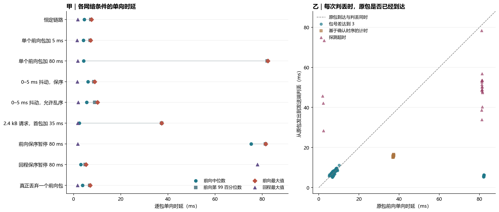
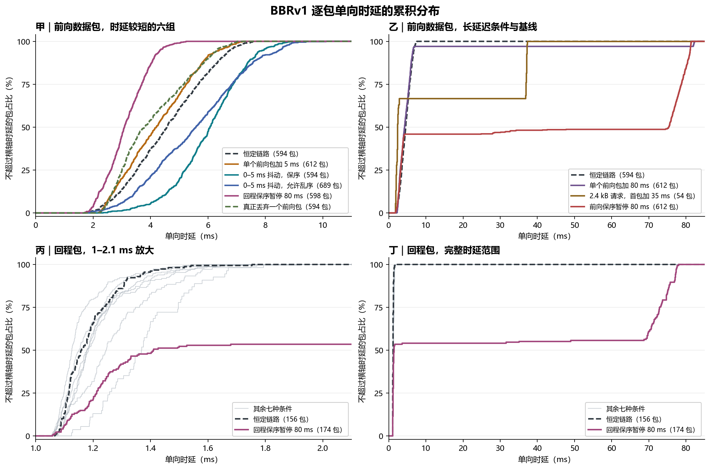
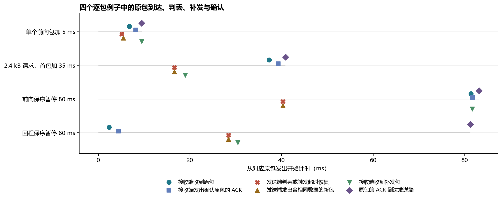

# 时延对 QUIC 判丢与重传的影响：理论与逐包实测

**时延过大确实会让发送端补发最终能够到达的原包。** 这种情况有三种机制。后发包的确认可以越过一个迟到包并触发包号判丢。前向路径保序暂停可以让发送端等不到确认，触发探测超时。回程暂停也能触发超时，即使接收端早已收到原包。本报告在第三版所用的 picoquic BBRv1 上单独验证这三种机制，并用真实丢弃一个包的实验作对照。

27 轮正式补测共发送 **162 笔测量任务**。双端日志配对得到 **16,316 个 QUIC 包**，包括握手、控制和应用数据。正式任务的前向数据包共有 **4,977 个**，包括补发，最终观察到 **4,959 个**抵达。余下 **18 个**全部是中继在真丢包对照中明确丢弃的包。对正式任务前向数据，发送端共记录 **192 次判丢或超时恢复**，其中 **174 个原包最终仍到达**，有 **186 次**能在后续发包中找到与原包重叠的流数据。数字按包或事件计，业务是否按时完成单独统计。[逐包表](results/pacing-loss/packets.csv.gz) · [判丢与补发表](results/pacing-loss/loss-events.csv) · [验证结果](results/pacing-loss/validation.json)

## 接收端多久没收到包才认为丢包？

本实验的接收端使用**可靠 QUIC 流**，没有设置按固定时限释放或丢弃数据的抖动缓冲（jitter buffer）。UDP 接收缓冲按字节计，用于暂存尚未读取的报文。picoquic 根据每个流的数据偏移重组数据，缓存乱序片段，缺口补齐后再按序交给应用。接收端用 ACK 报告自己收到的包号范围。应用在完整流结束（FIN）后记录上传完成，并回送一个字节作为完成回执。**20 ms 是业务完成时限**，超过它只会改变统计结果，可靠流仍会尝试交付。[实验端点](v3/endpoint.c) · [QUIC 流](https://www.rfc-editor.org/rfc/rfc9000.html#section-2) · [ACK 帧](https://www.rfc-editor.org/rfc/rfc9000.html#section-19.3)

数据包由**发送端**判断是否需要恢复。发送端既要等待原包穿过前向路径，也要等接收端生成 ACK、等 ACK 穿过回程。某包发出到其第一份 ACK 返回的耗时，包含这三段时间。接收端看到一段时间内没有包到达，无法仅凭静默区分发送端没有发包、链路暂时排队或原包确实丢失。

## 当前 picoquic 按什么规则判断？

下表适用于连接建立后的普通数据传输。`P` 表示尚未确认的原包，`A` 表示发送端见到的最大已确认包号。**平滑 RTT** 是对往返时间的加权估计，**RTT 波动值**表示样本偏离历史值的程度。**最大 ACK 延迟**是端点通告的接收端等待上限，本次连接的值为 10 ms。它和 ACK 实际回程时延分别计量。平滑 RTT 的详细计算见[发包节奏报告](REPORT.pacing.zh-CN.md)。

| 触发方式 | 当前 picoquic 的判断 |
|---|---|
| **包号阈值** | `A − P ≥ 3` 时，发送端立即认定仍未确认的较早包可能丢失。只要确认了足够靠后的包号即可，期间有多少个包实际到达另由 ACK 范围给出。 |
| **RACK 时间阈值** | `A − P` 为 1 或 2 时，发送端计算下面两个候选时间，取较早的一项。超过该时间后可判丢。RACK 是利用后发包确认时序推断前面包是否迟到的算法。 |
| **探测超时（PTO）** | 后续确认没有推进时，通常从路径上待确认队列尾包的发送时刻起，等待当前有效超时。计时到期后发送端启动探测或补发。本版本会在该路径中记录被取来补发的旧包，并可用一个新包发送仍需交付的流字节。连续超时会退避，代码也为发送队列持续追加小包设了备用判断。 |

```text
RTT 统计刷新时的基础计时值 = 平滑 RTT + 3 × RTT 波动值 + 对端最大 ACK 延迟
RACK 候选 1 = 原包发送时刻 + 基础计时值
RACK 候选 2 = 最高包号 ACK 到达时刻 + min(平滑 RTT / 4, 5 ms)
              − (被该 ACK 确认的参考包发送时刻 − 原包发送时刻)
              + 对端最大 ACK 延迟
RACK 判丢期限 = min(候选 1, 候选 2)
```

上述是本次**固定 picoquic 提交**的逻辑。RFC 9002 描述的通用时间阈值使用 `9/8 × max(平滑 RTT, 最新 RTT)` 并设置最小计时粒度，探测超时公式使用 `max(4 × RTT 波动值, 计时粒度)`。本实验使用源码中的 RACK 分支和 `3 × RTT 波动值`，表里的计时值来自实际发送端，不用 RFC 公式代算。[本次判丢实现](https://github.com/private-octopus/picoquic/blob/37bb5d28aaea417649a6d4facc15f54de7d55829/picoquic/loss_recovery.c#L545-L650) · [计时实现](https://github.com/private-octopus/picoquic/blob/37bb5d28aaea417649a6d4facc15f54de7d55829/picoquic/timing.c) · [RFC 9002 §6](https://www.rfc-editor.org/rfc/rfc9002.html#section-6)

## 怎样测到每个包的单向时延和真实到达情况？

实验在同一台 WSL2 主机的三个隔离网络命名空间运行。6G-Testbed 在中继的两个出口各施加 1 ms 基础传播时延。中继以 20 Mbps 的 IP 数据服务预算转发前向数据，并可按时间对加密 UDP 数据报附加延迟、暂停释放或丢弃。每轮先用一笔 300 kB 请求预热连接，再每隔 350 ms 发送一笔请求，共六笔测量任务。每个条件运行三轮。常规请求为 40 kB，专门隔离 RACK 分支的一组使用 2.4 kB 的两包请求。补测统计传输和完成回执，不运行模型推理。

同一连接的客户端发送与服务器接收共用单调时钟。端点用完整 qlog 记录发送和接收事件，按方向、包号空间和包号配对。中继用加密 UDP 内容的 SHA-256 哈希标记原始数据报和明确丢弃的记录。双端虚拟网卡另用 `tcpdump` 抓包，以加密数据的前缀校验数据报跨中继后的身份。端点日志和网卡抓包对所有配对包的到达结果一致。二者测得的单向时延差的绝对值中位数为 **0.051 ms**，P99 为 **0.314 ms**，最大为 **1.170 ms**。端点时间包含用户态处理，网卡时间位于虚拟链路的抓包点，报告以端点时间计算判丢先后，并附上网卡测量作为校验。[原始双端证据](results/pacing-loss/raw-evidence.tar.xz) · [复现与字段说明](studies/pacing_loss/README.md)

旧 V3 端点使用了 picoquic 的默认短日志模式，每个端点的 qlog 默认记录到约 100 个发送包。旧实验的端点样本和中继逐包事件覆盖其相应观察区间，本报告的全轮逐包配对使用开启完整日志后重新采集的数据。预跑用于检查干预和采集，表中只统计最终同时有完整 qlog 和双端网卡抓包的 27 轮。

## 单向时延有多大，和超时值差多少？

前向单向时延的 P50、P95、P99 分别是已抵达包的第 50、第 95 和第 99 百分位数。真丢弃的原包计入发送包数，缺少到达时刻，因此没有单向时延。表中时间均为 ms，P50 表示中位数。

### 三个计时指标的定义

设 `t首发` 是某笔请求中第一个携带该请求数据的客户端 QUIC 包的发送时刻，`t原包` 是发生判丢事件的那个原包的发送时刻，`t判丢` 是发送端实际记录该判丢或超时恢复事件的时刻。三个时间点都来自发送端的单调时钟。`T有效(t)` 表示在时刻 `t` 读取到的发送路径探测超时**时长**。

| 表中指标 | 单个样本的计算公式 | 按网络条件如何汇总 |
|---|---|---|
| **请求首包有效超时值 P50** | `T有效(t首发)`。发送端发出请求的第一个数据包时，记录当时的探测超时时长。这个数值反映发送端当时掌握的路径状态。 | 每笔请求取一个样本，再对 18 笔请求取中位数。对应逐包表的 `effective_timer_at_send_ms` 和汇总表的 `first_timer_p50`。 |
| **判丢时有效超时值 P50** | `T有效(t判丢)`。发送端作出判丢或超时恢复决定时，读取原包发送路径当时的探测超时时长。包号阈值、RACK 时间阈值和探测超时三类事件都记录该值。 | 对实际发生的前向数据包判丢或超时恢复事件取中位数。对应 `effective_timer_at_loss_ms` 和 `loss_timer_p50`。 |
| **判丢年龄 P50** | `(t判丢 − t原包) / 1000`。日志的时间戳以 µs 记录，相减后除以 1,000 得到 ms。这个值表示原包发出后，发送端实际等了多久才作出判丢或超时恢复决定。 | 对同一批前向事件的实际等待时长取中位数。对应 `age_at_loss_ms` 和 `loss_age_p50`。 |

无判丢事件的条件在后两列显示为「—」。首包列按请求取样，后两列按事件取样。一次请求可能没有判丢，也可能有多个包触发判丢。比较同一个包发出时和判丢时的计时器变化，需要在逐包记录中配对这两个值。[计时采集代码](studies/pacing_loss/build.py) · [汇总代码](studies/pacing_loss/analyze.py)

**有效超时时长怎样计算？** picoquic 刷新 RTT 统计时，把基础计时值更新为 `平滑 RTT + 3 × RTT 波动值 + 对端最大 ACK 延迟`。如果两次刷新之间出现了超过当前基础计时值的 RTT 估计，代码可以先将基础计时值抬高到该估计。随后，picoquic 从当时保存的基础计时值计算有效时长。令 `n` 为路径当前的超时退避计数。在连接已建立、`n` 为 0、1 或 2 且未触及源码上限时，公式为 `T有效 = 基础计时值 × 2ⁿ`。本表的首包样本和 191 次判丢事件取到未退避的计时值。另一次回程暂停事件的退避计数为 1，有效时长由 **22.534 ms** 加倍到 **45.068 ms**。[基础计时值更新](https://github.com/private-octopus/picoquic/blob/37bb5d28aaea417649a6d4facc15f54de7d55829/picoquic/timing.c#L193-L265) · [退避与计时上限](https://github.com/private-octopus/picoquic/blob/37bb5d28aaea417649a6d4facc15f54de7d55829/picoquic/timing.c#L39-L82) · [逐次判丢记录](results/pacing-loss/loss-events.csv)

| 网络条件 | 前向数据包发出 / 到达 | 前向单向时延 P50 / P95 / P99 / 最大 | 回程单向时延最大 | 请求首包有效超时值 P50 | 判丢时有效超时值 P50 | 判丢年龄 P50 |
|---|---:|---:|---:|---:|---:|---:|
| 恒定链路 | 594 / 594 | 4.57 / 6.77 / 7.27 / 7.58 | 1.75 | 21.48 | — | — |
| 单个前向包额外延迟 5 ms | 612 / 612 | 4.20 / 6.39 / 7.00 / 7.22 | 1.54 | 20.36 | 19.85 | 5.83 |
| 单个前向包额外延迟 80 ms | 612 / 612 | 4.28 / 6.55 / 82.14 / 82.39 | 1.74 | 106.56 | 96.55 | 5.98 |
| 前向 0–5 ms 抖动，保序 | 594 / 594 | 6.07 / 7.95 / 8.60 / 9.00 | 1.58 | 20.97 | — | — |
| 前向 0–5 ms 抖动，允许乱序 | 689 / 689 | 5.58 / 8.49 / 8.92 / 10.12 | 1.92 | 20.31 | 19.43 | 7.58 |
| 2.4 kB 请求，首包额外延迟 35 ms | 54 / 54 | 2.42 / 37.21 / 37.30 / 37.33 | 1.79 | 28.65 | 27.91 | 15.69 |
| 前向保序暂停 80 ms | 612 / 612 | 75.32 / 81.12 / 81.33 / 81.48 | 1.77 | 43.56 | 43.56 | 50.20 |
| 回程保序暂停 80 ms | 598 / 598 | 3.09 / 4.33 / 4.92 / 5.24 | 77.98 | 142.86 | 37.74 | 43.89 |
| 真正丢弃一个前向包 | 612 / 594 | 3.80 / 6.33 / 6.83 / 7.01 | 1.72 | 20.68 | 20.13 | 5.83 |

**为什么判丢年龄可以比判丢时有效超时值短，也可以更长？** 包号阈值和 RACK 可以先触发判丢。走常规探测超时分支时，`探测超时的到期时刻 = 待确认队列尾包的发送时刻 + 有效超时时长`。判丢年龄从发生判丢的原包发出时算起。以表下方时间线中的前向暂停案例为例，队列尾包比原包晚发 **6.007 ms**。有效超时时长是 **34.242 ms**，因此原包对应的期限是发出后 **40.249 ms**。发送端在期限后 **0.022 ms** 记录恢复事件，判丢年龄为 **40.271 ms**。逐包表的 `deadline_age_ms` 记录的是「源码计算的期限 − 原包发送时刻」，可以用它区分计时起点造成的差异和到期后的处理时间。[探测超时实现](https://github.com/private-octopus/picoquic/blob/37bb5d28aaea417649a6d4facc15f54de7d55829/picoquic/loss_recovery.c#L567-L613) · [该包的时间线数据](results/pacing-loss/examples.csv)

只给单个包加延迟时，后面的包仍可通过。随机抖动组给测量时段里的每个前向数据报抽取 0–5 ms 额外延迟。保序组让每个包的释放时刻至少等于前一个包，改变了实际的时延分布。两组使用相同的随机种子和配置范围，产生重传后，进入中继的数据报和使用的随机样本也会不同。前向或回程暂停组在指定窗口把该方向的数据报保序延至窗口结束再释放，模拟一次延迟停顿。[逐包统计汇总](results/pacing-loss/summary.csv) · [网络干预实现](studies/pacing_loss/relay.py)



图 1 甲图的横轴为逐包单向时延，纵轴为网络条件。圆点、方块、菱形分别表示前向中位数、P99、最大值，三角表示回程最大值。灰线连接前向中位数和最大值。乙图每个点表示一个发送端判丢、最终收到原包的事件。横坐标为原包抵达接收端的耗时，纵坐标为从原包发出到发送端判丢或启动超时恢复的耗时。点在斜线下方时，判丢发生在原包到达之前。点在斜线上方时，原包先到接收端。三种标记对应包号阈值、RACK 时间阈值和探测超时。真实丢弃的原包缺少到达时刻，因此在表中统计。

### 逐包单向时延的累积分布



四幅图的横轴均为单向时延，纵轴表示同一条件下，时延不超过该值的已到达包占比。计算方法是用时延不超过横轴数值的包数除以该曲线的样本总数。甲图比较六组前向时延较短的条件。乙图把范围扩展到 85 ms，比较三组有长时延的前向条件，并重复画出恒定链路作为基线。丙图和丁图绘制相同的回程数据，丙图放大 1–2.1 ms，丁图显示完整范围。灰色细线分别对应另外七种网络条件，每条曲线按各自的样本数计算。

前向曲线统计正式任务中已到达的 QUIC 数据包，包含补发包。真正丢弃的 18 个原包缺少接收时刻，因此前向真丢包组用已到达的 594 个包作分母。回程曲线统计每轮从实验起点算起 1.2 s 之后发出并到达的 QUIC 1-RTT 包，其中包含确认包和业务回执。图例括号给出相应曲线的包数。[逐包数据](results/pacing-loss/packets.csv.gz) · [制图脚本](studies/pacing_loss/plots.py)

在单个前向包额外延迟 80 ms 的条件下，**18/612（2.9%）** 的前向数据包单向时延超过 80 ms，曲线在约 97% 处形成平台。回程暂停 80 ms 时，**80/174（46.0%）** 的回程包单向时延超过 20 ms，而其他八组的回程包都在 2 ms 内到达。这两处平台可以区分少量包迟到和大批包被暂停窗口滞留。

| 网络条件 | 中继真丢包 | 发送端按包号 / RACK / 超时记录的事件 | 原包判丢前 / 后到达 | 后续包确实带有重叠流数据的事件 | 完整上传 P50（ms） | 20 ms 内完成 |
|---|---:|---:|---:|---:|---:|---:|
| 恒定链路 | 0 | 0 / 0 / 0 | 0 / 0 | 0 | 18.25 | 18/18 |
| 单个前向包额外延迟 5 ms | 0 | 18 / 0 / 0 | 0 / 18 | 18 | 18.75 | 18/18 |
| 单个前向包额外延迟 80 ms | 0 | 18 / 0 / 0 | 0 / 18 | 18 | 18.71 | 18/18 |
| 前向 0–5 ms 抖动，保序 | 0 | 0 / 0 / 0 | 0 / 0 | 0 | 23.80 | 0/18 |
| 前向 0–5 ms 抖动，允许乱序 | 0 | 98 / 0 / 0 | 67 / 31 | 92 | 23.11 | 0/18 |
| 2.4 kB 请求，首包额外延迟 35 ms | 0 | 0 / 18 / 0 | 0 / 18 | 18 | 17.83 | 18/18 |
| 前向保序暂停 80 ms | 0 | 0 / 0 / 18 | 0 / 18 | 18 | 92.16 | 0/18 |
| 回程保序暂停 80 ms | 0 | 0 / 0 / 4 | 4 / 0 | 4 | 91.11 | 0/18 |
| 真正丢弃一个前向包 | 18 | 18 / 0 / 0 | 0 / 0 | 18 | 18.84 | 18/18 |

**在这组实验里，乱序本身足以触发判丢。** 允许乱序组的前向最大时延为 **10.12 ms**，低于该组请求首包有效超时的中位数 **20.31 ms**，仍发生了 **98 次**包号阈值判丢。相近抖动范围下，保序组的最大时延为 **9.00 ms**，判丢次数为 **0**。两组的 40 kB 请求都超过 20 ms。允许乱序组多发送了 **111,967 B** 与此前发包重叠的业务流数据，因此队列或任务耗时应与补发开销一起看。

**前向暂停和回程暂停会造成不同的超时。** 前向暂停组有 18 个原包在发送端超时后才到达。回程暂停组的前向数据包最大时延只有 **5.24 ms**，仍发生 **4 次**超时恢复，4 个原包都已在超时前到达。回程暂停期间测到的 ACK 往返较长，使后续请求发出时的有效计时值升高。对照里真正丢弃的 18 个原包从未抵达，发送端同样通过包号阈值补发，18 笔任务最终均在 20 ms 内交付。[逐次判丢记录](results/pacing-loss/loss-events.csv) · [逐任务结果](results/pacing-loss/tasks.csv)

## 四个包怎样验证触发原因？



图 2 的横轴为从各自原包发出开始的时间。圆点是原包抵达接收端，蓝方块是接收端发出那份后来首次确认原包的 ACK。红叉是发送端判丢或启动超时恢复。上三角表示含相同流数据的新包发出，下三角表示该补发包抵达。紫色菱形表示原包的 ACK 到达发送端。标记上下错开只用于避免重叠，纵轴只区分四个案例。补发用新包号发送原来的流字节。

| 案例与原包号 | 原包单向时延（ms） | 从发出到判丢或超时（ms） | 原包 ACK 到达耗时（ms） | 判断依据 |
|---|---:|---:|---:|---|
| 单包额外延迟 5 ms，包 257 | 6.728 | 5.133 | 9.484 | 当时已确认的最大包号领先 4。有效超时值仍为 36.564 ms，包号条件提前触发。 |
| 2.4 kB 请求首包额外延迟 35 ms，包 257 | 37.275 | 16.599 | 40.825 | 包号只领先 1，RACK 的判丢期限是发出后 16.354 ms。 |
| 前向保序暂停 80 ms，包 256 | 81.332 | 40.271 | 83.109 | 有效超时时长为 34.242 ms，从待确认队列尾包发出开始计时。换算为相对原包发送时刻的期限后，结果是 40.249 ms。原包和补发包都在暂停解除后抵达。 |
| 回程保序暂停 80 ms，包 257 | 2.356 | 28.401 | 81.242 | 从客户端发出原包算起，接收端在 4.354 ms 时发出了对应 ACK，ACK 自身在回程用了 76.888 ms。发送端实际期限是 28.309 ms。 |

第二行的 RACK 期限可以用日志复算。相对原包发出，后续包的 ACK 在 **4.763 ms** 到达。该参考包比原包晚发 **0.212 ms**，当时平滑 RTT 为 **7.213 ms**，最大 ACK 延迟为 **10 ms**。候选 2 为 `4.763 + 7.213/4 − 0.212 + 10 ≈ 16.354 ms`，早于候选 1 的 **24.455 ms**。发送端实际在期限后约 **0.245 ms** 处理该事件并发出补发包。[四条时间线的原始字段](results/pacing-loss/examples.csv)

## 怎样判断一种空口时延配置是否容易触发无效补发？

逐包比较应使用**原包单向时延、对应的确认返回耗时、发送端当时的实际判丢条件**。对包号判丢，需要看未确认原包前面形成多深的确认缺口。即使单向最大时延比有效超时值小，只要足够靠后的包先获确认，就可能补发。对 RACK，要用同一原包的实际计时期限和 ACK 到达时刻。对探测超时，还要从计时器实际绑定的待确认包开始算，并把回程时延和接收端确认等待算进来。某个场景的最大前向时延与另一个场景的超时中位数放在一起，无法判断单个包的触发原因。

当前实验显示，控制空口释放次序可以显著减少包号误判，代价可能是增加后续包在保序队列里的等待。回程应同时观测 ACK 的发送和抵达时刻。后续评估改变包号阈值或计时容忍度时，可以用本报告的真丢包组检查恢复是否被推迟，并同时比较按时交付率和补发字节数。这里的最大值来自有限样本，真实无线链路的调度、无线重传和更长路径需要另外测量。[配套复现实验与字段](studies/pacing_loss/README.md)
