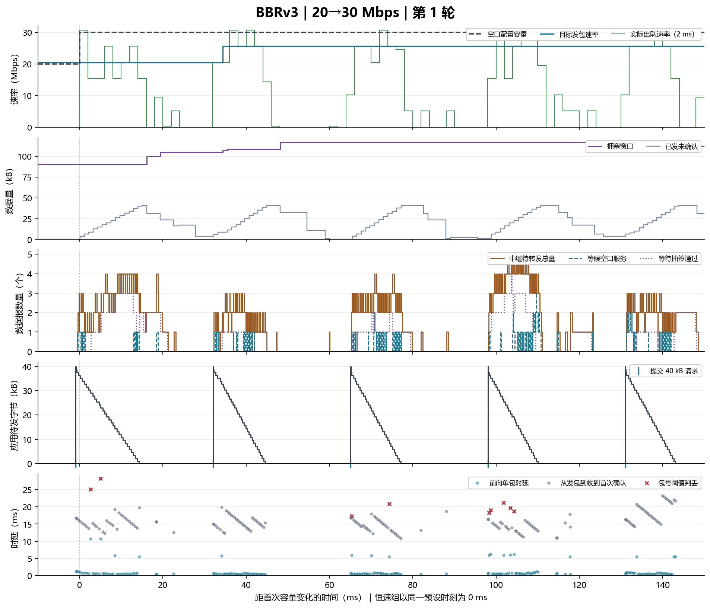
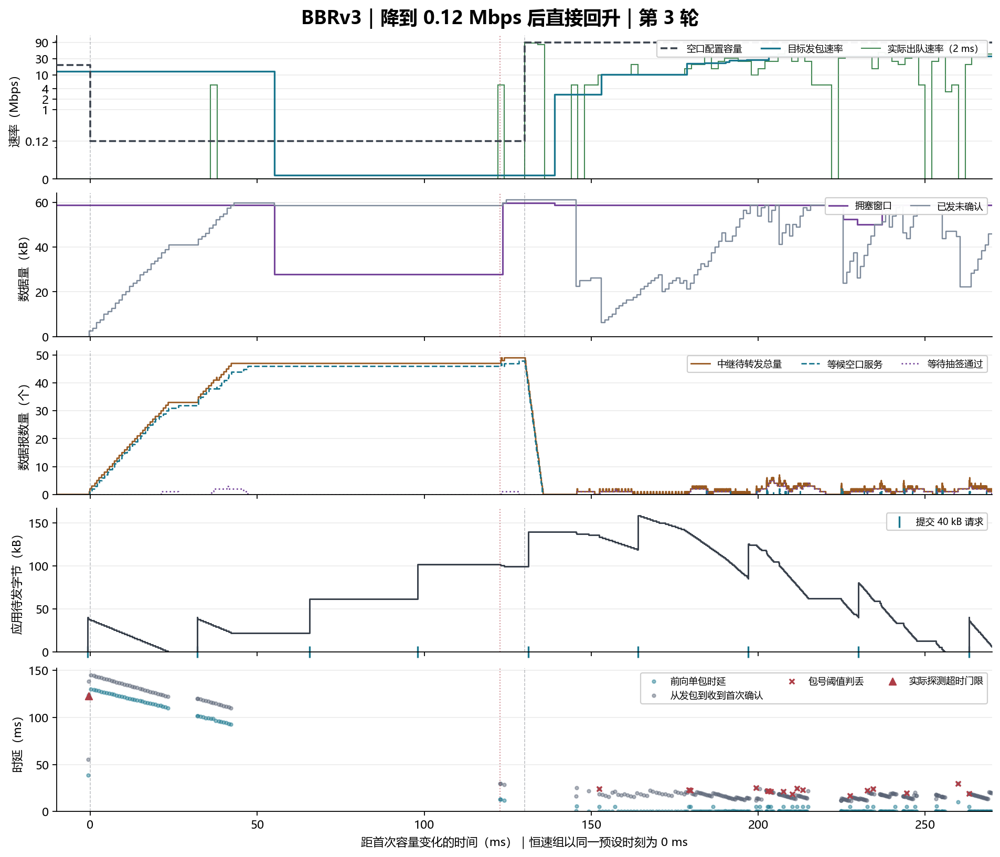
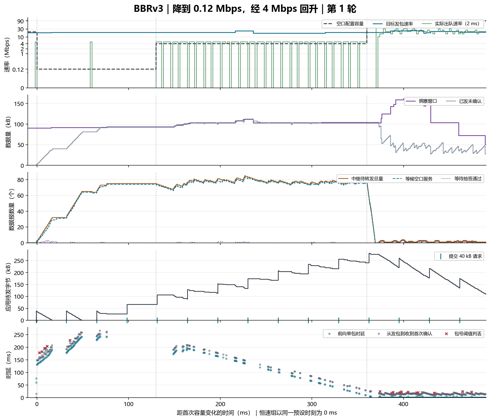

# BBRv3 每 33 ms 提交一笔 40 kB 的空口失配实测

每笔请求保持 **40 kB**，提交间隔改为 **33 ms**。本次重新跑了九条容量曲线，每条五轮，共 **45 轮、1,350 笔上传**，全部收齐。升速后仍能观察到有数据待发、窗口有余量而空口闲置。深降速条件下则观察到排队、确认超时和补发。两者也能出现在同一次降速与回升过程中，但探测超时只在部分深降速轮次触发。[逐轮结果与原始数据](results/pacing-mismatch-reverse/train-33ms) · [此前 8 ms 提交间隔的报告](https://github.com/qinyishcn/quic-testbed-lab/blob/f0f73e797a0dabab5a6f1c5c141cb42fbc62501c/REPORT.pacing-mismatch-40kb-bbr3.zh-CN.md)

## 1. 网络和任务怎样设置？

每轮在一条本地 QUIC 连接上先用 **300 kB** 预热，之后每 **33 ms** 提交一笔 **40 kB** 上传，每笔使用一个新流。第一笔在预设切换前 **1 ms** 提交，每轮共 **30 笔**。提交按时钟进行，实际相邻提交间隔的中位数为 **33.00 ms**，范围为 **32.397–33.608 ms**。前一笔仍未完成时允许重叠。应用平均提供 **9.70 Mbps** 的业务字节，因此在 20、30 或 90 Mbps 的空口上，两个请求之间自然可能有空档。只有应用还有数据待发时的空口闲置，才能用于观察发送端供包不足。

上行中继保持此前的模拟规则。每个数据报有 **10%** 的概率在进入空口队列前等待 **5 ms**，到期重新抽签，可以重复等待。回程数据报独立抽取 **10–20 ms** 的均匀随机时延。服务器初始单流额度为 **512 KiB**，连接级额度为 **8 MiB**。45 轮握手通告均与配置一致，客户端三类流控阻塞通知均为 **0**。中继完成全部数据报转发，双端抓包校验通过。[运行脚本](studies/pacing_loss/mismatch_experiment.py) · [流控检查](results/pacing-mismatch-reverse/train-33ms/flow-control.csv) · [双端抓包校验](results/pacing-mismatch-reverse/train-33ms/bbr3-gate-reverse/validation.json)

### 九条曲线的结果

所有曲线从 **20 Mbps** 开始。时间相对预设切换点。上传耗时从请求提交算到服务器收齐。确认往返耗时从原包发出算到发送端收到覆盖该包的第一个 ACK。P50 是中位数，P95 和 P99 分别是第 95 和第 99 百分位数。队列峰值为五轮中等待空口服务的最大包数。事件计数只包含正式上行请求的业务包。

| 容量曲线 | 切换后的容量时序 | 40 kB 上传 P50 / P95 | 确认往返 P99 | 队列峰值 | 包号判丢 / 时间阈值判丢 / 探测超时 |
|---|---|---:|---:|---:|---:|
| [恒定 20 Mbps](results/pacing-mismatch-reverse/train-33ms/bounded_fixed.png) | 全程维持 20 Mbps | 17.24 / 27.65 ms | 26.53 ms | 9 个 | 365 / 0 / 0 |
| [升到 30 Mbps](results/pacing-mismatch-reverse/train-33ms/bounded_rise.png) | 0 ms 升至 30 Mbps | 17.24 / 33.54 ms | 25.46 ms | 3 个 | 355 / 1 / 0 |
| [降到 16 Mbps](results/pacing-mismatch-reverse/train-33ms/bounded_narrow.png) | 0 ms 降至 16，100 ms 到 20，120 ms 到 24 Mbps | 17.67 / 32.59 ms | 26.73 ms | 13 个 | 362 / 1 / 0 |
| [降到 10 Mbps](results/pacing-mismatch-reverse/train-33ms/bounded_dip.png) | 0 ms 降至 10，100 ms 到 15，120 ms 到 20，140 ms 到 30 Mbps | 17.86 / 38.06 ms | 35.34 ms | 25 个 | 333 / 0 / 0 |
| [升到 90 Mbps](results/pacing-mismatch-reverse/train-33ms/rise.png) | 0 ms 升至 90 Mbps | 17.01 / 28.31 ms | 24.78 ms | 2 个 | 353 / 0 / 0 |
| [降到 2 Mbps](results/pacing-mismatch-reverse/train-33ms/drop.png) | 0 ms 降至 2，130 ms 到 90 Mbps | 17.46 / 102.49 ms | 119.38 ms | 82 个 | 328 / 1 / 0 |
| [降到 0.12 Mbps 后直接回升](results/pacing-mismatch-reverse/train-33ms/collapse.png) | 0 ms 降至 0.12，130 ms 到 90 Mbps | 15.47 / 109.48 ms | 139.43 ms | 77 个 | 340 / 1 / 2 |
| [降到 0.12 Mbps，经 1 Mbps 回升](results/pacing-mismatch-reverse/train-33ms/staged.png) | 0 ms 降至 0.12，130 ms 到 1，280 ms 到 90 Mbps | 32.52 / 259.35 ms | 282.76 ms | 82 个 | 354 / 1 / 1 |
| [降到 0.12 Mbps，经 4 Mbps 回升](results/pacing-mismatch-reverse/train-33ms/rebound.png) | 0 ms 降至 0.12，130 ms 到 4，360 ms 到 90 Mbps | 158.34 / 437.03 ms | 252.53 ms | 84 个 | 410 / 0 / 0 |

每条曲线统计 **150 笔请求**和对应的逐包数据。经 4 Mbps 回升的低速阶段持续得更久，更多请求在回升前积压。两条分段回升曲线的持续时间不同，表中的上传耗时差异同时反映速率和驻留时间。[汇总数据](results/pacing-mismatch-reverse/train-33ms/summary.csv) · [逐请求完成记录](results/pacing-mismatch-reverse/train-33ms/bbr3-gate-reverse/tasks.csv)

## 2. 升速后什么时候是真正的供包不足？



**图 1** 展示首轮，横轴以升速为 **0 ms**。第一行黑虚线是配置容量，青线是发送端安排发包间隔时使用的**目标发包速率（pacing rate）**，绿线是每 **2 ms** 完成模拟空口传输的完整 IP 包换算得出的实际出队速率。按整包计量，个别 2 ms 窗口的换算值可以略高于容量。第二行紫线是**拥塞窗口（cwnd）**，表示发送端允许未确认的在途字节上限，灰线是实际尚未确认且仍计入窗口的字节。第三行棕线是中继收到但尚未转发的**总包数**，包括正在服务的包。蓝虚线是已进入服务队列、尚未开始传输的包数，紫色点线是等待通过随机抽签的包数。第四行黑线是业务已经提交但尚未第一次发出的应用字节，短竖线标记每笔 **40 kB** 的提交时刻。第五行以原包发出时刻为横坐标，分别画前向单包时延与完整的确认往返时延。红叉标出按包号阈值判丢的原包。

升到 **30 Mbps** 后的头 **8 ms**，五轮实际出队仅 **15.36–21.76 Mbps**，等待服务的队列有 **91.0%–97.6%** 的时间为空。首轮的目标发包速率中位数为 **20.50 Mbps**，实际在途中位数为 **13.77 kB**，拥塞窗口中位数为 **90.23 kB**，窗口末仍有 **15.59 kB** 新数据待发。升至 **90 Mbps** 时，五轮头 8 ms 也只转发了 **16.64–21.76 Mbps**，约占容量 **18%–24%**。

**相邻请求的空档可以直接从待发字节区分。** 图 1 首轮的 **24–31 ms**，应用待发字节为零，中继待转发总包数始终为零，实际出队速率也为零。下一笔到约 **32.07 ms** 才提交。前 8 ms 的闲置和这个空档对应不同的发送状态。[短时间窗统计](results/pacing-mismatch-reverse/train-33ms/time-windows.csv)

## 3. 降速排队到什么程度会出现超时或判丢？

降到 **16 Mbps** 后，五轮头 **12 ms** 的实际入队速率为 **17.07–21.33 Mbps**，等待服务的队列峰值为 **2–6 个包**。降到 **10 Mbps** 时，同一窗口的实际入队为 **16.21–19.63 Mbps**，等待服务队列峰值达到 **6–13 个包**。降到 **2 Mbps** 时，头 12 ms 已有 **16–20 个包**等候服务。这三条曲线都观察到了排队，却没有记录到由探测超时触发的正式上行业务恢复事件。[降至 16 Mbps 的曲线](results/pacing-mismatch-reverse/train-33ms/bounded_narrow.png) · [降至 10 Mbps 的曲线](results/pacing-mismatch-reverse/train-33ms/bounded_dip.png) · [降至 2 Mbps 的曲线](results/pacing-mismatch-reverse/train-33ms/drop.png)



**图 2** 取直接回升组中首次观察到探测超时的第三轮。速率轴在接近零的区域使用线性刻度，高速区域采用对数刻度。竖直红点线标出发送端实际启动恢复的时间。红三角标在对应原包的发送位置，纵坐标是该原包的实际超时门限。包 **274** 的门限是发包后 **122.975 ms**，而收到原包首次 ACK 已是发包后 **138.416 ms**。发送端在首次降速后 **122.629 ms** 启动探测恢复时，空口队列仍有 **46 个包**等待服务，应用还有 **101.69 kB** 新数据待发。恢复前最近一次采样的拥塞窗口只有 **27.87 kB**，已发未确认量为 **58.59 kB**，发送端可用的窗口额度已经耗尽。[逐包事件与计时字段](results/pacing-mismatch-reverse/train-33ms/forward-loss-events.csv)

三类事件按固定版本 picoquic 的实际日志区分。包号阈值使用较新确认的包号，时间阈值利用后发包的确认时序，探测超时在等待确认进展达到计算期限时触发探测。**用于和实际确认往返耗时比较的门限**是「实现计算的到期时刻减去对应原包的发送时刻」。表中事件均能与原包和补发记录配对。[QUIC 恢复机制](https://www.rfc-editor.org/rfc/rfc9002.html#section-6) · [本次计时口径](REPORT.ack-deadlines.zh-CN.md)

| 事件类别 | 代表性原包 | 发送端的决策依据与实际结果 |
|---|---|---|
| 包号阈值判丢 | 20→30 Mbps 第 1 轮，包 276 | 原包的前向时延 **10.677 ms**。判丢时已确认的最大包号领先 **7**。原包在判丢前已到服务器，补发副本又晚 **5.590 ms** 到达。 |
| 时间阈值判丢 | 经 1 Mbps 回升第 1 轮，包 276 | 最大已确认包号只领先 **1**。该原包的判丢门限为发包后 **202.972 ms**，实际确认到达耗时 **259.699 ms**。原包最终先于补发副本到达。[该轮逐包时间图](results/pacing-mismatch-reverse/train-33ms/staged-rack.png) |
| 探测超时 | 0.12 Mbps 直接回升第 3 轮，包 274 | 启动恢复时的最大已确认包号仍落后原包 **1**。原包首次确认比超时门限晚 **15.441 ms**，补发副本比原包晚 **11.923 ms** 到达。 |

全组记录 **3,200 次包号阈值判丢、5 次时间阈值判丢和 3 次探测超时恢复**。被判丢或触发恢复的原包最终全部到达。三次超时恢复分别来自直接回升的两轮和经 1 Mbps 回升的一轮，三次补发副本均晚于原包到达。恒定 20 Mbps 组也有包号判丢，这说明本次两向随机等待配置下，包乱序可以在容量恒定时触发判丢。[全部正式上行事件](results/pacing-mismatch-reverse/train-33ms/forward-loss-events.csv)

## 4. 深降速后回升，为什么空口先忙后闲？



**图 3** 展示经 4 Mbps 回升的首轮。速率轴和图 2 一样。两条相关的时间刻度是 **130 ms** 和 **360 ms**，分别把空口从 **0.12 Mbps** 调至 **4 Mbps**，再调至 **90 Mbps**。第一行先看到旧队列把空口用起来，第三行显示等待服务的包逐步清完，第四行同时显示应用侧仍积压了多笔请求。

升至 **90 Mbps** 后的 **360–368 ms**，首轮旧队列支撑了平均 **88.32 Mbps** 的实际出队。到了 **368–380 ms**，出队速率降为 **21.39 Mbps**，等待服务的队列有 **91.0%** 的时间为空，应用仍有 **259.82 kB** 新数据待发。此时目标发包速率的中位数是 **18.75 Mbps**，已发未确认量和拥塞窗口的中位数分别为 **92.70 kB** 和 **103.17 kB**。在途数据仍占据较多窗口额度，不能只用 pacing 解释整个回升过程。五轮在 **368–380 ms** 的实际出队为 **2.56–21.39 Mbps**。这一组五轮均未记录探测超时，说明明显的回升后供包缺口也可以在没有探测超时时出现。[回升时间窗数据](results/pacing-mismatch-reverse/train-33ms/time-windows.csv)

## 复跑和复算

用仓库的 [BBRv3 判丢观测端点](bbr3/README.md) 运行 `studies/pacing_loss/mismatch_experiment.py`，传入 `--testbed`、`--bbr3`、`--out`，以及以下选项。

```text
--repeats 5 --train-33ms --reverse-delay-ms 10 20
--only bounded_fixed bounded_rise bounded_narrow bounded_dip rise drop collapse staged rebound
```

用 `studies/pacing_loss/analyze.py <原始目录>/bbr3-gate-reverse results/pacing-mismatch-reverse/train-33ms/bbr3-gate-reverse --archive` 关联双端 QUIC 日志、逐包抓包和中继事件，再用 `python studies/pacing_loss/paced_requests_report.py` 复算所有图表。[原始抓包与日志](results/pacing-mismatch-reverse/train-33ms/bbr3-gate-reverse/raw-evidence.tar.xz) · [分析与绘图脚本](studies/pacing_loss/paced_requests_report.py)
