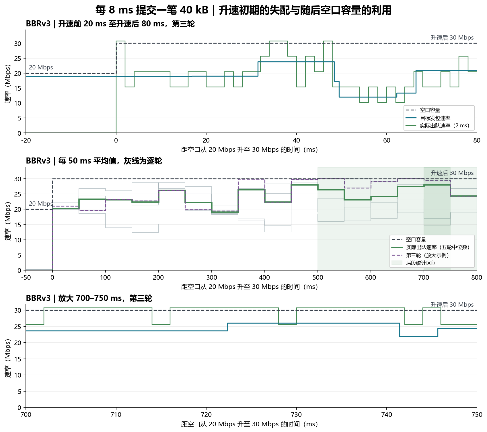

# 每 8 ms 提交一笔 40 kB 时的 BBRv3 上行实测

把每笔上传保持在 **40 kB**，并将两笔请求的提交间隔缩短至 **8 ms** 后，BBRv3 仍出现了升速初期供包不足。升速后的前 **8 ms**，五轮只用到约 **47%–73%** 的空口容量。到 **500–800 ms**，有一轮用到约 **95%**，其余四轮仍在约 **69%–86%**。毫秒级的发包失配与较长时间窗内接近满载可以同时出现，接近满载在本组只出现在部分时段和轮次。[逐轮、逐时段数据](results/pacing-mismatch-reverse/train-40kb-windows.csv)

## 实验怎样避免服务器额度用尽？

每轮先用 **300 kB** 预热。之后在同一条 QUIC 连接上，每 **8 ms** 提交一笔 **40 kB** 上传，每笔使用一个新流。第一笔在升速前 **1 ms** 提交，最后一笔在升速后 **991 ms** 提交，总计 **125 笔**。提交按照固定时间表进行，允许前一笔尚未完成时提交下一笔。应用提供的速率为 **40 Mbps**，超过升速后的空口容量 **30 Mbps**。网络沿用先以 **20 Mbps** 运行再升至 **30 Mbps** 的容量曲线。上行每个包有 **10%** 的概率等待 **5 ms**，等待结束后重新抽签。回程每个数据报独立抽取 **10–20 ms** 的均匀随机时延。[任务和网络配置](studies/pacing_loss/mismatch_experiment.py)

服务器把**初始单流接收额度**从 **65,635 B** 提高到 **512 KiB**，覆盖每笔 40 kB 请求和 300 kB 预热。把**初始连接接收额度**提高到 **8 MiB**，覆盖每轮 **5.3 MB** 的全部应用数据。发送端的握手日志在 **5 轮**中都记录了这两个通告值。整个连接内，单流额度不足、连接额度不足和流数量不足的阻塞通知计数均为 **0**。服务器收齐了 **625 笔**正式上传。[流控核验表](results/pacing-mismatch-reverse/train-40kb-flow-control.csv) · [逐请求完成记录](results/pacing-mismatch-reverse/train-40kb/bbr3-gate-reverse/tasks.csv)

## 毫秒级失配与长时间容量利用怎样同时出现？

**图 1** 以升速时刻为 0 ms。上排显示第三轮的 **−20 至 80 ms**，中排显示五轮的 **−50 至 800 ms**。上排和中排的黑虚线都在 **0 ms** 从 **20 Mbps** 跳到 **30 Mbps**。下排放大升速后的 **700–750 ms**，这段的容量一直是 **30 Mbps**。青线是 QUIC 安排发包间隔时使用的**目标发包速率**，绿线是每 **2 ms** 内完成模拟空口传输并由中继转发的**实际出队速率**。中排将每轮的实际出队速率按 **50 ms** 窗口取平均。细灰线表示单轮，粗绿线表示同一窗口的五轮中位数，紫虚线标出第三轮。浅绿底表示 **500–800 ms** 的汇总区间，较深的背景标出 **700–750 ms** 的放大区间。速率按完整 IP 包出队计量，单个 2 ms 窗口可能略高于配置容量，补发包也会计入空口占用。

| 升速后时间 | 五轮平均出队速率范围 | 对 30 Mbps 容量的利用率 |
|---|---:|---:|
| 0–8 ms | 14.08–21.76 Mbps | 约 47%–73% |
| 500–800 ms | 20.55–28.37 Mbps | 约 69%–95% |

**升速初期的问题是供包不足。** 前 8 ms 的五轮中，上行等待服务的队列有 **91.4%–97.5%** 的时间为空。图中第三轮的目标速率为 **18.96 Mbps**，实际平均出队速率为 **21.76 Mbps**。拥塞窗口的中位数是 **93.94 kB**，实际在途量的中位数是 **12.52 kB**。该轮还有应用数据待发，拥塞窗口和服务器授予的额度均有余量。[早期逐轮时段数据](results/pacing-mismatch-reverse/train-40kb-windows.csv)

**第三轮的后段接近满载，队列为短时的供包缺口补上了数据。** 第三轮的 **500–800 ms** 平均出队 **28.37 Mbps**。放大其中的 **700–750 ms**，目标发包速率为 **21.91–25.99 Mbps**，平均进入中继的速率为 **24.78 Mbps**，但空口平均出队仍达 **29.49 Mbps**。这个窗口里已有数据在队列等待，队列峰值为 **33.28 kB**，所以空口能够一边服务旧积压，一边接收新包。其余四轮在 **500–800 ms** 的平均出队为 **20.55–25.78 Mbps**。这组数据说明，较短的请求间隔能够提供足够业务量，但 BBRv3 的平均出队速率是否接近容量仍随控制状态和已有队列变化。[后段逐轮时段数据](results/pacing-mismatch-reverse/train-40kb-windows.csv)

**消除流控阻塞后，2 ms 统计窗口里仍可能没有完整包出队。** 例如第一轮的 **550–552 ms**，中继没有转发任何上行包，直到 **552.582 ms** 才收到下一个上行数据报。客户端这一轮没有流控阻塞记录。这个短暂的空口断供仍保留在原始记录中。[第一轮的中继和 QUIC 日志](results/pacing-mismatch-reverse/train-40kb/bbr3-gate-reverse/raw-evidence.tar.xz)

## 复跑

使用当前代码重新构建 [BBRv3 判丢观测端点](bbr3/README.md)。在本地 Testbed 调用 `studies/pacing_loss/mismatch_experiment.py`，传入 `--testbed`、`--bbr3`、`--out`，并使用 `--repeats 5 --only bounded_rise_40kb_train --reverse-delay-ms 10 20`。用 `studies/pacing_loss/analyze.py <原始目录>/bbr3-gate-reverse results/pacing-mismatch-reverse/train-40kb/bbr3-gate-reverse --archive` 生成分析数据，再运行 `python studies/pacing_loss/reverse_delay_report.py --train-40kb` 更新图表。[补测数据和校验](results/pacing-mismatch-reverse/train-40kb) · [制图脚本](studies/pacing_loss/reverse_delay_report.py)
