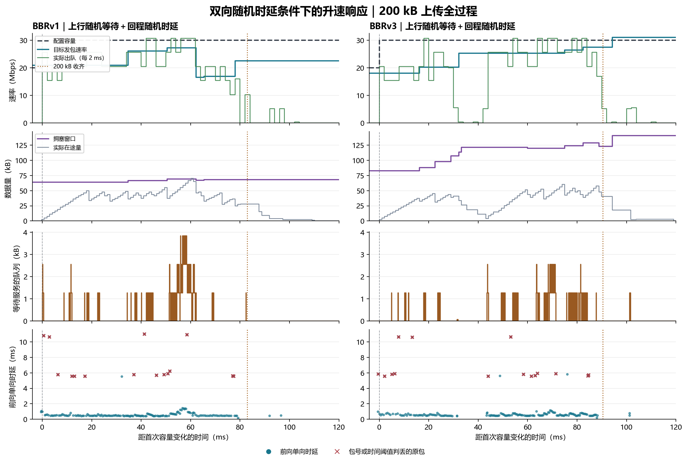
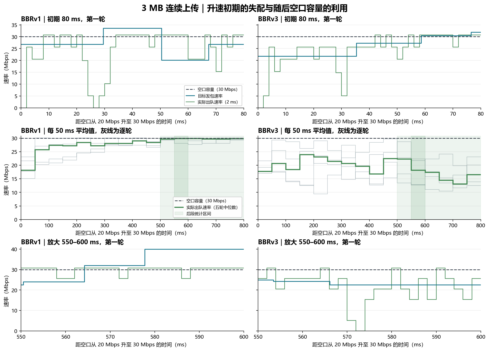
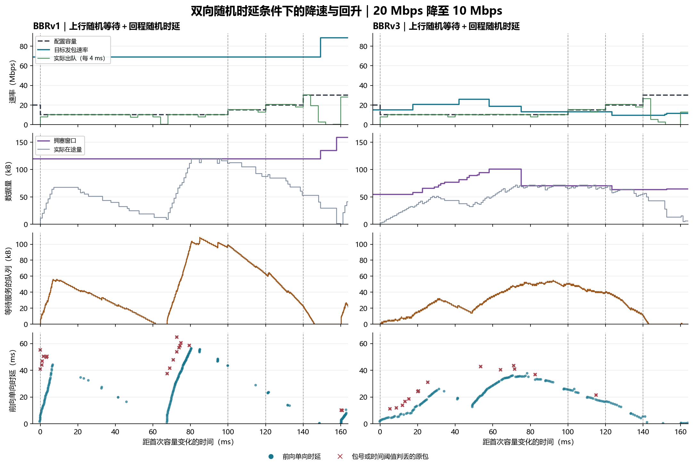
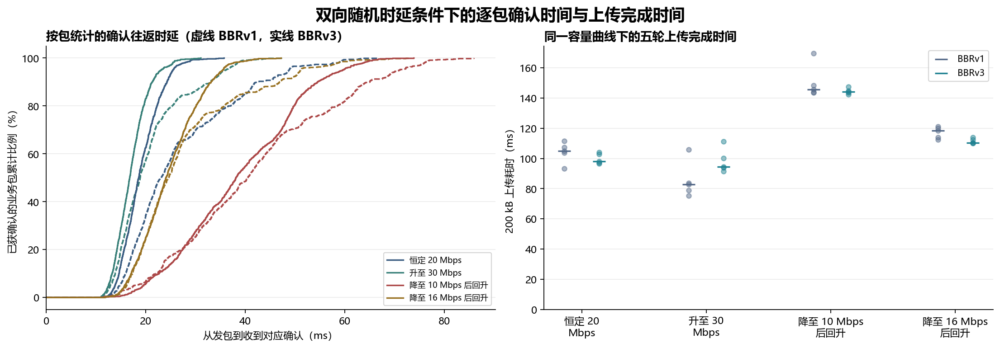

# QUIC 实测：上行逐包随机等待与回程 10–20 ms 随机时延

本报告记录两种网络条件同时启用后的结果。在四条容量曲线的主实验中，上行容量从 **20 Mbps 升到 30 Mbps** 时，BBRv3 的五轮在前 **8 ms** 只用到 **55%–77%** 的容量。上行容量从 **20 Mbps 降到 10 Mbps** 时，两版都出现积压，200 kB 上传耗时中位数约 **144–146 ms**。主实验两版合计触发 **683 次包号阈值判丢**和 **1 次基于后发包确认时间的判丢**。端点日志中由探测超时触发的业务包恢复事件为 **0 次**。[逐轮结果](results/pacing-mismatch-reverse/runs.csv) · [逐事件记录](results/pacing-mismatch-reverse/events.csv)

3 MB 连续上传补测显示，升速初期的失配和后段的容量利用可以同时观测到。BBRv1 在升速后 **500–800 ms** 的实际出队速率达到 **28.71–30.01 Mbps**，而 BBRv3 同段为 **13.59–19.90 Mbps**。[长时间补测统计](results/pacing-mismatch-reverse/scale-windows.csv)

## 1. 上行和回程分别如何施加随机时延？

- **上行（客户端到服务器）**。每个 UDP 数据报交给模拟空口前独立抽取随机数，有 **10%** 概率先等待 **5 ms**。到期后同一个包再抽一次，可以重复等待。放行的包进入上行队列，按配置容量串行传输。实测 **19,983 个**上行数据报中，**1,938 个**至少等待一次，**208 个**至少等待两次。这个计数包含预热和控制数据报。
- **回程（服务器到客户端）**。每个 UDP 数据报到达中继后，独立从 **10–20 ms** 均匀抽取一次额外时延，抽样粒度为 **1 µs**。中继按各包自己的放行时刻转发，因此后到的包可能先出队。回程不设容量瓶颈，并使用独立于上行的随机数生成器。全部 **5,968 个**回程数据报的抽取时延为 **10.007–20.000 ms**，均值 **14.985 ms**。实测中继滞留 **10.021–20.082 ms**，中位数 **15.1835 ms**。实际放行比计划晚的时间，第 99 百分位数为 **0.171 ms**，最大 **0.401 ms**。按中继入队序号检查，有 **2,364 个**回程包在至少一个后到包之后放行，占 **39.6%**。[中继代码](studies/pacing_loss/relay.py) · [回程抽样与实测](results/pacing-mismatch-reverse/reverse-relay.csv)

实验在本地 6G-Testbed 的隔离网络命名空间和虚拟网卡中运行，两端使用同一固定 picoquic 提交的 BBRv1 和 BBRv3。每条上行容量曲线由两个版本各跑 **5 轮**，共 **40 轮**。每轮先传 **300 kB** 预热，容量首次切换前约 **1 ms** 提交 **200 kB** 上传，在相对时刻 **160 ms** 提交 **40 kB** 上传。80 笔正式请求均由服务器收齐。40 kB 请求按固定时刻提交，BBRv1 的 10 Mbps 场景有一轮与前一笔上传重叠。[运行配置](studies/pacing_loss/mismatch_experiment.py) · [任务时间戳](results/pacing-mismatch-reverse)

| 上行容量曲线 | 0 ms 前 | 0 ms 起的容量变化 |
|---|---:|---|
| 恒定容量 | 20 Mbps | 持续为 20 Mbps。 |
| 升速 | 20 Mbps | 升至 30 Mbps 并保持。 |
| 降至 10 Mbps 后回升 | 20 Mbps | 降至 10 Mbps，100 ms 时升至 15 Mbps，120 ms 时升至 20 Mbps，140 ms 时升至 30 Mbps。 |
| 降至 16 Mbps 后回升 | 20 Mbps | 降至 16 Mbps，100 ms 时升至 20 Mbps，120 ms 时升至 24 Mbps。 |

## 2. 哪些时段会出现空口闲置或队列积压？

**图 1（甲）** 取两个版本各自的第 1 轮，横轴以容量变化时刻为 **0 ms**，画到 **120 ms**。棕色竖点线标出服务器收齐该轮 200 kB 的时刻，BBRv1 是升速后 **82.89 ms**，BBRv3 是 **90.48 ms**。第一行的黑虚线是模拟空口配置容量，青线是 QUIC 发送端用于安排发包间隔的**目标发包速率（pacing rate）**，绿线是按 **2 ms** 分桶统计的实际出队 IP 速率。分桶按完整数据报计量，个别桶可以略高于配置容量。第二行的紫线是**拥塞窗口（cwnd）**，表示允许在途的字节上限，灰线是发送端已发出、仍计入窗口的**实际在途量**。第三行是已经放行到上行队列、仍等候串行服务的字节数。第四行每个点代表一个上行业务包，横坐标是该包的发送时刻，纵坐标是服务器收到该包的**前向单向时延**。红叉表示发送端曾依包号或确认时间阈值判丢的原包。

BBRv3 的五轮在升速后的前 **8 ms** 实际出队 **16.64–23.04 Mbps**，约为 30 Mbps 容量的 **55%–77%**。上行等待服务的队列有 **90.8%–98.2%** 的时间为空。第一轮的目标发包速率中位数为 **17.99 Mbps**，实际在途中位数为 **11.27 kB**，拥塞窗口中位数为 **82.81 kB**，该时段末还有约 **179 kB** 的请求新字节未发。窗口有余量，但供包节奏跟不上升速后的空口。BBRv1 第一轮的同一时段也有这个现象，实际出队 **19.20 Mbps**，其余四轮则在 **19.20–29.44 Mbps** 之间，具体表现随该轮的发送状态变化。[逐轮时段统计](results/pacing-mismatch-reverse/windows.csv)

**图 1（乙）** 使用相同的上行随机等待和回程 **10–20 ms** 随机时延，把升速前提交的上传扩大至 **3 MB**，两个版本各跑五轮。十笔上传都持续到升速后 **800 ms** 以上。上排取首轮的头 **80 ms**，下排放大同一轮的 **550–600 ms**。两排均按 **2 ms** 统计实际出队速率，用绿线表示，并用青线显示目标发包速率。中排覆盖 **0–800 ms**，每 **50 ms** 计算一次平均出队速率，细灰线是每一轮，粗绿线是各时间窗的五轮中位数。横向黑虚线均为 **30 Mbps**，中排浅绿色背景标出汇总用的 **500–800 ms**，较深的部分是下排放大的 **550–600 ms**。[长传时间窗数据](results/pacing-mismatch-reverse/scale-windows.csv) · [十轮原始记录](results/pacing-mismatch-reverse/sustained)

BBRv1 在升速后 **0–8 ms** 的实际出队速率只有 **14.08–20.48 Mbps**，到了 **500–800 ms**，五轮平均出队速率达到 **28.71–30.01 Mbps**，约用到 **96%–100%** 的容量。首轮 **550–600 ms** 正好展示了两个尺度的差别。目标发包速率在 **24.01–40.02 Mbps** 之间变化，这 50 ms 内平均进入中继 **34.00 Mbps**，平均实际出队 **29.90 Mbps**，等待服务队列最多积压 **37.12 kB**。空口在这个时间窗里接近满载，同时发送端的目标仍在空口容量上下波动。实际出队速率按 IP 字节统计，包含补发占用的容量。

BBRv3 在升速后 **500–800 ms** 的五轮平均出队速率只有 **13.59–19.90 Mbps**，约用到 **45%–66%** 的容量。五轮中，首轮 **500–550 ms** 曾达到 **28.67 Mbps**，紧接着的 **550–600 ms** 回落到 **21.71 Mbps**。因此这套联合网络条件下，延长持续上传能看到 BBRv1 的平均出队速率贴近容量，BBRv3 仍有持续的供包缺口。[长传逐轮统计](results/pacing-mismatch-reverse/scale-windows.csv)

**图 2** 沿用图 1（甲）的速率、窗口、队列和单包时延指标，绿线改为每 **4 ms** 分桶。灰色竖虚线标出上行容量的每次切换。BBRv3 第一轮在降速后 **0–12 ms** 以 **17.07 Mbps** 向中继送包，容量只有 **10 Mbps**，等待服务的队列峰值为 **8.96 kB**。到 **50–100 ms**，队列一直有包等待，峰值达到 **55.04 kB**，实际在途中位数 **67.61 kB** 已接近窗口的 **70.66 kB**。在同一时段，BBRv1 第一轮的队列峰值达到 **108.80 kB**。容量逐步回升后，两个版本的积压均消退。右列在回到 30 Mbps 后也出现很低的出队速率，但该轮的 200 kB 请求在 **150 ms** 前已发完全部新字节，因此要结合剩余工作量判断这段空口为什么空闲。[队列、窗口与已发送字节](results/pacing-mismatch-reverse/windows.csv)

## 3. ACK 多久到一次，单个包多久获得确认？

**图 3 左图** 的横轴是一个上行业务包从发出到发送端收到首次确认该包的 ACK 所用的时间。该时间包含上行传输与等待、接收端等待发出 ACK，以及 ACK 回程。纵轴是截至某个时延已获得确认的业务包比例。颜色区分容量曲线，虚线是 BBRv1，实线是 BBRv3。**右图** 的圆点表示每轮 200 kB 请求从提交到服务器收齐的时间，短横线表示五轮中位数。

| 上行容量曲线 | BBRv1 逐包确认中位数 / P99 | BBRv3 逐包确认中位数 / P99 | BBRv1 / BBRv3 的 200 kB 上传中位数 | BBRv1 / BBRv3 的 40 kB 上传中位数 |
|---|---:|---:|---:|---:|
| 恒定 20 Mbps | 23.15 / 59.47 ms | 18.57 / 28.95 ms | 104.87 / 98.05 ms | 17.40 / 20.58 ms |
| 升至 30 Mbps | 18.87 / 39.43 ms | 16.77 / 26.32 ms | 82.95 / 94.37 ms | 14.77 / 20.71 ms |
| 降至 10 Mbps 后回升 | 40.40 / 76.89 ms | 38.10 / 65.49 ms | 145.53 / 144.04 ms | 17.25 / 27.64 ms |
| 降至 16 Mbps 后回升 | 24.62 / 61.14 ms | 24.04 / 40.44 ms | 118.52 / 110.39 ms | 18.22 / 26.15 ms |

表中逐包确认统计只包含 200 kB 请求的上行业务包，P99 表示 99% 的这些包在该时间内获得确认。**相邻 ACK 到达间隔**是另一个量。把首次确认该请求新包的 ACK 接收时刻去重，先计算每轮的间隔中位数，再取五轮中位数。四条容量曲线下，200 kB 请求的这项指标落在 **3.63–4.32 ms**。例如，BBRv3 升至 30 Mbps 时，发送端约每 **4.08 ms** 得到一批新确认，而单个包通常需要约 **16.77 ms** 才获确认。多个尚未确认的数据包可以同时在途。[按轮 ACK 时序和耗时](results/pacing-mismatch-reverse/ack-timing.csv)

## 4. 随机时延怎样体现为乱序和判丢？

**回程确实发生了 ACK 乱序。** 以 BBRv3 升速首轮为例，服务器的回程包 **107** 和 **108** 都携带 ACK。中继先在升速后 **52.923 ms** 收到包 107，再在 **55.810 ms** 收到包 108。两者分别抽到 **15.387 ms** 和 **10.244 ms** 的等待，实际分别在 **68.319 ms** 和 **66.137 ms** 放行。后进入中继的 ACK 先出队 **2.182 ms**。[首轮原始中继与 QUIC 日志](results/pacing-mismatch-reverse/bbr3-gate-reverse/raw-evidence.tar.xz)

**发送端也判丢了已经到达服务器的原包。** 图 1（甲）右下首个红叉对应业务包 **276**。服务器在升速后 **5.428 ms** 已收到原包。发送端在 **15.918 ms** 得知已确认的包号领先 4，按**包号阈值**判丢，随后补发的副本在 **16.594 ms** 到达。包含原包的首次 ACK 到 **21.635 ms** 才抵达发送端。这个例子可直接对照服务器收包、回程确认和发送端判丢的先后顺序。[包 276 与补发配对](results/pacing-mismatch-reverse/events.csv)

| 主实验正式上行业务的事件 | BBRv1 | BBRv3 |
|---|---:|---:|
| 包号阈值判丢 | 350 | 333 |
| 基于后发包确认时间的判丢 | 0 | 1 |
| 由探测超时（PTO）触发的恢复事件 | 0 | 0 |
| 与此前发送范围重叠的业务字节 | 397,460 B | 374,279 B |

包号阈值判丢由较新包的确认触发。时间阈值判丢依据后发包的确认及更早包的发送时间判断早包是否迟到。探测超时在发送端久未获得确认进展、达到计算期限时触发。正式上行 **8,600 个**业务包全部在接收端留下记录，也都能配对到 ACK。表中被判丢的原包最终全部到达。两端抓包经过按包校验，另有 **16 个回程握手包**在网卡抓包中可见，但到达时对应密钥已不可用，QUIC 日志记录为无法解密。这些握手包独立标记在数据表中，业务统计只使用正式请求包。事件计数对应本次上下行随机机制同时开启的配置。[QUIC 判丢与探测超时定义](https://www.rfc-editor.org/rfc/rfc9002.html#section-6) · [逐包记录和校验](results/pacing-mismatch-reverse)

## 复跑和复算

使用同一仓库的 [BBRv1 观测端点](studies/pacing_loss/README.md)和 [BBRv3 观测端点](bbr3/README.md)。运行 `studies/pacing_loss/mismatch_experiment.py` 时提供 `--testbed`、`--bbr1`、`--bbr3` 和新建的 `--out` 路径，并使用 `--repeats 5 --only bounded_fixed bounded_rise bounded_dip bounded_narrow --reverse-delay-ms 10 20`。脚本生成 `bbr1-gate-reverse` 和 `bbr3-gate-reverse` 两组。用 `studies/pacing_loss/analyze.py <原始目录>/<组名> results/pacing-mismatch-reverse/<组名> --archive` 分别生成逐包数据和归档，再运行 `python studies/pacing_loss/reverse_delay_report.py` 复算图表。[归档与校验](results/pacing-mismatch-reverse) · [制图脚本](studies/pacing_loss/reverse_delay_report.py)

3 MB 连续上传以 `--repeats 5 --only bounded_rise_long --reverse-delay-ms 10 20` 单独复跑。两组用同一分析命令导出到 `results/pacing-mismatch-reverse/sustained/<组名>`，再运行制图脚本更新图 1（乙）和时间窗统计。[长传归档与校验](results/pacing-mismatch-reverse/sustained)
