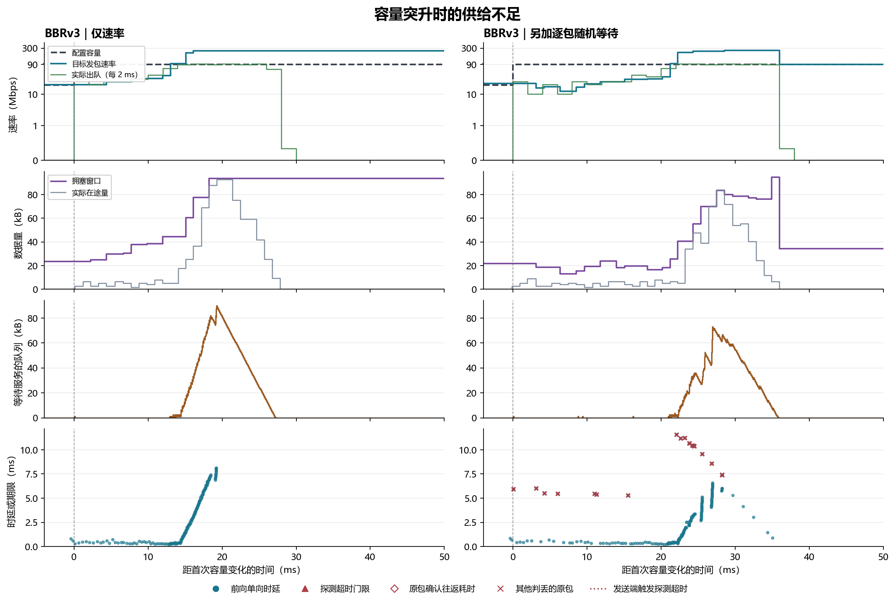
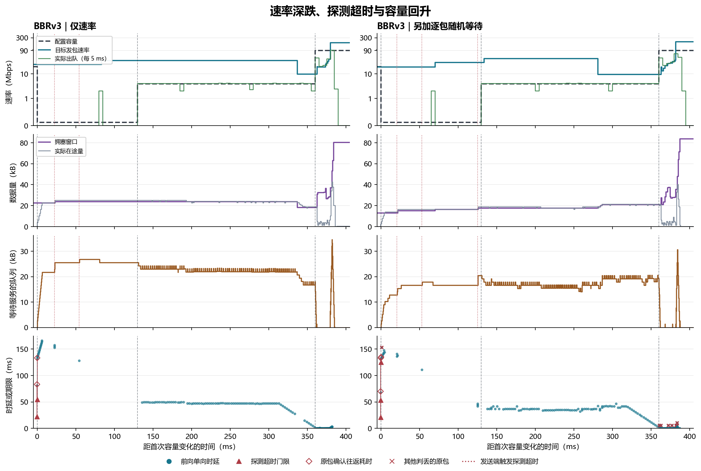
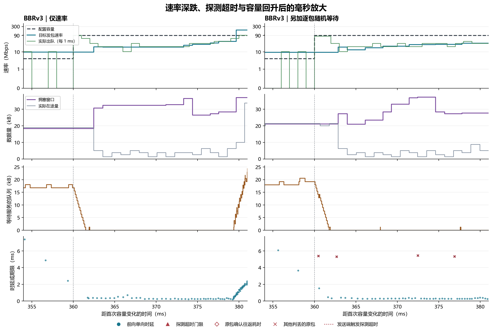
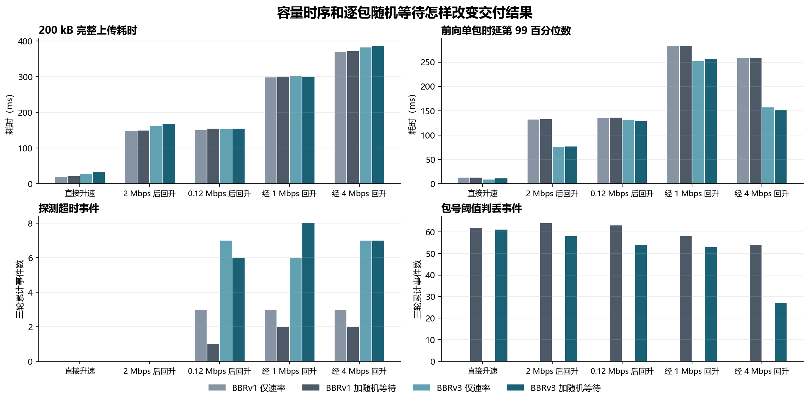

# QUIC 发包与模拟空口容量失配的实测

在回程直接转发、前向只限速的条件下，BBRv3 实测到了两种失配。前向容量从 **20 Mbps 升到 90 Mbps** 时，三轮的头 8 ms 实际只转发 **25.6–28.2 Mbps**，等待服务的队列几乎一直为空。前向容量极深下跌时，发送端还能继续发包，旧包积压到超过探测超时门限。采用分段回升的速率曲线后，旧队列排空时仍有请求数据待发，但 90 Mbps 空口只获得约 **18–20 Mbps** 的数据。另加逐包随机等待后，最明显的变化是包号阈值判丢增多。[逐轮结果](results/pacing-mismatch/runs.csv) · [时段统计](results/pacing-mismatch/windows.csv) · [逐次判丢与补发记录](results/pacing-mismatch/events.csv)

## 1. 怎样设置网络和业务才能看清失配？

实验沿用本地 6G-Testbed 的两端 QUIC 连接、三套隔离网络命名空间、虚拟网卡和逐包观测端点。BBRv1 与 BBRv3 来自同一个固定 picoquic 提交，使用默认拥塞控制和探测超时配置。回程数据报收到后立即转发。每轮先传 **300 kB** 预热，再于第一次容量变化前约 **1 ms** 提交 **200 kB**，让容量变化发生时发送端还有足量数据可发。容量回到 90 Mbps 后约 **20 ms**，再提交一笔 **40 kB**，观察短请求。负载是定长业务字节，完成时间量到服务器收齐为止。五条容量曲线各跑 **2 个版本 × 2 种逐包等待配置 × 3 轮**，共 **60 轮、120 笔正式请求**，全部收齐。[实验脚本](studies/pacing_loss/mismatch_experiment.py) · [两端验证与原始记录](results/pacing-mismatch)

| 容量曲线 | 第一次变化前 | 从 0 ms 开始 | 后续容量变化 | 观察目的 |
|---|---:|---|---|---|
| 直接升速 | 20 Mbps | 90 Mbps | 保持 90 Mbps | 观察容量突然变大时，发送端是否供包不足。 |
| 2 Mbps 后回升 | 20 Mbps | 2 Mbps 持续 130 ms | 130 ms 升至 90 Mbps | 观察明显排队但未触发探测超时的情况。 |
| 0.12 Mbps 后回升 | 20 Mbps | 0.12 Mbps 持续 130 ms | 130 ms 升至 90 Mbps | 观察短时极深降速能否单靠排队触发超时。 |
| 经 1 Mbps 回升 | 20 Mbps | 0.12 Mbps 持续 130 ms | 先到 1 Mbps，280 ms 升至 90 Mbps | 观察少量确认恢复时，控制器是否已收敛到低速。 |
| 经 4 Mbps 回升 | 20 Mbps | 0.12 Mbps 持续 130 ms | 先到 4 Mbps，360 ms 升至 90 Mbps | 观察超时、排队消退和随后供包不足能否在同一轮出现。 |

**仅速率组**通过容量曲线给前向包串行服务。每个数据报累计到足够服务字节才出队，同一服务队列按入队顺序转发。测试从 2 Mbps 降档开始，随后加深到 0.12 Mbps，最后补了两个分段回升条件。2 Mbps 降档能产生明显长尾，但两版的纯速率组均未触发探测超时。0.12 Mbps 直接回升能触发超时，但控制器可能在容量回升后很快又提速。加入中间速率是为了让恢复期持续收到低速交付样本。**0.12 Mbps 是有意设置的深衰落压力条件**。一个 1,280 B 的 IP 包如果完整落在该档，即使独占服务也需要约 **85.3 ms**。[容量计划](studies/pacing_loss/mismatch_experiment.py) · [中继服务逻辑](studies/pacing_loss/relay.py)

**随机等待组**重放相同容量和业务计划。每个前向 UDP 数据报到达中继后，先独立抽取一个 `[0,1)` 均匀随机数。小于 `0.1` 就在进入服务队列前等待 **5 ms**，到时再重新抽一次，直到通过。后到的包可以先进入服务队列，因此同一前向路径也会发生重排。理论上至少等待一次、两次、三次的概率分别为 **10%、1%、0.1%**，平均附加等待为 `5 × 0.1 / 0.9 ≈ 0.556 ms`。以随机等待组的全部 **15,309 个**前向数据报为分母，实测有 **1,345 个**恰好等待一次、**85 个**恰好等待两次、**8 个**至少等待三次，合计 **9.39%** 至少等一次。这里包括预热和控制数据报。复算脚本用归档种子重放抽签顺序，逐次检查等待和放行记录。两组中继均无丢包。[随机等待逻辑](studies/pacing_loss/relay.py) · [逐轮抽签计数](results/pacing-mismatch/runs.csv)

## 2. 容量突升后，空口为什么会闲着？

**图 1 的读法。** 左列是仅速率，右列是加随机等待，均取 BBRv3 第一轮。各行横轴均相对第一次容量变化。第一行黑虚线是**配置容量**，即中继可提供的服务速率。青线是**目标发包速率（pacing rate）**，即发送端用于安排发包间隔的速率。绿线是按固定时间分桶得到的实际出队 IP 速率。速率纵轴使用低速线性、高速对数的刻度。短分桶按整包计量，某个桶可能略高于配置容量。第二行紫线是**拥塞窗口（cwnd）**，即发送端允许的未确认字节上限，灰线是**实际在途字节**。第三行棕线是已进入前向服务队列、还没开始串行服务的字节，当前正在传的包和抽签等待的包另计。第四行蓝点是从 QUIC 发包到接收端收到的**前向单向时延**，每个点的横坐标是该包发出的时刻。红叉标出触发包号或 RACK 判丢的原包，判丢是发送端依据确认信息对原包作出的判断。[制图和分桶口径](studies/pacing_loss/mismatch_report.py)

容量升到 **90 Mbps** 后的头 **8 ms**，BBRv3 仅速率第一轮的目标速率中位数为 **22.94 Mbps**，实际出队 **25.60 Mbps**，只用到该时段容量的 **28.44%**。服务等待队列 **99.35%** 的时间为空，峰值只达一个约 **1.28 kB** 的 IP 包。窗口中位数 **27.20 kB**，实际在途中位数只有 **3.76 kB**，发送端仍有大量 200 kB 请求数据待发。因此这一段的主要限制是供包节奏，窗口还有余量。三轮的实际出队均在 **25.60–28.16 Mbps**。同一组 BBRv1 则在升速前保留了较高的目标速率和较大的窗口，三轮头 8 ms 的实际出队为 **84.34–88.18 Mbps**，同时形成明显队列。相同升速条件下，控制器进入阶跃前的状态决定了是先用不满还是先排队。[逐轮头 8 ms 指标](results/pacing-mismatch/windows.csv)

随机等待组第一轮的头 8 ms，BBRv3 目标速率中位数为 **17.68 Mbps**，实际出队 **16.64 Mbps**，服务等待队列仍有 **99.17%** 的时间为空。随后两列都能提速，队列和单向时延也随之上升。右列还有被延后的包让后发包先获确认。例如 **包 281** 的前向耗时为 **5.934 ms**，发送端因最大已确认包号领先 **3** 而判丢，包含同一流字节的新包在实验时刻 **1,203.083 ms** 到达，原包在 **1,205.989 ms** 到达。这次补发比原包更早交付相同字节。[升速组逐包事件](results/pacing-mismatch/events.csv)

## 3. 深度降速、超时和容量回升怎样连起来？

**图 2** 沿用图 1 的四行指标。容量从 20 Mbps 降到 **0.12 Mbps**，在 **130 ms** 升到 **4 Mbps**，到 **360 ms** 回到 **90 Mbps**。上三行红色竖点线标出发送端实际启动探测超时恢复的时刻。**探测超时（PTO）**表示发送端等待确认进展超过计算期限后发探测或补发。底行在触发超时的原包发送位置画红三角和空心菱形。三角是从原包发出到计算期限的时间，菱形是从同一原包发出到收到该包确认的实际往返耗时。两点的垂直差值是该 ACK 晚于门限的时间。蓝点仍表示前向单向时延。[门限定义与计时逻辑](REPORT.ack-deadlines.zh-CN.md) · [QUIC 探测超时规范](https://www.rfc-editor.org/rfc/rfc9002.html#section-6.2)

仅速率第一轮，降档后 **0–12 ms** 的目标速率中位数仍为 **24.60 Mbps**，而空口只有 **0.12 Mbps**。中继实际收到相当于 **14.51 Mbps** 的数据，服务等待队列峰值达到 **21.76 kB**，这 12 ms 内没有完整数据报转发。实际在途中位数 **22.54 kB**，已接近窗口中位数 **22.37 kB**。之后第一个超时发生在降档后 **22.108 ms**，此时旧包仍在前向传输。[队列和窗口核算](results/pacing-mismatch/windows.csv)

| 仅速率第一轮原包 | 原包单向时延 | 实际超时门限 | 原包确认往返耗时 | 补发包从发出到到达 | 补发副本比原包晚到 |
|---|---:|---:|---:|---:|---:|
| 包 257 | 81.244 ms | 22.360 ms | 83.201 ms | 152.660 ms | 93.866 ms |
| 包 258 | 131.499 ms | 54.425 ms | 133.197 ms | 128.330 ms | 51.336 ms |

**原包和重传副本都会受到同一个瓶颈的影响。** 包 257 触发恢复后，携带相同流字节的包 275 进入中继，单在中继内就待了 **152.286 ms**。包 275 在原包之后 **93.866 ms** 才到达，消耗了额外的服务字节。这一轮 200 kB 的完整上传用时 **382.393 ms**，但两次补发副本都比原包晚到，所以不能把这笔任务的长时延全归给重传。仅速率的全部 **29 次**前向业务探测超时都观察到同样的原包先到，且原包的 ACK 全部晚于各自的门限。[原包与补发配对](results/pacing-mismatch/events.csv) · [补发包的中继时间戳](results/pacing-mismatch/rebound/bbr3-rate/packets.csv.gz)

**超时之后，目标速率和窗口并没有在第一个超时点同时跌下去。** 图 2 左列在超时后仍维持较高的目标速率。随后的 4 Mbps 阶段继续提供低速确认，窗口和速率在 90 Mbps 恢复前已经下降。第 1 轮在 **250–300 ms** 的目标速率和窗口中位数是 **34.92 Mbps、23.79 kB**，到 **340–360 ms** 变为 **9.84 Mbps、18.31 kB**。这版 BBRv3 的超时恢复路径会按当时在途量和一个包的大小设恢复窗口，退出恢复时可以重新进入启动。图中测到的是超时恢复、低速反馈和窗口变化共同作用的时序，单靠这些轨迹无法把后续的目标降速全部归因于第一次超时。2 Mbps 条件提供了直接反例。该组没有探测超时，但 BBRv3 第一轮在回升后 **132–137 ms** 的目标速率中位数也只有 **2.72 Mbps**，实际出队 **6.14 Mbps**，服务等待队列全程为空。[BBRv3 超时与退出恢复源码](https://github.com/private-octopus/picoquic/blob/37bb5d28aaea417649a6d4facc15f54de7d55829/picoquic/bbr.c#L830-L875) · [回升时段统计](results/pacing-mismatch/windows.csv)

**图 3** 放大图 2 的 **354–381 ms**，绿线用 **1 ms** 分桶。两列在 360 ms 刚升速时都还留有旧队列，旧队列能够立即向空口供包。约 2 ms 后队列排空，实际出队速率随发送端的供包节奏降下去。仅速率第一轮在 **362–367 ms** 的容量为 **90 Mbps**，目标速率中位数 **19.11 Mbps**，实际出队 **20.48 Mbps**，等待服务队列全程为空。拥塞窗口中位数已经恢复到 **32.41 kB**，实际在途只有 **3.76 kB**。截至该时段末，200 kB 请求仍有约 **61.1 kB** 新字节没发。这个时段空口只用到 **22.76%**，且窗口有余量。三轮仅速率组同一时段的出队为 **18.43–20.48 Mbps**，紧接着的 **367–375 ms** 为 **23.04–28.16 Mbps**。随机等待三轮在前一个时段出队 **18.43–22.53 Mbps**。这个放大窗口把旧队列耗尽、容量仍高、目标速率仍低和应用还有数据四件事对齐了。[三轮放大区间数据](results/pacing-mismatch/windows.csv)

## 4. 额外的逐包随机等待改变了什么？

**图 4** 的横轴是五条容量曲线。左上为 200 kB 上传完成耗时，柱高取每组 3 轮中位数。右上先在每轮求正式业务前向单包时延第 99 百分位数，再取三轮中位数。左下和右下分别累计三轮的探测超时与包号阈值判丢次数。灰色系是 BBRv1，青色系是 BBRv3，深色加入逐包随机等待。RACK 利用后发包的确认时间推断早发包是否迟到，随机等待组另有 **3 次** RACK 事件，见逐事件表。[逐轮汇总](results/pacing-mismatch/runs.csv) · [逐事件表](results/pacing-mismatch/events.csv)

- **纯速率组主要表现为排队和探测超时。** 两版合计 **5,964 个**正式前向业务包，出现 **29 次**探测超时，包号阈值与 RACK 均为零。2 Mbps 后回升时，虽然单包尾时延已明显上升，两版仍无探测超时。降到 0.12 Mbps 后，两版在三种回升计划下都出现过探测超时。
- **随机等待主要增加了重排引起的判丢和额外流量。** 两版合计 **6,509 个**正式前向业务包，发生 **554 次**包号阈值判丢、**3 次** RACK 和 **26 次**探测超时。所有被判丢或触发探测的原包最终都抵达。重叠业务字节由仅速率组的 **35,427 B** 增到 **677,998 B**。这里统计的是后发包中与此前已发送流区间重叠的字节。
- **任务长时延仍主要由容量过程决定，随机等待的影响随条件变化。** BBRv3 的直接升速组，200 kB 上传中位数从 **27.35 ms** 增至 **32.82 ms**。经 4 Mbps 回升组则从 **381.52 ms** 增至 **386.50 ms**，同组 40 kB 请求的中位数从 **4.11 ms** 增至 **7.32 ms**。BBRv3 经 1 Mbps 回升时，200 kB 中位数是 **300.87 ms 与 299.91 ms**。这些是每格三轮的实测差异，不能据此断定随机等待会在每种条件下把任务延长固定的时间。

这套实验表明，控制器调节慢于容量突升时，空口可能在队列为空且应用有待发数据的情况下闲置。相反，旧窗口和发包目标在深度降档后仍允许数据继续入队，就可能产生超时和冗余补发。对短时限业务，需要同时观察**旧队列清完用了多久、清完以后目标速率多久能追上新容量、重复数据在瓶颈上消耗了多少服务量**。

## 复算与复跑

在仓库根目录运行 `python studies/pacing_loss/mismatch_report.py`，即可用已发布的原始记录重算四张图和三张表。复跑沿用 [BBRv1 观测端点](studies/pacing_loss/README.md)和 [BBRv3 判丢观测端点](bbr3/README.md)。按 `--only rise drop collapse`、`--only staged`、`--only rebound` 分三次调用 `studies/pacing_loss/mismatch_experiment.py`，结果分别对应归档目录 `initial`、`staged`、`rebound`。每次都传 `--testbed`、`--bbr1`、`--bbr3` 和新的 `--out`。各轮用 `studies/pacing_loss/analyze.py` 关联双端日志和网卡抓包，再复算图表。分段回升的早期试跑出现了抓包尾部缺失，采集程序延后结束抓包后重新跑了该组，表中使用通过逐包校验的 12 轮。[运行脚本](studies/pacing_loss/mismatch_experiment.py) · [分析脚本](studies/pacing_loss/mismatch_report.py) · [原始归档、逐包表和校验](results/pacing-mismatch)
