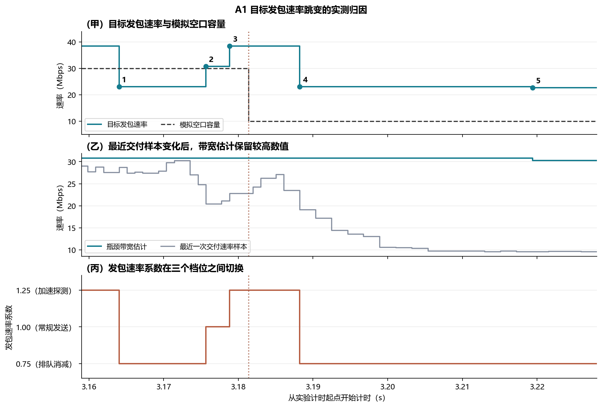
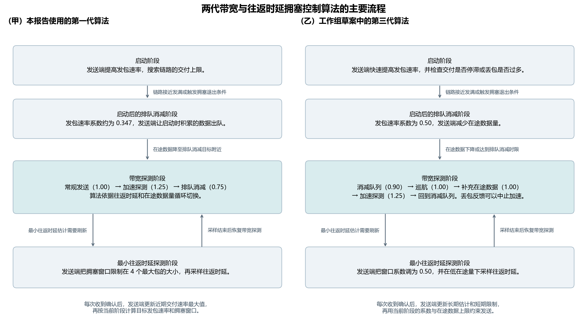

# QUIC 拥塞窗口（cwnd）与发包节奏（pacing）机制及实测

本报告使用第三版 QUIC 实验的端点、网络和任务数据，独立解释发送端为何要控制发包节奏、picoquic BBRv1 怎样选择发包速率，以及节奏和空口容量对不上时会发生什么。实验在同一台 WSL2 主机上运行真实 QUIC，使用 6G-Testbed、虚拟网卡和软件中继模拟无线侧的服务速率。这里的**空口容量**指中继按配置能够转发的 IP 数据速率。正式数据覆盖 21 个配置、63 轮和 12,294 次请求发送，包含 C1 的业务重试。[第三版实验](REPORT.v3.zh-CN.md) · [复现说明](v3/README.md)

- **容量稳定可以提高按时完成率，BBRv1 仍会主动探测带宽。** 同为约 20 Mbps 的平均容量，A1 恒定管道让 40 kB 请求的 20 ms 按时完成率从 87.2% 提高到 100%。在长时波动补测中，264 次可见发包目标跳变中有 164 次只改变了系数。
- **发包节奏和网络匹配以后，队列可以变短，任务完成时间还受任务大小、协议开销和窗口余量限制。** B1 在同一 30 Mbps 分配下将前 20 ms 的队列峰值中位数从 21.8 kB 降至 6.4 kB，上传耗时中位数基本相同。D1 在相同名义发送量下缩短了 50 kB 请求的上传耗时中位数 4.04 ms，分段方案的 50 kB 请求仍未赶上 20 ms 时限。

## 发送端为什么同时需要拥塞窗口和发包节奏？

**拥塞窗口 `cwnd`** 是允许同时在途的数据量上限。**在途数据**是发送端已经发出、仍在等待确认的数据。普通应用数据包发送前，发送端要同时满足有数据可发、还有连接和流的接收额度、窗口余量足够、发包器允许发送这几个条件。收到确认消息（ACK）后，在途数据量下降，发送端就获得更多窗口余量。

**发包节奏 `pacing`** 是发送端把一批数据分布到什么时间发出去。**目标发包速率**是拥塞控制器给发包器的速率目标。对于长度固定、没有其他约束的包，理想包间隔等于包的比特数除以目标速率。例如，一个 1,252 B 的包在 20 Mbps 下对应约 0.501 ms 的理想间隔。实际间隔还受发包批量、操作系统唤醒和拥塞窗口约束。QUIC 的恢复规范要求发送端使用 pacing 或限制成批注入的规模。[QUIC RFC 9002 §7.7](https://www.rfc-editor.org/rfc/rfc9002.html#section-7.7)


图 1 是原理示意，图中数值用于演算。甲图的深色部分是等待确认的在途字节，浅色部分是窗口余量。乙图的横轴是发包时间，圆点代表 1.2 kB 的包，目标从 12 Mbps 提高到 24 Mbps 时，理想包间隔从 0.8 ms 减为 0.4 ms。丙图的实心圆表示已经发包，空心圆表示因窗口用满而没有发送，竖虚线表示首个确认到达。丁图对比模拟空口容量、带宽估计、目标发包速率和拥塞窗口基础目标。浅橙色表示降速后仍沿用的旧值，浅青色表示探测或更新模型后的新值。拥塞窗口基础目标使用 4 ms 最小往返时延和 2 倍窗口系数，图中省略了发包批量余量。

**单包大小和发包批量是两个参数。** 单包大小受路径包长上限、可发数据和协议头约束。A1 使用 1,252 B 的 IPv4 路径 UDP 负载上限并关闭路径包长探测。在所归档的 A1 长时波动逐包记录中，19,704 个出队 IPv4 包为 1,280 B，扣掉 IPv4 和 UDP 头后是 1,252 B。**发包批量额度 `Q`** 是发包器能短时成批释放的数据量。picoquic 把 `Q ÷ 目标速率` 换算成可积攒的时间额度，随经过时间补充，按发包消耗，因此真实包间隔可以短于理想间隔。使用默认参数时，BBRv1 的批量额度在速率低于 1.2 Mbps 时为一个最大包，在 1.2 到 24 Mbps 之间为两个最大包，在 24 Mbps 及以上约为按当前目标发送 1 ms 的数据量，最多 65,536 B。[发包器源码](https://github.com/private-octopus/picoquic/blob/37bb5d28aaea417649a6d4facc15f54de7d55829/picoquic/pacing.c) · [原始证据](results/v3/trace-evidence.tar.xz)

## 平滑 RTT 和 BBR 的最小 RTT 分别怎样算？

**原始往返时延样本**等于发送端收到 ACK 的时刻减去对应被确认包的发送时刻。连接就绪且已有首个样本以后，这版 picoquic 还会尝试扣掉接收端报告的 ACK 等待时间。它先把等待时间限制在本端配置的最大 ACK 延迟以内，再检查原始样本是否严格大于「路径已知最小 RTT + 要扣除的时间」。只有检查通过才扣除。路径最小值和最大值用扣除后的样本更新。首个样本保留原始往返耗时。终端队列、空口等待和回程排队都发生在路径上，仍可能进入样本。[picoquic RTT 采样源码](https://github.com/private-octopus/picoquic/blob/37bb5d28aaea417649a6d4facc15f54de7d55829/picoquic/timing.c)

**平滑 RTT `SRTT`** 给最近一段测量和历史值分配不同权重。picoquic 在一个测量段累计样本数、总和、最小值和最大值。常规应用数据的段更新由最大已确认包号推进，源码还处理首次更新和距上次更新时间小于当前样本四分之一的情况。用 `Ravg` 表示该段样本均值，`Rlo`、`Rhi` 表示该段最小和最大样本。`RTTvar` 是 RTT 波动的估计，使用本段两端样本距离旧平滑 RTT 的较大值。实现以 µs 做整数计算。

```text
初始化：SRTT = 首个 RTT 样本，RTTvar = 首个样本 / 2
以后：  SRTT_new   = (7 × SRTT_old + Ravg) / 8
       偏差样本   = max(|Rlo − SRTT_old|, |Rhi − SRTT_old|)
       RTTvar_new = (3 × RTTvar_old + 偏差样本) / 4
       基础重传计时值 = SRTT_new + 3 × RTTvar_new + 对端最大 ACK 延迟
```

举例，旧 `SRTT` 是 4 ms，旧 `RTTvar` 是 1 ms，该测量段的样本是 3、4、8 ms。均值为 5 ms，最远样本比旧 `SRTT` 大 4 ms。新 `SRTT` 是 **4.125 ms**，新 `RTTvar` 是 **1.750 ms**。若对端最大 ACK 延迟为 10 ms，基础重传计时值就是 **19.375 ms**。在实测的单包延迟组里，包 257 被判丢时的 `SRTT` 是 8.717 ms，`RTTvar` 是 5.949 ms，按同一公式得到 **36.564 ms**，与日志记录一致。实际代码还会在新样本超过当前计时值时先抬高计时值，并在连续超时时延长有效超时。[逐包实测字段](results/pacing-loss/examples.csv) · [判丢与重传报告](REPORT.loss-detection.zh-CN.md)

**BBRv1 用自己的低排队 RTT 估计 `RTprop` 计算带宽时延积。** 每次处理 ACK 时，如果当前 RTT 样本小于等于已有 `RTprop`，就用样本更新并刷新记录时间。如果样本仅高出不到 5%，就刷新记录时间并保留原值。如果距上次刷新同时超过 10 s 和 20 倍原 `RTprop`，旧记录过期，代码用当前样本更新，并可进入最小往返时延探测。A1 的带宽探测阶段用 `RTprop` 设定推进所需的时间和窗口目标。`SRTT` 则参与判丢计时、拥塞通知去重和部分发包器保护逻辑。[BBRv1 的 RTT 更新和探测源码](https://github.com/private-octopus/picoquic/blob/37bb5d28aaea417649a6d4facc15f54de7d55829/picoquic/bbr1.c#L688-L727)

## picoquic BBRv1 怎样算发包速率和窗口目标？

实验使用固定提交 `37bb5d28aaea417649a6d4facc15f54de7d55829` 的 picoquic BBRv1。**交付速率样本**由一段时间内确认的数据量除以发送间隔和交付间隔中较长的一段得到。端点只在交付间隔大于 1 ms 等条件满足时生成新样本，随后由 BBRv1 读取最近值。**瓶颈带宽估计 `BtlBw`** 取算法接受的最近 10 个反馈轮次里的最高交付速率。反馈轮次由被确认的包在发出时记录的累计已交付字节数推进。BBRv1 还会用 `3,072 B ÷ RTprop` 给采样值设置下限，启动时可用观测峰值的一半补足低样本。`BtlBw × RTprop` 是**带宽时延积**，表示按该带宽发送一个低排队往返周期需要的数据量。[交付采样源码](https://github.com/private-octopus/picoquic/blob/37bb5d28aaea417649a6d4facc15f54de7d55829/picoquic/frames.c) · [BBRv1 源码](https://github.com/private-octopus/picoquic/blob/37bb5d28aaea417649a6d4facc15f54de7d55829/picoquic/bbr1.c)

在已发满链路的带宽探测阶段，发送端按以下方式计算目标。带宽用 B/s，往返时间用 s，结果分别是 B/s 和 B。

```text
目标发包速率 = 有效瓶颈带宽估计 × 发包速率系数
在途阈值(g) = floor(g × 有效瓶颈带宽估计 × 最小往返时延) + 3 × 发包批量额度
拥塞窗口目标 = 在途阈值(2.00)
```

公式对应 A1 的默认配置。源码允许另设较大的目标往返时延。发送端认为链路尚未发满时，只有候选目标速率高于旧目标才会替换旧值。确认发满后，候选值可以上调或下调目标。每次更新先计算速率，再按速率算批量额度 `Q`，最后算窗口目标。发包系数和窗口系数独立，批量额度是两者之间的一条联系。

## 窗口什么时候增加、什么时候减少？

设 `W` 是 ACK 处理前的拥塞窗口，`D` 是这次 ACK 新确认的数据量，`Wtarget` 是用最新模型算出的窗口目标，`M` 是路径允许的 UDP 最大包长。这里的 `D` 取协议栈记录的已确认包字节数。处理 ACK 首先从在途量中移除已确认的包，随后 BBRv1 按下面的规则更新**窗口上限**。窗口上限和它当前有多少空位是两个量。

| 状态或触发事件 | 此版本的窗口计算 |
|---|---|
| 连接初始化 | 初始 `cwnd` 为 `10 × 1,536 B = 15,360 B`。其中 1,536 B 是实现常量，A1 路径的 `M` 为 1,252 B。 |
| 常规启动，算法尚未判定链路已发满 | 如果 `W < Wtarget`，或累计交付字节仍低于初始窗口，就设 `Wnew = W + D`。否则保留 `W`。这一阶段在加上 `D` 之后可以暂时高于目标。 |
| 已判定链路发满，收到 ACK | 先算 `Wnew = min(W + D, Wtarget)`。若模型或批量额度让目标变小，收到确认的同时，窗口也可以直接缩到较小的目标。 |
| 完成常规 ACK 更新 | 如果上一步结果小于 `4 × M`，则将窗口提高到 `4 × M`。如果处于最小 RTT 探测，窗口再被限制到 `4 × M` 以内。A1 的这个值是 5,008 B。 |
| 接受非超时拥塞通知 | 一般设 `Wnew = floor(W / 2)`。窗口已经低于实现的最小值时，走下一行的最小窗口分支。 |
| 接受超时拥塞通知，或进入最小窗口分支 | 保存首次进入暂停前的窗口，将窗口设为 `2 × 1,536 B = 3,072 B`。后续 ACK 按正常窗口规则处理。若收到符合该暂停状态的误判重传通知，代码还可在后续 ACK 恢复保存的窗口。 |

启动和启动后排队消减阶段的窗口系数约为 2.885，带宽探测阶段为 2.00，最小 RTT 探测阶段为 1.00 并另施加四包限制。picoquic 还为路径最小 RTT 超过 50 ms 的连接实现了不同的启动分支。表中的常规启动和 A1 窗口例子使用短 RTT 路径。B1 部分对照还会由实验程序临时给窗口设置下限，比较时需要辨明是否启用了这一外部设置。[窗口计算](https://github.com/private-octopus/picoquic/blob/37bb5d28aaea417649a6d4facc15f54de7d55829/picoquic/bbr1.c#L1036-L1076) · [B1 端点设置](v3/endpoint.c)

普通判丢通知要通过拥塞控制器的过滤才会触发减窗。该版本按连续丢包事件的包号距离更新平滑丢包率。若新丢包号大于上一次，先令 `d = min(两次丢包号之差, 32)`，把旧值乘 `(15/16)^d`，再把衰减后距离 1 的差值的 `1/16` 加进去。普通补发通知要求新平滑值严格大于 20%，超时通知可以通过这个门槛。代码还检查拥塞序号，并在一个平滑 RTT 内或已有拥塞标志时过滤重复通知。显式拥塞通知（ECN）走独立入口。这样可以区分**传输层判丢**、**实际补发**和**BBRv1 接受信号后减窗**三件事。[丢包率滤波源码](https://github.com/private-octopus/picoquic/blob/37bb5d28aaea417649a6d4facc15f54de7d55829/picoquic/cc_common.c#L105-L136) · [拥塞处理源码](https://github.com/private-octopus/picoquic/blob/37bb5d28aaea417649a6d4facc15f54de7d55829/picoquic/bbr1.c#L1147-L1254)

举例，如果 `Wtarget = 25,863 B`，`W = 20,000 B`，这次 ACK 新确认 `D = 2,504 B`，窗口增长到 **22,504 B**。如果旧窗口已经是 **32,790 B**，同一目标会把更新结果限制到 **25,863 B**。后一组窗口值在 A1 的系数切换中实际出现，下文的 A1 时序分析给出对应证据。

## 发包系数从哪里来，什么时候使用哪个系数？

系数主要取自状态表。早期 BBR 设计用 `2 ÷ ln(2) ≈ 2.885` 作为启动系数，目的是支持每个反馈轮次近似翻倍的启动搜索。启动后的消减阶段用它的倒数 `1 ÷ 2.885 ≈ 0.347`。带宽探测阶段的 **1.00、1.25、0.75** 分别对应按估计值发送、加 25% 试探和减 25% 消减队列。如果加速和减速各持续一样长且带宽估计不变，两段的名义速率平均回到估计带宽。实际阶段长度受在途阈值和 ACK 到达时刻影响。[早期 BBR 设计稿](https://datatracker.ietf.org/doc/html/draft-cardwell-iccrg-bbr-congestion-control-00) · [本次固定版本的系数表](https://github.com/private-octopus/picoquic/blob/37bb5d28aaea417649a6d4facc15f54de7d55829/picoquic/bbr1.c#L219-L246)

短往返路径通常先以约 2.885 倍的发包速率系数启动。连续三个有足够待发数据的反馈轮次，带宽估计都未达到此前基准的 1.25 倍时，算法进入启动后的排队消减阶段，发包系数约为 0.347。待在途数据回落后，算法进入**带宽探测 `ProbeBW`**。当最小往返时延需要刷新时，算法会进入**最小往返时延探测 `ProbeRTT`**，把窗口限制在四个路径最大包以内，在低在途量下等待至少 200 ms 并完成一个反馈轮次。63 轮中有 8 轮采到 `ProbeRTT`，A1 长时波动的一轮窗口为 5,008 B。带宽探测阶段中，代码按以下阶段编号选择系数。[逐轮最小往返时延探测记录](results/v3/BBRv1-probe-rtt-observations.csv)

| 当前编号与系数 | 正常 ACK 路径下的推进条件 | 下一阶段 |
|---|---|---|
| 0–5，系数 1.00 | 阶段持续时间超过 `RTprop`。 | 编号推进一格。0–4 推进后仍是 1.00，5 推到 6 后变为 1.25。 |
| 6，系数 1.25 | 阶段持续时间超过 `RTprop`，而且上一次处理 ACK 后保存的在途字节数达到 `在途阈值(1.25)`。 | 进入编号 7，使用 0.75。 |
| 7，系数 0.75 | 阶段持续时间超过 `RTprop`，而且保存的在途字节数降到 `在途阈值(1.00)` 或以下。 | 从保存的下一轮起始编号开始，恢复 1.00。 |

发送端处理 ACK 时先更新带宽模型，再使用此前保存的 `RTprop` 和在途字节数判断当前阶段能否推进。随后更新 `RTprop`，算出发包速率和拥塞窗口。拥塞通知设置的 `cycle_on_loss` 可以免去持续时间检查。实际 ACK 路径把 `packets_lost` 参数置为 0，因此加速和减速阶段仍检查相应的在途阈值。带宽时延积很小时，代码会把探测系数提高到 `max(1.25, 6,144 B ÷ 带宽时延积)`，6,144 B 来自四个 1,536 B 的实现包长常量。A1 诊断窗口实际观测到的系数为 0.75、1.00 和 1.25。实测图中的系数用同一次采样的 `目标速率 ÷ 带宽估计` 反推，再用内部状态日志复核。外部限速方案需要另查端点设置。[阶段选择与推进源码](https://github.com/private-octopus/picoquic/blob/37bb5d28aaea417649a6d4facc15f54de7d55829/picoquic/bbr1.c#L705-L769)

**带宽增长标志 `btl_bw_increased` 是 0 或 1，起始编号另行保存。** 新反馈轮接纳一个样本时，如果该样本超过上一轮的最高样本，就把标志置为 1。新轮的样本若受应用供数不足限制且未超过当前瓶颈带宽估计，代码拒绝该样本推进滤波窗口并清零标志。同一轮内，样本超过当前瓶颈带宽估计才会置 1。进入带宽探测时，代码会先把标志设为 1。每次结束编号 7 时，标志为 1 就把保存的起点加 1、最多到 5，并清零标志。标志为 0 就把保存的起点减 1、最低到 0。A1 短 RTT 路径的初始保存起点是 2，入场函数立即推进一次，从阶段 3 开始发送。后续若连续三轮结束时标志为 1，保存起点可以按 2、3、4、5 逐轮增加。

例如，历史最大交付速率仍为 30 Mbps，上一反馈轮最高样本为 18 Mbps，新反馈轮首个被接纳的样本为 22 Mbps。比较 22 和 18 即可置 1，带宽估计仍可以保持 30 Mbps。该标志会改变下一次加速探测前还要经过多少个 1.00 阶段。A1 内部日志在 3.101511 s 实际记录到阶段 7 直接回到阶段 5。同一轮在 3.072409 s 从 5 切到 6，在 3.091030 s 从 6 切到 7，加速实际持续 **18.621 ms**，当时记录的 `RTprop` 是 **2.375 ms**。这个时间差说明推进还受到在途条件和反馈时机的约束。现有 A1 日志记录了结果阶段与系数，判断标志的逐次输入来自源码，日志没有直接采集该位和用于比较的在途字节数。[带宽样本更新源码](https://github.com/private-octopus/picoquic/blob/37bb5d28aaea417649a6d4facc15f54de7d55829/picoquic/bbr1.c#L628-L684) · [A1 内部事件](results/v3/A1-native-pacing-updates.csv)

## A1 实际跳变有多大，怎样定位原因？



图 2 的三幅子图横轴都表示实验时间。甲图青线是发送端设置的目标发包速率，黑色虚线是模拟空口可提供的速率。乙图灰线是最近一次从确认反馈算出的交付速率，青线是 BBRv1 保留下来的瓶颈带宽估计。丙图的三个水平档位是用目标速率除以带宽估计反推的发包系数。橙色竖点线是模拟空口在 3.181364 s 从 30 Mbps 降到 10 Mbps 的时刻。甲图编号对应第三版报告的逐次事件表。

原始采样的 3–6 s 内有 264 次可见跳变。164 次只改变系数，94 次只改变带宽估计，6 次两者都变。只有 1 次跳变的相邻采样跨过模拟容量切换。只改变系数的目标变化绝对值中位数为 7.71 Mbps。独立复验在同样容量计划下记录了 286 次内部目标更新，其中 150 次只改变系数、122 次只改变带宽估计、14 次两者都变。286 次更新都出现在 ACK 处理过程中，复验重建了该轮 2,819 个端点采样的全部目标速率。[原始采样跳变](results/v3/A1-pacing-changes.csv) · [复验事件](results/v3/A1-native-pacing-updates.csv) · [复验重建校验](results/v3/A1-native-pacing-metadata.json)

3.164031 s，模拟空口仍是 30 Mbps，瓶颈带宽估计仍是 30.80 Mbps。系数从 1.25 切到 0.75 后，目标速率从 38.50 Mbps 降到 23.10 Mbps。空口后来降至 10 Mbps，算法再次切到 0.75 时，目标依然是 23.10 Mbps，因为旧带宽估计尚未退出。此时真正的排队取决于实际入队和出队速率之差。在同一次切换中，批量额度由 4,813 B 降到 2,504 B，窗口中的批量余量减少 `3 × (4,813 − 2,504) = 6,927 B`，与窗口从 32,790 B 降到 25,863 B 的变化一致。

## 稳容量和分段发包分别改善了什么？

| A1 管道 | 40 kB 每 20 ms 提交一次时，20 ms 内完成 | 上传耗时 P99（ms） | 连续待发时目标速率 P05–P95（Mbps） | 连续待发时目标与容量绝对差中位数（Mbps） | 连续待发时拥塞窗口 P05–P95（kB） |
|---|---:|---:|---:|---:|---:|
| 短时波动，10–30 Mbps | 1,046/1,200 | 21.89 | 16.6–30.3 | 12.2 | 21.4–26.5 |
| 恒定 20 Mbps | 1,200/1,200 | 18.23 | 14.8–25.5 | 4.9 | 19.3–21.8 |
| 稳定高容量，28–30 Mbps | 1,200/1,200 | 13.13 | 22.1–38.1 | 7.2 | 26.4–33.9 |
| 长时波动，10–30 Mbps | — | — | 21.9–38.0 | 11.9 | 25.5–32.9 |

P05、P95 和 P99 表示第 5、第 95 和第 99 百分位数。连续待发条件每 10 ms 产生 40 kB 请求，提供 32 Mbps 的应用负载。表中连续待发统计先按轮计算 3–6 s 的分位数，再取三轮中位数。恒定 20 Mbps 下，估计带宽和发包批量可比波动管道的高带宽阶段小，因而目标与容量的误差较小、拥塞窗口也较小。窗口取决于带宽时延积和批量额度，两者没有要求随失配指标同向变化。稳定高容量组的平均容量约 29 Mbps，比较它和恒定 20 Mbps 时同时改变了容量。这个组仍有明显的系数切换和目标速率波动。[A1 逐轮结果](results/v3/runs.json) · [任务汇总](results/v3/task-summary.csv)


图 3 统计各策略的 72 个 50 kB 请求。甲图是发送端目标发包速率，乙图是进入中继的实际 IP 速率，己图是中继发往服务器的实际 IP 速率。乙、己图用 2 ms 区间内的 IP 字节换算速率。丙图是中继等待转发的数据量，每个 1 ms 区间先取单任务峰值，再取各任务中位数。戊图是可同时在途的拥塞窗口中位数。丁图的横轴是完整上传所需时间，线段两端分别是中位数和 P95。时间序列横轴从请求提交计时，黑色点线表示模拟容量在 10 ms 处从 30 Mbps 降到 15 Mbps，灰虚线标出 20 ms 时限。

在 D1 中，先用 28 Mbps 后用 14 Mbps，与全程使用 21 Mbps 的名义发送量同为 52.5 kB。对 50 kB 请求，分段方案把上传中位数从 24.30 ms 缩至 20.26 ms，把前 20 ms 队列峰值中位数从 9.0 kB 降到 3.8 kB。原生 BBRv1 的同尺寸上传中位数为 19.67 ms，64/72 笔满足 20 ms，队列峰值中位数为 19.2 kB。对 40 kB 请求，分段发包和原生 BBRv1 都是 72/72 按时完成，队列峰值中位数分别为 3.8 和 15.4 kB。该实验显示队列、上传时限和实际发送量需要一起比较。[D1 时序数据](results/v3/BD-curves.csv.gz) · [分组数据](results/v3/task-summary.csv)

在 B1 中，200 kB 请求获得相同的 30 Mbps 资源时，发送端提前适配目标速率和窗口下限后，有 15/15 个请求在头 20 ms 内连续三个采样点达到分配速率 ±10%，原生发送端是 7/15。提前适配使前 20 ms 队列峰值中位数由 21.8 kB 降到 6.4 kB，上传中位数基本相同。C1 的提前选档减少了上传的业务字节数，发包节奏继续由 BBRv1 决定。[B1、C1 分析](REPORT.v3.zh-CN.md)

## 如果把可用窗口一次性交给终端，会发生什么？

把当前可发的 30 kB 一次交给终端，意味着 QUIC 到终端缓冲的提交间隔接近零。假设空口以 20 Mbps 持续工作且忽略协议开销，传完仍要 12 ms。若终端只有先进先出队列，后面的包会留在终端等待。若发送端以 20 Mbps 及时补包，在相同独占链路上整笔任务也能约 12 ms 完成。共享队列中的紧急任务、空口突然降速、后续链路变窄，以及发送时戳早于实际出队，都可能改变这两种方案的表现。

终端可以作为发包调度点，先接收待发计划，再按近期授权释放一小批，同时让端到端控制限制速率和在途量。实验需要分别记录提交时刻、真正出队时刻和确认返回时刻，否则 RTT 会混入终端排队。第三版的实测覆盖原生、固定速率和分段发包。一次性交付整窗并由终端调度的部分是机制分析，尚无独立的同条件实测结果。[QUIC pacing 与突发限制](https://www.rfc-editor.org/rfc/rfc9002.html#section-7.7)

## 换用其他拥塞控制算法时，哪些规则会变化？

第二版的 `steady` 是固定 8 Mbps 网络和原生 aioquic CUBIC 发包器，`steady_cap8` 在同样的网络上另加 8 Mbps 的发送端上限。aioquic 1.2.0 的原生目标由窗口和**平滑往返时延**算出，后者是经过滤波的往返耗时估计。第三版的 picoquic BBRv1 用带宽模型和阶段系数决定原生目标。两版中的**原生目标**都指端点自身拥塞控制计算出的发包速率，实际业务吞吐还取决于应用供数、窗口余量和网络容量。[第二版实验](REPORT.v2.zh-CN.md)



图 4 左侧是本次实测的 picoquic BBRv1，右侧是 BBRv3 草案。箭头表示算法从启动、消减队列进入带宽探测，以及临时进入最小往返时延探测后的返回路径。蓝框数字表示发包系数。BBRv3 的消减探测队列、巡航、补充在途和加速阶段分别使用 0.90、1.00、1.00 和 1.25。BBRv3 用长期带宽估计与短期带宽限制中较小的值计算有效带宽，并在窗口计算中考虑长期、短期在途量限制。草案的 pacing 公式额外乘 0.99。较新的反馈可以约束仍保留旧高值时的发送，具体收益需要在同一空口轨迹上重跑。图 4 的 BBRv3 部分是源码和草案对比，本报告的实测均使用相应版本所注明的拥塞控制器。[BBRv3 草案 §5](https://datatracker.ietf.org/doc/html/draft-ietf-ccwg-bbr-07#section-5) · [Google QUICHE BBRv3 实现](https://quiche.googlesource.com/quiche.git/+/7bd55da6bccfe63b0f07b6f37554f85dd577d75a/quiche/quic/core/congestion_control/bbr3_sender.cc)

报告的时间结果为网络上传与传输回执，回执只表示服务器收齐数据。模型首 token 时间和无线设备上的频谱效率需要另行测量。[逐任务和逐包证据索引](v3/README.md)
