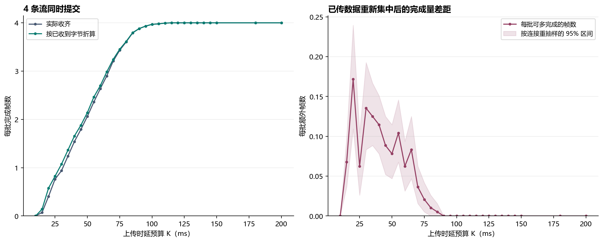
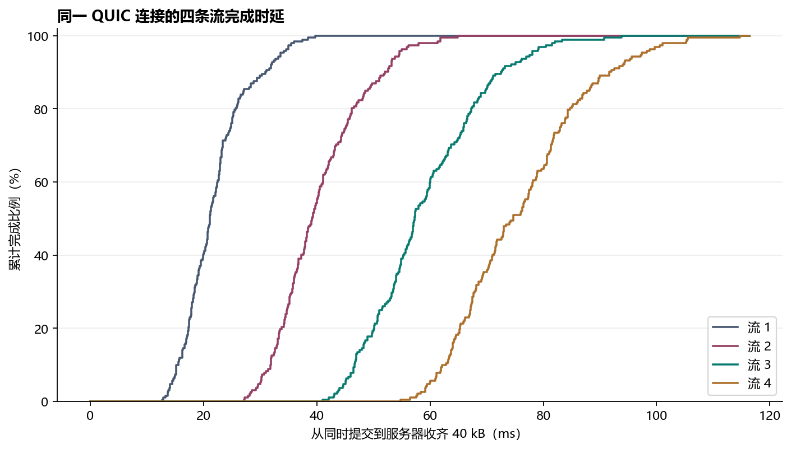
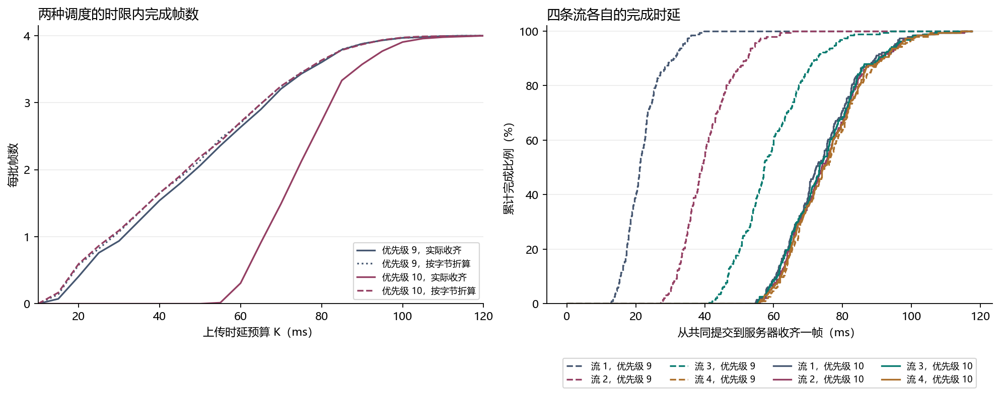
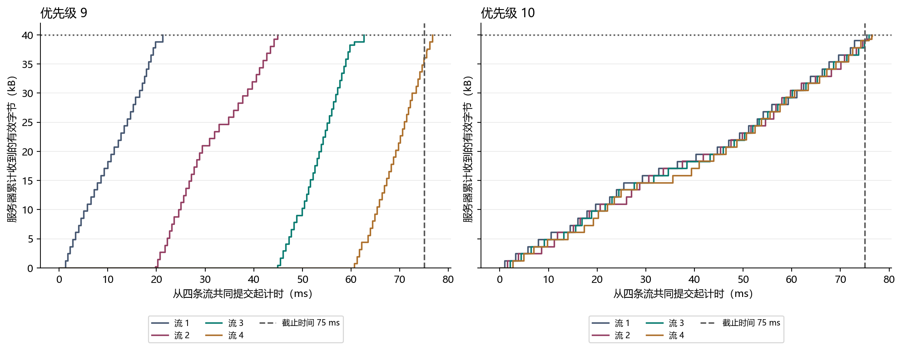
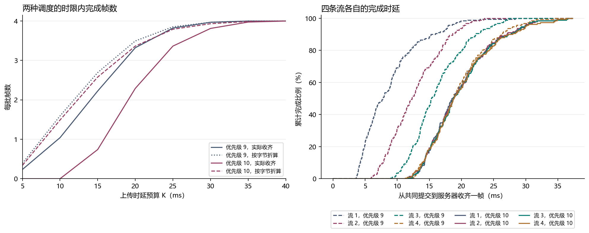
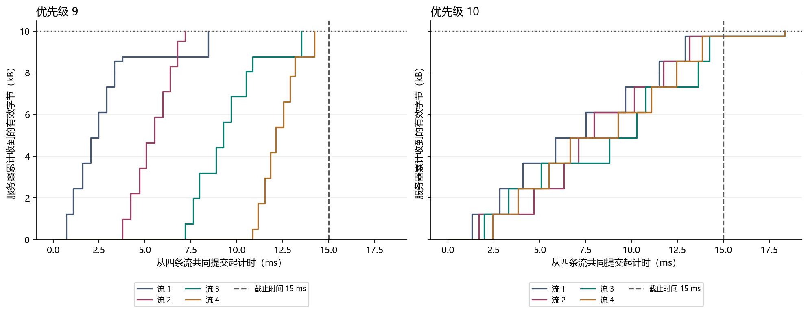
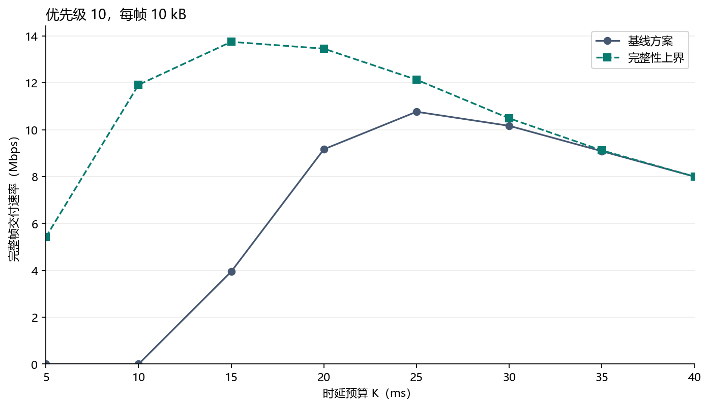

# 单用户四条 QUIC 流同时上传时，时限内能完成几帧

每批任务由同一个用户在同一条 QUIC BBRv3 连接上，同时提交四条流，每条流上传一个 40,000 byte 的帧。实验记录服务器收齐每一帧的时刻，并比较在同一时延预算内，实际完成的帧数与按已收到字节折算的帧数。

2026-11-18 增加了每条流上传 10,000 byte 的两组实测，上传时延预算取 5–40 ms，间隔为 5 ms。新增结果见本文的“每条流改为 10 kB 的补测”部分。

**在原始的优先级 9 实验中，20 ms 的绝对差距最大。** 192 批合计实际收齐 78 帧，已到达字节可折算为 111 帧，相差 33 帧。预算放宽到 60 ms 时，差距缩为 12 帧。到 90 ms 时，两种口径均为 745 帧。

**四条流都设为优先级 10 后，在 60 ms 截止时，有 111 批实际收齐 0 帧，但已到达字节足够折算为 3 帧。** 优先级 9 在同样的 192 批任务安排和空口容量时序下，未出现这种情况。

## 测试配置

| 项目 | 设置 |
|---|---|
| 流与帧 | 4 条可靠双向 QUIC 流，同时提交，每帧 40,000 byte |
| 发送控制 | picoquic 原生 BBRv3，四条流共享连接的拥塞窗口与发包节奏 |
| 流调度 | 原始实验中四条流均使用默认优先级 9。补测中四条流均使用优先级 10 |
| 上行空口 | 可用容量在 10–30 Mbps 内随机变化，每 5 ms 更新。生成过程的相邻状态相关参数为 0.65 |
| 上行逐包等待 | 每个 IP 数据报在空口入队前有 10% 概率延后 5 ms，等待结束后重新抽签 |
| 其余链路 | 空口服务完成后直接转发给服务器。回程只承载正常的 QUIC 确认与应用回复，模拟器未额外加入回传、传播或回程时延 |
| 样本 | 24 个种子和连接，每个连接预热一次后重复 8 批，同一连接内相邻批次相隔 300 ms。共 192 批、768 帧 |

服务端完成时刻取 QUIC 流收到结束标记且交付全部 40,000 byte 的应用回调。时延从四条流的共同提交时刻算起，到上传收齐为止。两端共享同一台主机的单调时钟。模拟器对每个 UDP 数据报计入 28 byte UDP/IP 头，按容量曲线计算其空口服务时间。

24 个连接共记录 32,075 个上行数据报，含握手和预热。3,175 个至少等待一次，占 9.90%，323 个至少等待两次，占 1.01%。正式测试的 768 帧均完整到达，批次之间未发生重叠。

## 优先级 9 的时延预算与完成数

对第 `i` 条流，用 `t_i` 表示其上传完成时延，`D_i(K)` 表示在提交后 `K` ms 内首次到达服务器的有效业务字节。接收端 QUIC 协议日志按流号和字节区间去重，重复或重传的业务字节只计一次。对每一批分别计算下面三个量。

```text
实际完成帧数      = 满足 t_i ≤ K 的流数
按字节折算帧数    = floor((D_1(K) + D_2(K) + D_3(K) + D_4(K)) / 40000)
剩余空间          = 按字节折算帧数 − 实际完成帧数
```

折算只能使用这批任务在时限内实际传到服务器的字节。每批先向下取整，再跨批求和或平均。例如两条流各收到 25 kB 且都未收齐时，实际是 0 帧，50 kB 可以折算为 1 帧。它描述在保持相同已交付字节数的假设下，如果把数据优先集中到少数帧，完整帧数可以多多少。这个统计值也包含已经收到完整字节但结束标记或回调尚未到达的情况。



**图 1。** 左图每个点是 192 批的平均完成帧数，蓝线为实测，绿线为按已收到字节折算的结果。右图的纵轴是每批可以多完成的完整帧数，阴影为对 24 个连接进行配对重抽样得到的 95% 区间。每个连接的 8 批始终一起重抽样。

| 预算 K | 实际完成（192 批合计） | 按字节折算（192 批合计） | 额外帧数 | 有差距的批次 | 相对实际完成数的增幅 |
|---:|---:|---:|---:|---:|---:|
| 15 ms | 14 | 27 | 13 | 13 / 192 | 92.86% |
| 20 ms | 78 | 111 | **33** | 33 / 192 | **42.31%** |
| 30 ms | 180 | 206 | 26 | 26 / 192 | 14.44% |
| 40 ms | 296 | 318 | 22 | 22 / 192 | 7.43% |
| 50 ms | 396 | 411 | 15 | 15 / 192 | 3.79% |
| 60 ms | 506 | 518 | 12 | 12 / 192 | 2.37% |
| 70 ms | 616 | 623 | 7 | 7 / 192 | 1.14% |
| 80 ms | 692 | 694 | 2 | 2 / 192 | 0.29% |
| 90 ms | 745 | 745 | 0 | 0 / 192 | 0.00% |
| 100 ms | 762 | 762 | 0 | 0 / 192 | 0.00% |
| 115 ms | 768 | 768 | 0 | 0 / 192 | 0.00% |

20 ms 下，每批平均实际完成 0.406 帧、可折算 0.578 帧，差 0.172 帧，其重抽样 95% 区间为 0.109–0.240 帧。15 ms 的相对增幅更高，但实际分母只有 14 帧，绝对差距为 13 帧。

第 2 个连接的第 1 批是一个具体例子。提交后 20 ms，流 1 到达 38,801 byte，流 2 到达 3,889 byte，流 3 和流 4 还没有有效字节到达。两条流均未收齐，合计 42,690 byte 可折算为 1 帧。该例说明可以优化的是有限时限内字节分布在哪条流上。若要验证实际的帧完成收益，需要实现相应的流调度并重新测量它对 QUIC 发包和确认的影响。

## 优先级 9 的各条流完成时延



**图 2。** 流 1–4 按同一批中的创建顺序编号。横轴为从共同提交到服务器收齐该流 40 kB 的时间，纵轴为不超过该时间的帧比例。每条曲线有 192 个样本。

| 流 | 完成时延 P50 | P95 | P99 |
|---|---:|---:|---:|
| 1 | 21.12 ms | 33.62 ms | 37.50 ms |
| 2 | 39.17 ms | 54.51 ms | 61.84 ms |
| 3 | 57.26 ms | 77.81 ms | 83.99 ms |
| 4 | 74.70 ms | 97.31 ms | 105.29 ms |

192 批的完成顺序均为流 1、2、3、4。流 4 最慢一笔为 114.667 ms，所以在 115 ms 的预算下，这批样本全部完成。这个顺序描述的是本次 picoquic 配置的观察结果。

## 补测四条流均为优先级 10

picoquic 对同为奇数优先级的流按流 ID 从小到大选择，对同为偶数优先级的流优先选择最久没有发数据的流。轮转发生在同一条 QUIC 连接内。四条流继续共享 BBRv3 的拥塞窗口和目标发包速率。
[picoquic 选流代码](https://github.com/private-octopus/picoquic/blob/37bb5d28aaea417649a6d4facc15f54de7d55829/picoquic/streams.c#L641-L663)

补测另外建立 24 条连接，每条连接测量 8 批，共 192 批、768 帧。两组使用相同的 24 个种子、空口容量时序、交付预算和任务安排。终端在优先级 10 补测中明确调用 picoquic 的接口设置客户端流的默认优先级。两组独立执行，同一个种子固定等待规则的随机数序列，实际发出的 UDP 数据报会随调度变化，因此两组中发生等待的数据报也会不同。

### 两种调度在不同截止时间下能收齐几帧



**图 3。** 左图横轴是上传时延预算，纵轴是 192 批的平均帧数。实线是服务器实际收齐的帧数，点线和虚线是分别按两组已收到的有效字节折算的帧数。右图横轴是从共同提交到服务器收齐某一条流的 40 kB 所经过的时间，纵轴是在该时间前收齐该流的批次百分比。右图用颜色区分流 1 到流 4，用虚线表示优先级 9，用实线表示优先级 10。左图中两组的折算曲线接近，优先级 10 的实际完成曲线在紧预算下明显更低。右图中，优先级 10 的四条流约在同一时间段完成。

| 预算 K | 优先级 9 实际 / 折算帧数 | 优先级 10 实际 / 折算帧数 | 优先级 10 的折算差额 | 优先级 10 实际 0 帧且折算 3 帧的批数 |
|---:|---:|---:|---:|---:|
| 20 ms | 78 / 111 | 0 / 114 | 114 | 0 |
| 40 ms | 296 / 318 | 0 / 317 | 317 | 0 |
| 50 ms | 396 / 411 | 0 / 421 | 421 | 53 |
| 55 ms | 453 / 473 | 3 / 465 | **462** | 85 |
| 60 ms | 506 / 518 | 59 / 521 | **462** | **111** |
| 65 ms | 557 / 573 | 175 / 573 | 398 | 99 |
| 70 ms | 616 / 623 | 287 / 624 | 337 | 94 |
| 75 ms | 659 / 663 | 408 / 662 | 254 | 72 |
| 80 ms | 692 / 694 | 523 / 698 | 175 | 52 |
| 90 ms | 745 / 745 | 686 / 743 | 57 | 15 |
| 100 ms | 762 / 762 | 750 / 763 | 13 | 4 |

表中的帧数按 192 批求和，最右一列每批最多计一次。优先级 10 的折算差额在 55 ms 和 60 ms 同为最大，相当于每批平均相差 2.41 帧。60 ms 时，两种调度分别可折算 518 帧和 521 帧，实际完成量却分别是 506 帧和 59 帧。每一批从第一帧完成到最后一帧完成的时间跨度，中位数从优先级 9 的 52.21 ms 缩短为优先级 10 的 1.66 ms。轮转让各帧的进度更接近，也把第一帧完成的时刻推迟。折算差额只衡量重新分配已交付字节的空间。

### 一个四条流都差约 1 kB 的实测批次



**图 4。** 两个面板使用第 1 个种子的第 1 批。横轴从四条流共同提交开始计时，纵轴是服务器从各条流累计收到的去重业务字节。每一级台阶表示收到此前未到达的字节。横向点线标出完整一帧所需的 40 kB，纵向虚线标出 75 ms 截止时间。示例取自实际完成 0 帧、可折算 3 帧、四条流都不足 40 kB 的观测点，其中进度最慢的流收到的字节数最多。

| 调度 | 流 1 | 流 2 | 流 3 | 流 4 | 已收到字节合计 | 实际 / 折算帧数 |
|---|---:|---:|---:|---:|---:|---:|
| 优先级 9 | 40,000 | 40,000 | 40,000 | 36,096 | 156,096 | **3 / 3** |
| 优先级 10 | 39,018 | 39,032 | 39,026 | 39,038 | 156,114 | **0 / 3** |

表中的数据量单位为 byte。到 75 ms 时，两种调度收到的总量仅相差 18 byte。优先级 9 已把字节集中交付给前三帧。优先级 10 的四帧各差 962–982 byte，随后在 75.374–76.525 ms 之间陆续完成。这个批次直接展示了字节总量接近、按时交付的完整帧数却相差 3 帧的情况。

优先级 10 补测的 768 帧最终全部收齐。双端抓包均无内核丢包，接收端 QUIC 日志与抓包核验一致。共有 32,064 个上行数据报，其中 3,169 个至少等待一次，326 个至少等待两次。数据报计数包含握手和预热。
[补测配置](results/quic-four-stream-deadline-priority10/environment.json) · [抓包核验](results/quic-four-stream-deadline-priority10/validation.json) · [逐包等待核验](results/quic-four-stream-deadline-priority10/radio-check.json)

## 每条流改为 10 kB 的补测

### 测试设置和统计口径

本次分别重测四条流都为优先级 9 和四条流都为优先级 10 的配置。每组仍有 24 条连接，每条连接正式测量 8 批，共 192 批、768 帧。每条流承载一帧 10,000 byte 的业务数据，每批总数据量为 40,000 byte。这里的帧大小是完整业务数据量，picoquic 会把业务帧拆入多个 QUIC 包发送。

两组空口容量仍在 10–30 Mbps 之间每 5 ms 更新，相邻状态的相关参数为 0.65。上行每个 IP 包仍有 10% 概率等待 5 ms，等待结束后重新抽签。回程按正常链路转发。两组沿用原始测试的 24 个网络种子、空口容量时序、每条连接一次的 160 kB 预热，以及 300 ms 的批次间隔。两组独立执行，包的组成和发送时刻会随调度变化。

上传时延仍从四条流共同提交开始计时，直到服务器应用收齐某一帧并收到该流的结束标记。用 `D_i(K)` 表示第 `i` 条流在 K ms 内到达服务器的去重业务字节，本组的折算公式使用 10,000 byte 作为分母。

```text
实际完成帧数   = 在 K ms 内收齐全部 10000 byte 并收到结束标记的流数
按字节折算帧数 = floor((D_1(K) + D_2(K) + D_3(K) + D_4(K)) / 10000)
折算差额       = 按字节折算帧数 − 实际完成帧数
```

预算取 5、10、15、20、25、30、35、40 ms。每批先向下取整，再对 192 批求和。折算数描述在相同已收到字节数下，把数据集中到少数帧的潜在空间。实验持续运行到各帧完整交付，超过 K 的帧计为该预算下未完成。

### 5–40 ms 内能完成多少个 10 kB 帧



**图 5。** 左图横轴是上传时延预算 K，范围为 5–40 ms，纵轴是每批平均帧数。蓝灰色曲线表示优先级 9，紫红色曲线表示优先级 10。实线表示实际收齐的帧数，点线和虚线表示按有效字节折算的帧数。右图横轴是收齐一帧的上传时延，纵轴是时延不超过该值的累计比例。右图用颜色区分流 1–4，用虚线表示优先级 9，用实线表示优先级 10。每条分流曲线有 192 个样本。左图中，10–20 ms 的预算下，优先级 10 的完整帧数明显低于其字节折算数。右图中，优先级 10 的四条完成时延曲线接近，优先级 9 的较早创建的流通常更早完成。

| 预算 K | 优先级 9 实际 / 折算帧数 | 优先级 9 折算差额 | 优先级 10 实际 / 折算帧数 | 优先级 10 折算差额 | 实际 0 帧且折算 3 帧的批数，优先级 9 / 10 |
|---:|---:|---:|---:|---:|---:|
| 5 ms | 45 / 75 | 30 | 0 / 65 | 65 | 0 / 0 |
| 10 ms | 200 / 306 | **106** | 0 / 286 | 286 | 1 / 8 |
| 15 ms | 427 / 517 | 90 | 142 / 495 | **353** | 1 / **63** |
| 20 ms | 638 / 671 | 33 | 440 / 646 | 206 | 1 / 51 |
| 25 ms | 734 / 740 | 6 | 646 / 728 | 82 | 0 / 23 |
| 30 ms | 762 / 762 | 0 | 732 / 755 | 23 | 0 / 5 |
| 35 ms | 768 / 768 | 0 | 763 / 766 | 3 | 0 / 1 |
| 40 ms | 768 / 768 | 0 | 768 / 768 | 0 | 0 / 0 |

表中的帧数按每组 192 批求和，各组最多完成 768 帧。K＝15 ms 时，优先级 10 实际完成 142 帧，按已收到字节可折算为 495 帧，差额为 353 帧。每批平均差额为 1.84 帧，按整条连接重抽样的 95% 区间为 1.69–1.99 帧。相对实际完成量的折算空间为 248.59%。K＝10 ms 时，优先级 10 的实际完成量为 0，因此该点只报告 286 帧的绝对差额。

优先级 9 的最大差额出现在 K＝10 ms，共 106 帧，相对实际完成的 200 帧为 53.00%。在八个预算点中，优先级 9 有 3 个不同批次出现实际 0 帧、折算 3 帧，优先级 10 有 134 个不同批次出现这种情况。表中同一批次可在不同 K 下出现，跨预算去重后才得到上述批次数。

与 40 kB 的结果相比，优先级 10 的最大绝对差额从 55–60 ms 移到 15 ms，数值从 462 帧变为 353 帧。每批总数据量缩为原来的四分之一后，主要的完整帧交付差距也出现在更短的预算内。随机等待的单次时长仍为 5 ms，因此本次时延分布同时受到业务量缩小和逐包等待的影响。

### 每条流的完成时延

P50、P95、P99 分别表示有 50%、95%、99% 的样本不超过该上传时延。表中单位均为 ms，对应图 5 右图的各条曲线。

| 流 | 优先级 9 P50 | 优先级 9 P95 | 优先级 9 P99 | 优先级 10 P50 | 优先级 10 P95 | 优先级 10 P99 |
|---:|---:|---:|---:|---:|---:|---:|
| 1 | 7.79 | 17.88 | 21.16 | 18.57 | 29.87 | 34.58 |
| 2 | 12.28 | 20.21 | 22.86 | 18.76 | 29.55 | 34.58 |
| 3 | 15.30 | 24.63 | 26.89 | 18.70 | 29.55 | 34.72 |
| 4 | 18.66 | 28.21 | 31.51 | 18.79 | 29.94 | 34.86 |

每批第一帧与最后一帧完成时刻的差值，中位数在优先级 9 下为 11.16 ms，在优先级 10 下为 0.47 ms。优先级 10 让各流同时接近完成，也推迟了较早几帧的完整交付。优先级 9 下，流 1 最先完成的批次占 81.77%，流 2 和流 3 也有先完成的批次。按流 ID 选择待发数据，与服务器最终收齐各流的顺序之间，还受到逐包等待、排队和 QUIC 恢复过程的影响。

### 一个四条流都只差 230 byte 的实测批次



**图 6。** 两个面板分别表示优先级 9 和优先级 10，使用第 9 个网络种子的第 3 批。横轴从四条流共同提交开始计时，纵轴是各流累计收到的去重业务字节，单位为 kB。横向点线表示完整一帧所需的 10 kB，纵向虚线表示 K＝15 ms。示例从优先级 10 实际完成 0 帧、可折算 3 帧的观测点中，选择进度最慢的流收到字节最多的一个。优先级 9 在截止前收齐四帧，优先级 10 的四条曲线则同时停在 9.77 kB。

| 调度 | 流 1 已收到 | 流 2 已收到 | 流 3 已收到 | 流 4 已收到 | 字节合计 | 实际 / 折算帧数 |
|---|---:|---:|---:|---:|---:|---:|
| 优先级 9 | 10,000 | 10,000 | 10,000 | 10,000 | 40,000 | **4 / 4** |
| 优先级 10 | 9,770 | 9,770 | 9,770 | 9,770 | 39,080 | **0 / 3** |

表中的数据量单位为 byte。优先级 10 的四帧各差 230 byte。发送端 QUIC 日志显示，四条流末尾的 230 byte 及各自的结束标记合并在包号为 263 的同一个 QUIC 包中，其所在 UDP 数据报长 971 byte，承载 920 byte 的业务数据。该包在共同提交后 12.618 ms 发出，在 18.343 ms 被服务器 QUIC 接收，单向经过 5.725 ms。中继日志记录这个数据报触发了一次 5 ms 随机等待。服务器应用在 18.354–18.358 ms 之间完成四条流的接收回调。这个批次中，一个携带四条流尾部数据的包被延后，四帧便同时错过了 15 ms 的预算。

优先级 9 在同一容量时序上的四帧完成时延分别为 8.443、7.186、13.521、14.227 ms，均在截止前完成。两组独立运行，数据报组成、随机等待命中的数据报和协议反馈会随调度变化。图 6 展示一个具体批次的过程，全部批次的差距由图 5 和汇总表给出。

### 按时完成帧对应的交付速率



**图 7。** 本图使用优先级 10、每帧 10 kB 的 192 批实测数据。横轴是时延预算 K，取值为 5–40 ms，间隔为 5 ms。纵轴是每批在 K 内完成的帧数乘以 10 kB，再除以 K 得到的完整帧交付速率，单位为 Mbps。蓝灰色实线“基线方案”使用实际完整接收的帧数，绿色虚线“完整性上界”使用按已到达有效字节折算的完整帧数。两条曲线均先按批计算，再对 192 批取平均。

令 `N实际(K)` 表示 192 批实际完成的帧数合计，`N折算(K)` 表示每批按已收到字节折算后再求和的帧数，K 的单位为 ms。每帧大小为 10,000 byte，每 byte 为 8 bit，公式中的换算使结果以 Mbps 表示。

```text
R基线(K)       = N实际(K) × 10000 × 8 / (192 × K × 1000) Mbps
R完整性上界(K) = N折算(K) × 10000 × 8 / (192 × K × 1000) Mbps
```

K＝15 ms 时，基线方案实际完成 142 帧，对应 3.94 Mbps。完整性上界可折算 495 帧，对应 13.75 Mbps，两者相差 9.81 Mbps。K＝25 ms 时，两条曲线分别为 10.77 Mbps 和 12.13 Mbps。K＝40 ms 时，每批四帧均已收齐，两条曲线相交于 8.00 Mbps。帧数达到每批四帧后，继续增加预算会扩大公式中的时间分母，因此交付速率会下降。完整性上界衡量在保持相同已到达有效字节总量的条件下，把字节集中到完整帧后的交付空间。 [图 7 的八个数据点](results/quic-four-stream-10kb-priority10/completion-rate.csv)

### 核验和原始数据

两组共 1,536 帧全部完整到达。优先级 9 最慢一帧为 34.466 ms，优先级 10 最慢一帧为 36.554 ms，因此在 K＝40 ms 时两组均已收齐全部 768 帧。双端抓包均无内核丢包，QUIC 日志与抓包逐包核验一致，原始归档内各文件的 SHA256 校验通过。

| 调度 | 上行数据报数 | 至少等待一次 | 至少等待两次 |
|---|---:|---:|---:|
| 优先级 9 | 11,188 | 1,127 | 141 |
| 优先级 10 | 11,093 | 1,129 | 113 |

数据报数包含握手和预热。各组环境文件记录实际执行的帧大小、优先级、端点哈希和依赖版本，原始归档包含任务计划、两端抓包、两端 QUIC 日志、逐包等待记录及 Testbed 日志数据库。

- 优先级 9 的[逐流完成时延](results/quic-four-stream-10kb-priority9/stream-completions.csv)、[逐批逐预算数据](results/quic-four-stream-10kb-priority9/per-batch-deadlines.csv)、[汇总表](results/quic-four-stream-10kb-priority9/deadline-summary.csv)、[原始归档](results/quic-four-stream-10kb-priority9/raw-evidence.tar.xz)和[核验结果](results/quic-four-stream-10kb-priority9/validation.json)。
- 优先级 10 的[逐流完成时延](results/quic-four-stream-10kb-priority10/stream-completions.csv)、[逐批逐预算数据](results/quic-four-stream-10kb-priority10/per-batch-deadlines.csv)、[汇总表](results/quic-four-stream-10kb-priority10/deadline-summary.csv)、[原始归档](results/quic-four-stream-10kb-priority10/raw-evidence.tar.xz)和[核验结果](results/quic-four-stream-10kb-priority10/validation.json)。
- [两种优先级的八个预算点对照](results/quic-four-stream-10kb-priority10/priority-comparison.csv)、[图 6 的逐流接收进度](results/quic-four-stream-10kb-priority10/priority-example-arrivals.csv)和[优先级 10 的逐包统计](results/quic-four-stream-10kb-priority10/packets.csv.gz)。图 6 的尾包对应 `four-stream__08` 的前向 1RTT 包 263。

## 数据和复现

- [每条流的完成时延](results/quic-four-stream-deadline/stream-completions.csv) · [分流分位数](results/quic-four-stream-deadline/stream-summary.csv)
- [逐批、逐预算的收到字节和完成帧数](results/quic-four-stream-deadline/per-batch-deadlines.csv) · [按预算汇总](results/quic-four-stream-deadline/deadline-summary.csv)
- [原始抓包与 QUIC 日志](results/quic-four-stream-deadline/raw-evidence.tar.xz)
- 优先级 10 补测的[每条流完成时延](results/quic-four-stream-deadline-priority10/stream-completions.csv)、[逐批逐预算记录](results/quic-four-stream-deadline-priority10/per-batch-deadlines.csv)、[按预算汇总](results/quic-four-stream-deadline-priority10/deadline-summary.csv)、[分流分位数](results/quic-four-stream-deadline-priority10/stream-summary.csv)和[原始抓包与 QUIC 日志](results/quic-four-stream-deadline-priority10/raw-evidence.tar.xz)。
- [两种优先级在全部预算点的对照表](results/quic-four-stream-deadline-priority10/priority-comparison.csv) · [图 4 的逐流到达记录](results/quic-four-stream-deadline-priority10/priority-example-arrivals.csv)

使用与跨层实验相同的方式构建 BBRv3 端点。这里只启动 BBRv3 模式和单段空口中继。下面的命令从仓库根目录运行，`ENDPOINT` 指向用当前代码重新构建的端点。绘图脚本可用 `--font` 指定支持中文的字体文件。 [端点构建方式](studies/cross_layer/README.md)

```bash
sudo "$PY" studies/multistream/experiment.py --testbed "$TESTBED" --endpoint "$ENDPOINT" \
  --out "$WORK/four-stream-raw" --repeats 24
"$PY" studies/pacing_loss/analyze.py "$WORK/four-stream-raw" "$WORK/four-stream" --archive
"$PY" studies/multistream/analyze.py --data "$WORK/four-stream"
sudo "$PY" studies/multistream/experiment.py --testbed "$TESTBED" --endpoint "$ENDPOINT" \
  --out "$WORK/priority10-raw" --repeats 24 --stream-priority 10
"$PY" studies/pacing_loss/analyze.py "$WORK/priority10-raw" "$WORK/priority10" --archive
"$PY" studies/multistream/analyze.py --data "$WORK/priority10"
"$PY" studies/multistream/compare_priorities.py results/quic-four-stream-deadline "$WORK/priority10"
```

10 kB 补测使用以下命令。两组运行相同的八个预算点，比较图的预算坐标范围也固定为 5–40 ms。

```bash
for PRIORITY in 9 10; do
  sudo "$PY" studies/multistream/experiment.py --testbed "$TESTBED" --endpoint "$ENDPOINT" \
    --out "$WORK/10kb-p$PRIORITY-raw" --repeats 24 --stream-priority "$PRIORITY" --frame-bytes 10000
  "$PY" studies/pacing_loss/analyze.py "$WORK/10kb-p$PRIORITY-raw" "$WORK/10kb-p$PRIORITY" --archive
  "$PY" studies/multistream/analyze.py --data "$WORK/10kb-p$PRIORITY" --budgets 5 10 15 20 25 30 35 40
done
"$PY" studies/multistream/compare_priorities.py "$WORK/10kb-p9" "$WORK/10kb-p10" --budget-xlim 5 40
"$PY" studies/multistream/completion_rate.py --data "$WORK/10kb-p10"
```
