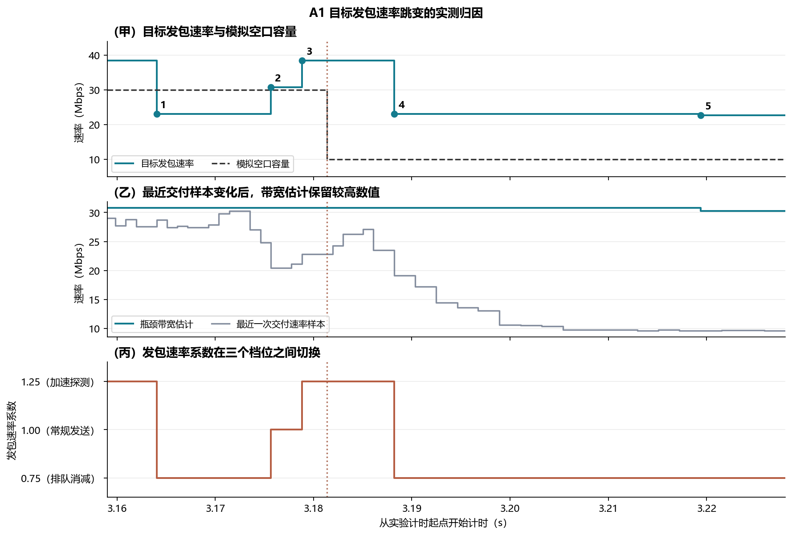
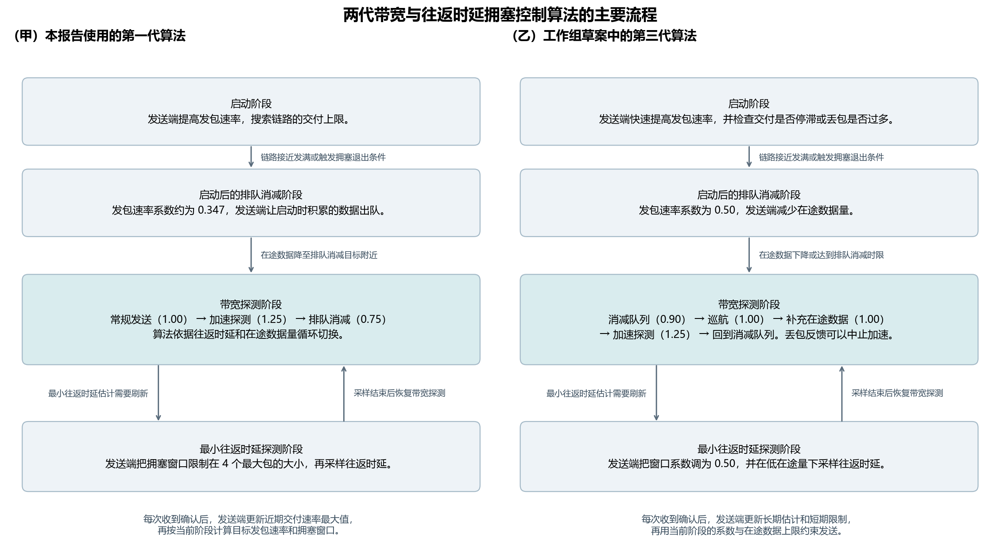

# 第三版｜稳定的网络服务怎样帮助 QUIC 上传 AI 请求？

本报告把「黄金管道」定义为网络能够提供的四种能力。第一种能力是稳定提供较高的上传容量。第二种能力是按请求大小分配上传速率。第三种能力是在首次上传前告知应用可用容量，让应用选择发送多少数据。第四种能力是把同一次上传拆成不同的发包阶段，让发送端在网络降速时同步放慢。

**报告版本和算法版本分别编号。** 本文是第三版报告（V3）。A1 至 D1 的实验采用 picoquic 的 BBRv1 拥塞控制算法。文末另设 BBRv3 算法说明，引用该算法的工作组草案。本报告尚无 BBRv3 实测数据。

| 用例 | 实验比较的是什么 | 实验观察到了什么 |
|---|---|---|
| A1 稳定上传容量 | 实验比较平均上传容量相同但稳定性不同的两条管道，并另测容量更高的管道。 | 平均上传容量约为 20 Mbps 时，恒定速率管道把 40 kB 请求的按时完成率从 87.2% 提高到 100%。 |
| B1 按请求分配上传速率 | 实验先比较固定分配和按需分配，再在网络分配相同的情况下比较两种发送端策略。 | 按需分配让大请求更容易在补测时限内上传完毕。发送端提前适配进一步减少了中继排队。 |
| C1 在上传前选择数据量 | 实验比较超时后缩小请求与上传前根据容量预测缩小请求。 | 当模拟空口容量为 10 Mbps 时，提前准确选档把首次按时完成的请求从 0 个增加到 72 个。 |
| D1 在一次上传内分段发包 | 实验在相同的模拟空口降速条件下比较固定目标发包速率与分段目标发包速率。 | 对 40 kB 请求，分段发包与拥塞控制算法自行调节均能按时完成，分段发包的队列峰值中位数更低。 |

## 实验环境与术语

实验用本地的 6G-Testbed 网络测试平台连接客户端、中继路由器和服务器。客户端把请求通过虚拟网卡发给中继，中继按配置速率把数据包转发给服务器。这里的**模拟空口容量**是中继在某一时刻能够为上传方向提供的服务速率，用来模拟终端到基站的无线链路容量。实验直接控制软件链路的速率和时延。实际无线频谱复用、信号遮挡造成的衰减以及在线容量预测性能需要在无线设备上另行验证。[6G-Testbed 上游项目](https://github.com/5G-MAG/6G-Testbed) · [实验复现步骤](v3/README.md)

**QUIC** 是一种传输协议。本实验使用 picoquic 实现 QUIC，每次发送都用一条独立的可靠传输流，收端按顺序收齐这一请求的字节。**BBRv1** 是实验采用的第一版带宽与往返时延拥塞控制算法。拥塞控制算法通过接收端返回的确认消息了解哪些数据已经到达，再估计链路的交付能力，决定发送节奏以及允许同时在途的数据量。[picoquic 中的 BBRv1 实现](https://github.com/private-octopus/picoquic/blob/37bb5d28aaea417649a6d4facc15f54de7d55829/picoquic/bbr1.c)

| 术语 | 本报告中的含义 |
|---|---|
| 请求大小 | 客户端一次提交的完整应用数据量。C1 的请求包含四张 JPEG 压缩图片、问题、选项和应用层字段。表中的请求大小只计应用数据。 |
| 模拟空口容量与网络分配速率 | 模拟空口容量是中继允许上传数据通过的速率。B1 里的网络分配速率是实验为某个请求配置的模拟空口容量。 |
| 瓶颈带宽估计 | 拥塞控制算法根据接收端的确认消息估算出的路径瓶颈交付速率。路径瓶颈是传输能力最受限的链路环节。 |
| 目标发包速率（pacing rate） | 发送端用这个目标安排相邻数据包的发出间隔。拥塞控制算法根据瓶颈带宽估计设定目标，并在探测阶段短时提高目标，以判断链路是否还能交付更多数据。实际发包还取决于应用是否有数据、拥塞窗口是否有余量，以及操作系统何时唤醒发包程序。 |
| 拥塞窗口（cwnd） | 发送端允许同时在途的数据量上限。在途数据是已经发出但还未收到确认的数据。算法用瓶颈带宽估计和最小往返时延计算基本窗口，再为成批发包留出额外额度。 |
| 往返时延（RTT） | 发送端发出数据并收到对应确认所经过的时间。基础往返时延是实验配置的上行和下行传播时延之和，实测往返时延还包含排队和确认等待。常规配置的基础往返时延为 2 ms，B1 另测了 12 ms。 |
| 实际入队速率、实际出队速率和中继队列 | 实际入队速率是数据包进入中继缓冲区的速率，实际出队速率是中继把数据包发往服务器的速率。两种速率都按网际协议（IP）数据包的字节数计算，包含协议头等附加数据。中继队列是已经进入缓冲区、正在等待转发的数据量。 |
| 上传耗时、传输回执耗时和模型首字耗时 | 上传耗时从客户端提交请求算到服务器收齐请求。服务器收齐后返回一个字节作为传输回执，传输回执耗时到客户端收到该字节为止。模型首字耗时在独立推理实验里从提交模型请求算到模型产生首段可见文字。 |
| 时限、按时完成率和百分位数 | 上传时限是实验允许请求完整到达服务器的最长时间。按时完成率等于按时完成的请求数除以发起的请求数。第 95 百分位数表示约 95% 的样本不超过该数值。第 5、第 50 和第 99 百分位数按同样的方法理解，第 50 百分位数也称为中位数。 |

报告使用十进制单位。1 kB 等于 1,000 B，1 MB 等于 1,000 kB。1 B（字节）等于 8 bit（比特），1 Mbps 表示每秒传输 1,000,000 bit。报告用 ms（毫秒）和 s（秒）表示时间。A1、B1 和 D1 使用大小可控的请求来单独考察传输因素。C1 使用同一批 12 道视频问答题，把提问之前的四帧图片重新压缩成两个请求大小档位。实验对两个档位分别运行本地 MiniCPM-o 2.6 视觉语言模型，让模型读取图片和问题并生成答案。实验把传输回执与模型输出分别计量。A1 的请求接连提交，测得的传输回执耗时没有包含服务器等待模型开始处理的时间。

### 拥塞窗口和目标发包速率怎样配合？

**拥塞窗口规定发送端最多允许多少数据同时在途。目标发包速率规定发送端应以多快的节奏发出数据包。** 对普通应用数据包，发送端有待发数据、到了发包时刻，并且窗口余量能放下这个包，才会发包。窗口余量等于拥塞窗口减去当前在途数据量，如果结果小于零，发送端需要等在途数据减少后才能继续发送。[QUIC 的拥塞窗口与发包节奏](https://www.rfc-editor.org/rfc/rfc9002.html#section-7)

**原理图的读法。** 四个子图使用简化示例，所有数字都用于说明机制。甲至丙图假设每个包计入窗口的数据量为 1.2 kB。丁图另用 30 Mbps 和 10 Mbps 两种网络容量说明 BBRv1 的控制目标怎样变化。

- **甲图比较收到确认前后的窗口余量。** 深色部分表示已经发出但还未确认的在途数据，浅色部分表示还能发送的数据量。示例将拥塞窗口固定为 6 kB。两个包获确认后，在途数据从 4.8 kB 减至 2.4 kB，窗口余量从 1.2 kB 增至 3.6 kB。确认首先释放在途额度，拥塞控制算法还可以根据反馈另行更新窗口大小。
- **乙图比较两种目标发包速率下的理想发包间隔。** 横轴表示发送时间，每个圆点代表一个 1.2 kB 的包。理想间隔等于包的比特数除以目标发包速率。当目标从 12 Mbps 提高到 24 Mbps 时，包间隔从 0.8 ms 缩短到 0.4 ms。该示例假设应用一直有数据，窗口余量也始终足够。
- **丙图说明什么情况下发送端要等确认。** 横轴是时间，两行使用相同的 9.6 Mbps 目标发包速率和 4 ms 往返时延。实心圆表示发送端实际发出了一个包，空心圆表示到了示例规定的发包时刻但窗口已经用满，竖虚线表示第一个包的确认到达。4.8 kB 的窗口可以让发送端每隔 1 ms 发出一个包。2.4 kB 的窗口最多同时容纳两个包，发送端在 0 ms 和 1 ms 发包后，必须等到 4 ms 才能再发。提高目标发包速率可以缩短包间隔，但无法在窗口已经用满时释放在途额度。
- **丁图比较四种状态下的网络容量、算法估计和控制目标。** 网络容量是链路实际配置的速率，瓶颈带宽估计是 BBRv1 根据确认反馈形成的估计。示例把目标发包速率算作带宽估计乘以发包速率系数。常规发送时系数为 1，短时探测时系数提高到 1.25，因此目标发包速率可以从 30 Mbps 提高到 37.5 Mbps，拥塞窗口的基础目标仍为 30 kB。窗口基础目标等于带宽估计乘以最小往返时延，再乘以窗口系数。图中采用 4 ms 和 2 倍，并省略实际实现为成批发包预留的额度。网络刚降到 10 Mbps 时，旧估计仍可能让发送目标和窗口目标保持原值。若算法随后采纳 10 Mbps 的较低估计，两个目标才会按新的估计变化。浅橙色标出降速后仍未匹配的数值，浅青色标出探测或更新估计后发生变化的数值。该示例用状态描述反馈过程，各列没有指定的持续时间。[picoquic 的 BBRv1 实现](https://github.com/private-octopus/picoquic/blob/37bb5d28aaea417649a6d4facc15f54de7d55829/picoquic/bbr1.c)

A1 的长时波动补测展示了模拟空口降速后目标发包速率仍偏高的实际例子。判断网络是否积压时，还要看实际入队速率是否持续高于实际出队速率。C1 中，应用缩小了重试请求，实际发出的数据量减少，起始目标发包速率的中位数仍为 86.9 Mbps。

**单个包的大小和一次成批发送的数据量分别由不同环节决定。** QUIC 发送端会将应用请求分装进多个包。路径允许的最大包长、发送时可用的数据和协议头共同决定每个包的大小。原理图用 1,200 B 方便计算。A1 采用 picoquic 的 IPv4 默认路径包长上限，并关闭了路径包长探测。归档记录中有 19,704 个出队 IP 包的大小为 1,280 B。扣掉 20 B 的 IPv4 头和 8 B 的 UDP 头后，UDP 负载为 1,252 B。picoquic 按路径包长上限与目标发包速率计算基准间隔，并按实际发送的长度计入发包额度。BBR 还会单独计算**发包批量额度**，即发包器可成批调度的字节量。批量额度变大时，单个包仍受路径包长上限约束。[picoquic 发包节奏实现](https://github.com/private-octopus/picoquic/blob/37bb5d28aaea417649a6d4facc15f54de7d55829/picoquic/pacing.c) · [A1 逐包记录](results/v3/trace-evidence.tar.xz)

正式实验包含 **21 个配置，每个配置运行 3 轮，共 12,294 次请求发送**。总数包含 C1 的重试。服务器最终完整收到了所有请求，因此本报告中的上传失败均指请求超过指定时限。正式轮次中，中继没有丢弃数据包。逐轮计算第 99 百分位数后，中继实际出队时间相对计划的最大统计偏差为 **0.36 ms**，请求实际提交时间相对计划的最大统计偏差为 **0.39 ms**。初轮的本地推理进程与网络实验同时运行，实验剔除了受影响的轮次，并在推理进程结束后重跑了该批配置。[运行环境](results/v3/environment.json) · [逐轮统计](results/v3/runs.json)

**发送端实际运行了哪些算法？** 默认的发送端由 picoquic BBRv1 自行计算拥塞窗口、目标发包速率和发包批量额度，picoquic 的发包器据此安排真实 QUIC 包的发送。B1 的「按需分配，发送端提前适配」对照会额外设置目标发包速率和窗口下限。D1 的固定速率和分段发包对照会额外设置目标发包速率，仍使用算法计算的拥塞窗口。正式实验的端点日志中，**63 轮里有 8 轮采到了最小往返时延探测状态**。例如，A1 长时波动补测的第二轮在 9.919760 s 首次采到该状态，窗口限制为 **5,008 B，即 4 个 1,252 B 的路径最大包**。A1 跳变放大图所分析的 3–6 s 区间处于带宽探测阶段。[逐轮最小往返时延探测记录](results/v3/BBRv1-probe-rtt-observations.csv)

## A1｜稳定上传容量能否提高按时完成率？

实验先每隔 20 ms 提交一笔 40 kB 请求，连续提交 8 s。实验随后把提交间隔缩短到 10 ms，连续提交 6 s，让发送端持续有待发数据，以便观察拥塞控制算法在负载充足时的行为。第二种负载以 32 Mbps 的速率产生应用数据，高于所有被测管道的平均容量。实验用这种负载比较传输控制和队列行为。

| 管道 | 模拟空口容量（Mbps） | 容量保持时间 |
|---|---|---|
| 普通管道（短时波动） | 容量在 10 和 30 之间交替，均值约为 20。 | 每个档位持续 5 至 10 ms。 |
| 恒定速率管道 | 容量固定为 20。 | 容量在整轮实验中保持恒定。 |
| 稳定高容量管道 | 容量在 28 和 30 之间交替，均值约为 29。 | 每个档位持续 5 至 10 ms。 |
| 普通管道（长时波动） | 容量在 10 和 30 之间交替，均值约为 20。 | 每个档位持续 120 至 180 ms。实验只在持续有待发数据的负载下测量这一管道。 |

### 每隔 20 ms 提交一笔 40 kB 请求

| 管道 | 20 ms 内上传完成的请求数 | 上传耗时第 99 百分位数（ms） | 传输回执耗时第 99 百分位数（ms） |
|---|---:|---:|---:|
| 普通管道（短时波动） | 1,046/1,200 | 21.89 | 23.02 |
| 恒定速率管道 | 1,200/1,200 | 18.23 | 19.43 |
| 稳定高容量管道 | 1,200/1,200 | 13.13 | 14.30 |

恒定速率管道和普通短时波动管道的平均上传容量都约为 20 Mbps。恒定速率管道让超过 20 ms 上传时限的请求从 154 个降到 0 个。稳定高容量管道把平均上传容量提高到约 29 Mbps，上传耗时的第 99 百分位数又比恒定速率管道降低 5.10 ms。三种管道的拥塞控制算法在第 3 s 至第 6 s 都处于启动阶段，算法此时还在寻找足以填满链路的发送速率。稳定高容量管道的目标发包速率约为 83 Mbps，实际入队速率约为 17 Mbps。这组负载每 20 ms 只提供一笔请求，算法的目标速率远高于应用持续提供数据的速率。

### 发送端持续有待发数据

实验在开始计时后的第 3 s 至第 6 s 统计下表。速率单位为 Mbps，数据量单位为 kB。实验先计算各轮的统计量，再取三轮结果的中位数。

| 管道 | 实际出队速率 | 目标发包速率第 5 至第 95 百分位数 | 目标与容量的绝对差，中位数 / 第 99 百分位数 | 拥塞窗口第 5 至第 95 百分位数 | 中继队列第 95 百分位数 |
|---|---:|---:|---:|---:|---:|
| 普通管道（短时波动） | 20.0 | 16.6–30.3 | 12.2 / 21.0 | 21.4–26.5 | 20.5 |
| 恒定速率管道 | 20.0 | 14.8–25.5 | 4.9 / 6.5 | 19.3–21.8 | 14.2 |
| 稳定高容量管道 | 29.0 | 22.1–38.1 | 7.2 / 10.3 | 26.4–33.9 | 20.5 |
| 普通管道（长时波动） | 19.9 | 21.9–38.0 | 11.9 / 27.2 | 25.5–32.9 | 24.3 |

**图 1 的读法。**

- **甲图比较目标发包速率。** 横轴列出四种管道。圆点表示每轮目标发包速率中位数在三轮中的中位数。竖线两端分别表示三轮第 5 百分位数和三轮第 95 百分位数的中位数。稳定高容量管道的目标发包速率高于普通短时波动管道，但图中的波动区间仍然较宽。
- **乙图比较目标发包速率与模拟空口容量的绝对差。** 对于每个采样时刻，实验先用目标发包速率减去同一时刻的模拟空口容量，再取绝对值。圆点和竖线沿用甲图的统计方法。竖线表示第 5 至第 95 百分位数，上表另列第 99 百分位数。恒定速率管道的差值最小，稳定高容量管道的差值也小于普通短时波动管道。
- **丙图展示瓶颈带宽估计随时间的变化。** 横轴从实验计时起点开始，纵轴表示拥塞控制算法估出的瓶颈交付速率。每条曲线取该管道的一轮示例。普通长时波动管道的估计多次停留在约 30 Mbps 附近，尽管该管道的容量也会降到 10 Mbps。
- **丁图展示 40 kB 请求每隔 20 ms 提交时的完成表现。** 柱高使用左侧纵轴，表示 20 ms 内上传完成的请求占比。黑色圆点和点线使用右侧纵轴，表示传输回执耗时的第 99 百分位数。恒定速率管道和稳定高容量管道的按时完成率都达到 100%，稳定高容量管道的回执尾部耗时更短。

### 长时波动补测中的目标发包速率与网络速率

**补充图的读法。** 两幅子图都来自普通管道长时波动补测的第一轮。横轴表示从实验计时起点开始经过的时间，单位为 s。纵轴表示速率，单位为 Mbps。青色实线表示发送端约每 1 ms 记录一次的 BBR 目标发包速率。黑色虚线表示实验为中继配置的模拟空口容量，容量在 10 和 30 Mbps 之间切换。图中的网络速率表示可供上传使用的容量，实际出队速率另见上表。

- **甲图显示第 3 s 至第 6 s 的统计区间。** 浅蓝色区域对应乙图放大的时间段。当青色实线高于黑色虚线时，发送端的目标发包速率高于当时的模拟空口容量。
- **乙图放大第 3 s 至第 3.7 s 的两次降速。** 在约 3.181 s，模拟空口容量从 30 Mbps 降到 10 Mbps。降速后头 5 ms 内采到的目标发包速率仍为 38.5 Mbps。此后，发送端把目标发包速率降到约 22.7 Mbps，仍高于该时段的 10 Mbps 容量。这个示例展示了网络降速与传输层调整之间的时间差。上表给出的速率差统计包含三轮补测。[该轮的容量配置与端点原始采样](results/v3/trace-evidence.tar.xz)

### A1 的目标发包速率为什么反复跳变？

补充图的青色实线是发送端实际设置的**目标发包速率（pacing rate）**。picoquic BBRv1 在本轮带宽探测阶段将目标发包速率设为**瓶颈带宽估计乘以发包速率系数**。这里的系数是无量纲的倍数。算法用 **1.25 倍**短时增加发送速率来探测更多容量，用 **0.75 倍**减少发送量来消减探测期间积累的队列，用 **1.00 倍**恢复常规发送。确认消息驱动算法检查是否进入下一个阶段。算法会检查距离本阶段开始是否已经超过一个最小往返时延，并在加速、减速阶段额外检查在途数据量。即使网络容量保持恒定，发包目标也会随算法阶段跳变。[BBRv1 的阶段切换与速率计算源码](https://github.com/private-octopus/picoquic/blob/37bb5d28aaea417649a6d4facc15f54de7d55829/picoquic/bbr1.c#L705-L769)

原图第 3 s 至第 6 s 的相邻采样点之间共有 **264 次可见跳变**。实验逐次检查跳变前后的目标发包速率、瓶颈带宽估计和模拟空口容量。每个采样点的目标发包速率都可以用带宽估计乘以 **0.75、1.00 或 1.25** 中的一个系数重建，差值处于实现按整数 B/s 取整的范围内。每条记录对应一次**采样可见**的变化。约 1 ms 的采样可能把多次内部更新合并，记录时间表示首次采到新值的时刻。[264 次跳变的逐次记录](results/v3/A1-pacing-changes.csv)

| 原图可见的变化原因 | 次数 | 变化幅度或方向 |
|---|---:|---|
| 只有发包速率系数发生变化 | 164 | 目标速率变化的绝对值中位数为 7.71 Mbps。 |
| 只有瓶颈带宽估计发生变化 | 94 | 目标速率变化的绝对值中位数为 0.82 Mbps。 |
| 同一个采样间隔内，发包速率系数和瓶颈带宽估计均发生变化 | 6 | 两个因素共同决定变化后的目标速率。 |

把所有发生系数切换的记录合在一起，**0.75→1.00** 和 **1.00→1.25** 各出现 57 次，**1.25→0.75** 出现 56 次。只有 1 次目标速率跳变的前后两个采样点跨过网络配置的容量切换。只改变系数的跳变通常更大，只改变瓶颈带宽估计的跳变通常更小。原图第 3 s 至第 6 s 内，重传计数始终为 2，期间没有新增重传记录。

**跳变放大图的读法。** 三幅子图共用时间横轴。橙色竖点线表示模拟空口在 3.181364 s 从 30 Mbps 降到 10 Mbps。甲图的青色线和黑色虚线分别表示目标发包速率和配置的模拟空口容量。甲图的编号与下表对应。乙图的灰线表示最近一次交付速率样本，即发送端根据确认消息估计的近期交付速率。乙图的青色线表示算法保留下来的瓶颈带宽估计。丙图表示根据目标发包速率与带宽估计反推的发包速率系数。

| 图中编号 | 首次采到变化的时间（s） | 目标发包速率变化（Mbps） | 该次变化的原因 |
|---|---:|---:|---|
| 1 | 3.164031 | 38.50 → 23.10 | 网络容量仍为 30 Mbps。带宽估计维持 30.80 Mbps，算法把系数从 1.25 切换到 0.75，进入排队消减阶段。 |
| 2 | 3.175641 | 23.10 → 30.80 | 网络容量和带宽估计保持原值，算法把系数从 0.75 恢复到 1.00。 |
| 3 | 3.178832 | 30.80 → 38.50 | 网络容量和带宽估计保持原值，算法把系数从 1.00 提高到 1.25，重新加速探测。 |
| 4 | 3.188228 | 38.50 → 23.10 | 此时已经进入 10 Mbps 的容量档位。带宽估计仍为 30.80 Mbps，算法把系数从 1.25 切到 0.75。网络降速约 6.9 ms 后首次采到了这个新目标。 |
| 5 | 3.219395 | 23.10 → 22.73 | 系数保持 0.75。瓶颈带宽估计从 30.80 降至 30.30 Mbps，最近一次交付速率样本已经降到 9.62 Mbps。算法仍保留近期较高的交付样本。 |

**单独的内部日志复验。** 实验用同一容量计划再运行一轮，并在 picoquic 的拥塞控制通知处理函数中记录每次实际改写发包目标时的内部状态。记录显示，该轮第 3 s 至第 6 s 的 **286 次内部更新**都在收到确认消息时发生，其中 150 次只改变系数，122 次只改变带宽估计，14 次两者同时改变。系数切换与算法的探测阶段编号一致。带宽估计的 82 次上调都采用了当时的交付速率样本，54 次下调都伴随算法进入新的反馈轮次。该实现只在轮次推进时淘汰较旧的带宽样本，因此短时出现的低交付速率通常要等旧高值退出记录窗口后才会压低带宽估计。内部更新日志可以重建该轮 **2,819 个端点采样点的全部目标发包速率**。[独立复验的内部事件](results/v3/A1-native-pacing-updates.csv) · [复验环境与重建结果](results/v3/A1-native-pacing-metadata.json)

**发包批量额度也可以解释拥塞窗口的同步变化。** 例如图中第 4 次跳变时，带宽估计保持 30.80 Mbps，拥塞窗口却从 32,790 B 降到 25,863 B。按这一版 picoquic 的实现，目标速率为 38.50 Mbps 时，发包批量额度约为 **1 ms 内按目标速率可发出的 4,813 B**。目标速率降至 23.10 Mbps 后，批量额度变为两个路径最大包的总大小，也就是 **2 × 1,252 B = 2,504 B**。拥塞窗口的发包余量是批量额度的 3 倍，计算得到的 **6,927 B** 降幅与实测完全相同。内部日志复验中，150 次只改变系数的事件有 143 次的窗口变化量可以由同一个公式精确重建。[批量额度和拥塞窗口计算源码](https://github.com/private-octopus/picoquic/blob/37bb5d28aaea417649a6d4facc15f54de7d55829/picoquic/bbr1.c#L336-L368)

**A1 总结。** 与同均值的普通短时波动管道相比，恒定速率管道用更小的拥塞窗口实现了同样约 20 Mbps 的实际出队速率。普通短时波动管道的瓶颈带宽估计中位数为 23.6 Mbps，恒定速率管道的估计中位数为 19.8 Mbps。普通管道短时交付得较快时，拥塞控制算法会暂时保留较高的交付速率样本，因此估出的瓶颈带宽和留出的拥塞窗口都可能更大。稳定高容量管道把实际出队速率提高到约 29 Mbps，也把目标发包速率与模拟空口容量的绝对差中位数从普通短时波动管道的 12.2 Mbps 降到 7.2 Mbps。算法的主动探测仍然造成目标速率波动。普通长时波动管道在降档时出现的突出问题是带宽估计继续停留在高值，导致发送目标超过低档容量。

## B1｜网络按请求分配上传速率后，发送端能否及时跟上？

实验让 40 kB、200 kB 和 1 MB 的请求交错到达。原始上传时限为 20 ms。即使忽略协议开销和传播时间，30 Mbps 的模拟空口也只能在 20 ms 内提供 75 kB 的传输服务。实验因此为每种请求大小另设一个补测时限，并保留原始时限的完成结果。

| 请求大小 | 20 ms 内传完所需的应用速率（Mbps） | 模拟空口容量为 30 Mbps 时的理论最短传输时间（ms） | 补测上传时限（ms） |
|---|---:|---:|---:|
| 40 kB | 16 | 10.7 | 24 |
| 200 kB | 80 | 53.3 | 70 |
| 1 MB | 400 | 266.7 | 310 |

即使模型不消耗任何处理时间，1 MB 请求的理论最短上传时间也超过了端到端首字时间 200 ms 的业务目标。端到端首字时间从客户端提交请求开始，到客户端收到模型的第一段可见文字为止。B1 只度量了上传过程。

实验比较四种策略。**固定分配策略**始终提供 20 Mbps。**容量波动策略**在 10 和 30 Mbps 之间切换，平均容量为 20 Mbps。**按需分配、发送端自行调节策略**为 40 kB 请求提供 18 Mbps，为另两种请求提供 30 Mbps，到补测时限结束时恢复基准速率，发送端仍由拥塞控制算法自行调节。**按需分配、发送端提前适配策略**使用相同的网络分配速率，发送端在请求提交时按照已知的分配速率设定目标发包速率。实验还根据该速率和基础往返时延为拥塞窗口计算下限。发送端只有在当前窗口低于下限时才扩大窗口，原拥塞控制算法继续处理确认和丢包。

### 两套上传时限的完成结果

| 请求大小 | 上传时限（ms） | 固定分配 20 Mbps | 容量在 10 和 30 Mbps 之间切换 | 按需分配，发送端自行调节 | 按需分配，发送端提前适配 |
|---|---:|---:|---:|---:|---:|
| 40 kB | 20 | 15/15 | 14/15 | 9/15 | 3/15 |
| 40 kB | 24 | 15/15 | 15/15 | 15/15 | 15/15 |
| 200 kB | 20 | 0/15 | 0/15 | 0/15 | 0/15 |
| 200 kB | 70 | 0/15 | 0/15 | 15/15 | 15/15 |
| 1 MB | 20 | 0/15 | 0/15 | 0/15 | 0/15 |
| 1 MB | 310 | 0/15 | 0/15 | 15/15 | 15/15 |

| 请求大小 | 固定分配的上传耗时中位数（ms） | 容量波动时的上传耗时中位数（ms） | 按需分配、发送端自行调节的上传耗时中位数（ms） | 按需分配、发送端提前适配的上传耗时中位数（ms） |
|---|---:|---:|---:|---:|
| 40 kB | 18.22 | 15.93 | 20.00 | 20.10 |
| 200 kB | 85.72 | 84.32 | 57.56 | 57.54 |
| 1 MB | 423.04 | 425.40 | 282.89 | 283.27 |

**图 2 的读法。**

- **甲图比较补测时限内的上传完成率。** 横轴给出请求大小和相应的 24、70 或 310 ms 时限。纵轴表示在对应时限内完成的请求占比，每种请求大小、每种策略的分母都是 15。两种按需分配策略都让 200 kB 和 1 MB 的请求在补测时限内全部完成。
- **乙图比较 200 kB 请求的目标发包速率。** 横轴从请求提交开始计时。两条彩色曲线使用每 1 ms 的跨请求中位数。黑色点线表示网络为两种按需分配策略共同提供的 30 Mbps。发送端提前适配时，目标发包速率较早贴近网络分配速率。
- **丙图比较 200 kB 请求的拥塞窗口。** 横轴从请求提交开始计时，纵轴表示发送端允许同时在途的数据量。每个时间点显示 15 个请求的窗口中位数。该图用来检查窗口是否会随着发送策略发生变化。
- **丁图比较 200 kB 请求的中继队列。** 实验先在每个 1 ms 区间内取每个请求的最大待转发数据量，再取 15 个请求的中位数。发送端提前适配时，中继需要暂存的数据量较少。
- **戊图比较基础往返时延为 12 ms 时，200 kB 请求的拥塞窗口。** 横轴从请求提交开始计时，纵轴仍表示允许同时在途的数据量，每个点仍取 15 个请求的中位数。两种策略的起始窗口都在 100 kB 以上。
- **己图比较基础往返时延为 12 ms 时的上传耗时。** 横轴表示请求大小。柱高表示上传耗时中位数，柱顶黑线的末端表示第 99 百分位数。两种策略的中位数接近，发送端提前适配的策略主要降低了较慢样本的上传耗时。

**B1 总结。** 对 200 kB 请求，网络从固定提供 20 Mbps 改为按需提供 30 Mbps 后，上传耗时中位数从 85.72 ms 降至 57.56 ms。网络维持相同的 30 Mbps 分配时，自行调节的发送端只有 7 个请求在头 20 ms 内连续 3 次约 1 ms 的采样中达到分配速率的上下 10% 以内。提前适配的发送端有 15 个请求达到这一条件，首次达到该条件的时间中位数为 0.55 ms。提前适配也把头 20 ms 内的队列峰值中位数从 21.8 kB 降到 6.4 kB，上传耗时中位数基本相同。

基础往返时延为 12 ms 时，发送端提前适配把 200 kB 请求上传耗时的第 99 百分位数从 93.36 ms 降到 66.29 ms，把 1 MB 请求的对应指标从 309.39 ms 降到 292.36 ms。两种请求在各自补测时限内的完成数都从 14/15 增加到 15/15。两种策略的起始拥塞窗口约为 103 至 106 kB，已经高于约 45 kB 的**带宽时延积**，即模拟空口容量为 30 Mbps 时在一个 12 ms 的基础往返周期内可发送的数据量。实测支持快速调整发送节奏可以减轻排队，窗口已经足够大时，实验无法把收益单独归因于扩大拥塞窗口。

对 40 kB 请求，18 Mbps 的按需分配比固定分配 20 Mbps 少占用 10% 的名义速率。按 24 ms 补测时限计算，按时到达的应用字节占可分配传输字节的比例从 66.7% 提高到 74.1%。如果必须在 20 ms 内完成，18 Mbps 的分配速率会让更多请求超时。实验度量的是单个请求的传输资源占用，其他用户能够复用多少资源需要另行验证。

## C1｜提前选择上传数据量能否减少超时和整笔请求的重复发送？

每笔原始请求在模拟空口容量为 10 或 30 Mbps 的条件下发送。容量在请求之间切换。实验为首次发送和可能的第二次发送各留出一个 40 ms 时段，因此同一笔原始请求的容量状态保持 80 ms。应用用同一批视频帧生成两种请求。**低档请求**的完整大小为 17.0 至 21.1 kB，**高档请求**的完整大小为 39.0 至 41.2 kB。每种策略在每种容量状态下都有 72 个首次请求。

- **超时后改用低档的策略**先发送高档请求。如果客户端在 20 ms 内没有收到传输回执，应用在原始请求提交后约 40 ms 用另一条可靠传输流发送完整的低档请求。
- **按完全正确的预测提前选档的策略**在模拟空口容量为 10 Mbps 时先发低档请求，在容量为 30 Mbps 时先发高档请求。实验直接提供正确的容量状态，用这一策略衡量预测完全正确时的收益。
- **按约八成准确率的预测提前选档的策略**同样按预测选择首次请求大小，但实验预先把约五分之一的状态判断改成错误的状态，用来衡量预测错误的代价。

### 各策略发送的请求大小

| 选档策略 | 模拟空口容量（Mbps） | 首发的低档 / 高档请求数 | 首次请求大小中位数（kB） | 第二次发送的请求数及大小 |
|---|---:|---:|---:|---|
| 超时后改用低档 | 10 | 0 / 72 | 40.0 | 72 次低档请求，中位数为 17.9 kB。 |
| 超时后改用低档 | 30 | 0 / 72 | 40.0 | 0 次。 |
| 按完全正确的预测提前选档 | 10 | 72 / 0 | 17.9 | 0 次。 |
| 按完全正确的预测提前选档 | 30 | 0 / 72 | 40.0 | 0 次。 |
| 按约八成准确率的预测提前选档 | 10 | 57 / 15 | 18.3 | 0 次。 |
| 按约八成准确率的预测提前选档 | 30 | 15 / 57 | 39.8 | 0 次。 |

### 低容量状态下的上传和模型结果

模拟空口容量为 10 Mbps 时，链路在 20 ms 内最多能传输 25 kB，所以约 40 kB 的高档请求会超过上传时限。模拟空口容量为 30 Mbps 时，三种策略的 72 个首次请求都在 20 ms 内上传完成。

| 模拟空口容量为 10 Mbps 时的选档策略 | 首次上传耗时中位数 / 第 99 百分位数（ms） | 首次按时上传的请求数 | 首次按时上传且本地模型答对的请求数 | 首次发送头 20 ms 内的队列峰值中位数（kB） |
|---|---:|---:|---:|---:|
| 超时后改用低档 | 35.14 / 36.21 | 0/72 | 0/72 | 39.4 |
| 按完全正确的预测提前选档 | 16.55 / 19.16 | 72/72 | 54/72 | 18.6 |
| 按约八成准确率的预测提前选档 | 17.06 / 35.78 | 57/72 | 43/72 | 19.2 |

**图 3 的读法。**

- **甲图比较首次按时上传的请求数。** 横轴是三种选档策略，两种柱色分别表示 10 和 30 Mbps 的模拟空口容量。纵轴统计首次发送后 20 ms 内完成上传的请求数，每个柱子的分母都是 72。容量为 10 Mbps 时，提前选档的收益最明显。
- **乙图比较首次按时上传且本地模型答对的请求数。** 实验把按时收到的首次请求与使用相同图片档位独立运行的模型答案逐题配对。只有首次上传在 20 ms 内完成并且模型答案正确，实验才计入该请求。每个柱子的分母仍是 72，20 ms 只约束上传。
- **丙图比较低容量状态下的首次上传耗时中位数。** 模拟空口容量固定为 10 Mbps。柱高表示从首次提交到服务器收齐请求的时间中位数。黑色点线表示 20 ms 的上传时限。两种提前选档策略的中位数均低于该时限。
- **丁图比较低容量状态下的中继队列。** 模拟空口容量固定为 10 Mbps。实验对每个首次请求取提交后 20 ms 内的最大排队字节数，再对 72 个首次请求取中位数。提前缩小请求可以减少进入中继的待发送数据。
- **戊图比较三种策略的首次请求大小。** 横轴是选档策略，两种颜色表示两个容量状态。圆点表示 72 个首次请求的大小中位数，线段两端分别表示最小和最大请求大小。约八成准确率的预测会选中两个档位，因此请求大小的范围同时覆盖低档和高档。
- **己图比较事后降档方案的起始目标发包速率。** 模拟空口容量为 10 Mbps。两根柱子分别表示高档首次发送和低档第二次发送后，拥塞控制算法的第一个采样点所记录的目标发包速率中位数。两根柱子都为 86.9 Mbps。

**C1 总结。** 三种策略都让拥塞控制算法自行决定发包节奏。超时后改用低档的策略改变的是第二次发送的应用字节数。模拟空口容量为 10 Mbps 时，该策略的首发与重试的起始目标发包速率中位数都是 86.9 Mbps，起始拥塞窗口中位数也都是 60.6 kB。高档首发和低档重试合计传输的应用数据量中位数为 57.8 kB，从原始请求提交到服务器收齐低档重试的耗时中位数为 56.5 ms。按完全正确的预测提前选档时，应用首次只发送约 17.9 kB，上传耗时中位数为 16.55 ms。

同一批 12 道题的本地模型结果显示，低档请求答对 9 道题，高档请求答对 10 道题。两个档位的模型首字耗时中位数分别约为 506 ms 和 507 ms。提前选档让更多请求在低容量状态下按时交付，但压缩图片会改变模型能够使用的视觉信息。预测出错时，高档请求仍可能超时，因此约八成准确率策略的首次上传耗时第 99 百分位数回升到 35.78 ms。

## D1｜在一次上传内分段发包能否兼顾上传耗时和排队？

实验把一次上传的前 10 ms 配置为 30 Mbps，把随后的模拟空口容量降至 15 Mbps。模拟空口在头 20 ms 可传输的理论网际协议数据量为 56.25 kB。分段发包方案在前 10 ms 使用 28 Mbps 的目标发包速率，随后使用 14 Mbps。在目标速率可以连续维持、忽略额外开销的情况下，该方案的头 20 ms 名义发送量为 52.5 kB。固定使用 21 Mbps 也得到相同的名义发送量，因此这两个方案可以用来比较发送时序本身的作用。

实验还比较由拥塞控制算法自行调节、固定使用 28 Mbps、固定使用 14 Mbps 这三种策略。各方案都保留拥塞控制算法的窗口约束。实验先用 50 kB 的请求测试接近 20 ms 容量上限时的表现，再用 40 kB 的请求测试容量还有余量时的表现。

| 发包策略 | 50 kB 请求的上传耗时中位数（ms） | 50 kB 请求在头 20 ms 内的队列峰值中位数（kB） | 50 kB 请求在 20 ms 内完成的数量 | 40 kB 请求在 20 ms 内完成的数量 |
|---|---:|---:|---:|---:|
| 由拥塞控制算法自行调节 | 19.67 | 19.2 | 64/72 | 72/72 |
| 固定使用 28 Mbps | 19.97 | 10.2 | 40/72 | 72/72 |
| 固定使用 14 Mbps | 29.94 | 2.6 | 0/72 | 0/72 |
| 固定使用 21 Mbps | 24.30 | 9.0 | 0/72 | 72/72 |
| 先用 28 Mbps，后用 14 Mbps | 20.26 | 3.8 | 0/72 | 72/72 |

**图 4 的读法。** 图中只统计 50 kB 请求，每种策略有 72 个请求。甲、乙、丙、戊、己图的横轴都从客户端提交请求开始计时。灰色虚线表示 20 ms 上传时限。甲、乙、己图的黑色点线表示模拟空口容量在 10 ms 时从 30 Mbps 降到 15 Mbps。

- **甲图比较目标发包速率。** 每条曲线按每 1 ms 计算 72 个请求的目标发包速率中位数。分段发包的目标随模拟空口容量降档，固定发包方案在请求仍有数据待发时继续使用设定的目标速率。请求传完并收到回执后，发送端恢复由拥塞控制算法自行调节，因此曲线后段可能抬升。
- **乙图比较实际入队速率。** 实验对每个请求按 2 ms 累计进入中继缓冲区的网际协议数据字节，换算成 Mbps，再取 72 个请求的中位数。请求发完后实际入队速率接近零。该图显示发送端实际交给中继的数据，与甲图的控制目标互相补充。
- **丙图比较中继队列中的待发送数据量。** 实验先取每个请求在每个 1 ms 区间内的队列峰值，再取 72 个请求的中位数。分段发包在容量降档后缩小了队列，固定使用 28 Mbps 的方案在降档后仍积累了一段时间的数据。
- **丁图比较上传耗时的中位数和第 95 百分位数。** 横轴是完整请求到达服务器所需的时间，纵轴列出五种发包策略。每条线段的左端是中位数，右端是第 95 百分位数。灰色虚线左侧表示上传耗时小于 20 ms。
- **戊图比较拥塞窗口。** 纵轴表示发送端允许同时在途的字节数，每个时间点取 72 个请求的中位数。分段发包的主要控制动作出现在甲图的发包目标上，戊图没有显示容量降档时拥塞窗口也按相同比例收缩。
- **己图比较实际出队速率。** 实验对每个请求按 2 ms 累计中继发往服务器的网际协议数据字节，换算成 Mbps，再取 72 个请求的中位数。该图用来观察高容量阶段实际转发了多少数据，以及上传任务完成时出队速率如何回落。短区间内的出队速率受到整包计数的影响，可以在容量线附近上下波动。

**D1 总结。** 对 50 kB 请求，固定使用 28 Mbps 与分段发包在前 10 ms 的实际入队速率中位数都为 29.7 Mbps，固定使用 21 Mbps 的方案只有 22.5 Mbps。在容量降档后的第 10 至第 13 ms，固定使用 28 Mbps 的方案仍以 27.3 Mbps 的中位入队速率向中继发送数据，分段发包的中位入队速率则降到 13.7 Mbps，更接近 15 Mbps 的模拟空口容量。

在同为 52.5 kB 名义发送量的对照中，分段发包比固定使用 21 Mbps 的方案缩短了 **4.04 ms**的上传耗时中位数，并将头 20 ms 内的队列峰值中位数降低约 **57%**。50 kB 请求的名义发送余量还要覆盖协议头、发送最后一个整包和传播等待，因此分段方案没有请求赶上 20 ms 时限。改用 40 kB 请求后，分段发包策略和由拥塞控制算法自行调节的策略都在 20 ms 内完成了各自的全部 72 个请求。分段发包把 40 kB 请求的队列峰值中位数从自行调节时的 15.4 kB 降到 3.8 kB。实验结果表明，分段发包可以兼顾较快上传和较短队列，前提是最后一段仍有足够的时间把完整请求送到服务器。

## BBRv1 和 BBRv3 的算法流程有什么区别？

左侧流程图对应本次实验使用的 picoquic BBRv1。右侧流程图对应互联网工程任务组拥塞控制工作组的 **BBRv3 草案 `draft-ietf-ccwg-bbr-07`**。两代算法都用交付速率估计带宽，用最小往返时延估计链路在低排队时的往返时间。两代算法都在启动时搜索可用带宽，再降低发送量消减队列，然后进入周期性的带宽探测。算法细节和系数以下文所引的实现或草案为准。[picoquic BBRv1 源码](https://github.com/private-octopus/picoquic/blob/37bb5d28aaea417649a6d4facc15f54de7d55829/picoquic/bbr1.c) · [BBRv3 草案第 5 节](https://datatracker.ietf.org/doc/html/draft-ietf-ccwg-bbr-07#section-5)

**算法流程图的读法。** 每列的纵向箭头表示从连接启动到进入稳定探测的常见顺序。蓝色框内的数字是发包速率系数，系数越大，算法相对带宽估计设定的目标发包速率越高。蓝色框内的箭头表示带宽探测阶段的循环。最下面的双向箭头表示在稳态中临时进入最小往返时延探测，采样完成后恢复带宽探测。连接在启动阶段的特殊分支和丢包恢复条件见相应源码或草案。

### BBRv1 怎样计算目标发包速率和拥塞窗口？

1. **收到确认后更新模型。** picoquic BBRv1 保存最近 10 个反馈轮次的交付速率最大值。反馈轮次由收到确认的数据位置推进，大致对应一个往返周期。较高的样本可以提高估计，较低的样本通常要等旧的最大值离开记录窗口后才会拉低估计。算法另外跟踪最小往返时延，用它与带宽估计计算带宽时延积。
2. **算法按阶段改变发包速率系数。** 常见的短往返路径在启动阶段采用约 2.885 的发包速率系数。连续 3 个有充足数据的反馈轮次未能使交付速率达到此前基准的 1.25 倍时，算法认为链路接近发满并进入排队消减阶段。该阶段的系数约为 0.347。进入带宽探测阶段后，算法循环使用 1.00、1.25 和 0.75，分别用于常规发送、加速探测和消减队列。
3. **算法分别计算速率和窗口。** 在带宽探测阶段，目标发包速率等于有效带宽估计乘以发包速率系数。拥塞窗口的基础目标等于带宽时延积乘以窗口系数，picoquic 在进入该阶段时把窗口系数设为 2。实现再加上 3 倍发包批量额度。发包速率系数与窗口系数分别计算，因此目标发包速率改变时，基础窗口可以保持原值，发包批量额度仍可能带动实际窗口改变。
4. **算法按需要刷新最小往返时延。** 当最小往返时延估计超过实现规定的有效期时，picoquic 可以进入往返时延探测阶段，把拥塞窗口限制到 4 个路径最大包的大小。在途数据降至阈值后，算法等待至少 200 ms，并且等待一个反馈轮次完成，再恢复发送。该实现也有独立的拥塞通知处理。丢包满足实现的拥塞判定条件时，非超时分支可以减半窗口，超时分支可以把窗口降至最小值。[picoquic BBRv1 的参数和通知处理](https://github.com/private-octopus/picoquic/blob/37bb5d28aaea417649a6d4facc15f54de7d55829/picoquic/bbr1.c)

### BBRv3 怎样把交付速率、丢包和在途数据结合起来？

**第一步，算法在确认到达时测量交付速率。** 算法跟踪已确认的字节数，以及发送这些数据所用的时间和收到对应确认所用的时间。算法用已确认字节数除以两段时间中较长的一段，避免确认消息集中到达时把估计抬得过高。如果发送端有发包机会但应用没有数据可发，算法会给该样本标记「应用受限」。应用受限的低值通常不会拉低长期最大值，高于现有估计的有效样本仍可提高最大值。[草案第 4.1 节](https://datatracker.ietf.org/doc/html/draft-ietf-ccwg-bbr-07#section-4.1) · [草案第 5.5.4 节](https://datatracker.ietf.org/doc/html/draft-ietf-ccwg-bbr-07#section-5.5.4)

**第二步，算法分别保存长期模型和短期限制。** 长期带宽估计 `max_bw` 取本轮和上一轮带宽探测周期中符合条件的交付速率样本的最大值。短期带宽上限 `bw_shortterm` 反映近期丢包后估计仍可安全使用的速率。发送端以两者较小值作为当前的**有效带宽**。算法还维护长期在途上限 `inflight_longterm` 和短期在途上限 `inflight_shortterm`。长期上限表示算法经过探测后估计链路可以承受的在途数据量。短期上限用近期丢包和交付样本进一步限制当前的在途数据量。[草案第 2.9 节](https://datatracker.ietf.org/doc/html/draft-ietf-ccwg-bbr-07#section-2.9) · [草案第 5.5 节](https://datatracker.ietf.org/doc/html/draft-ietf-ccwg-bbr-07#section-5.5)

**第三步，算法根据阶段选择控制方式。** 草案规定了以下发包速率系数和窗口系数。启动阶段既可因带宽增长停滞而结束，也可在满足草案的过量丢包条件时提前结束。持续带宽探测的四个子阶段依次消减队列、巡航、补充在途数据和加速探测。算法会根据等待时间、在途数据和反馈决定下一次探测，某些条件下可以跳过巡航阶段。[草案第 5.3 节](https://datatracker.ietf.org/doc/html/draft-ietf-ccwg-bbr-07#section-5.3) · [草案第 5.6.1 节系数表](https://datatracker.ietf.org/doc/html/draft-ietf-ccwg-bbr-07#section-5.6.1)

| BBRv3 阶段 | 发包速率系数 | 拥塞窗口系数 | 发送端在该阶段做什么 |
|---|---:|---:|---|
| 启动（Startup） | 2.77 | 2.00 | 发送端快速提高发送速率，搜索可用带宽。 |
| 消减启动排队（Drain） | 0.50 | 2.00 | 发送端让启动时积累的数据出队，并在到达退出条件或等待时限后进入带宽探测。 |
| 消减探测队列（ProbeBW_DOWN） | 0.90 | 2.00 | 发送端减少新的在途数据，让先前的探测队列排出。 |
| 巡航（ProbeBW_CRUISE） | 1.00 | 2.00 | 发送端接近有效带宽发包，并把窗口限制在留有余量的长期在途上限与短期上限之内。 |
| 补充在途数据（ProbeBW_REFILL） | 1.00 | 2.00 | 发送端清除上一轮的短期限制，通常经过一个反馈轮次为下一次加速做准备。 |
| 加速探测（ProbeBW_UP） | 1.25 | 2.25 | 发送端试探更高的交付速率，并在条件允许时增加长期在途上限。交付速率停滞或过量丢包可以结束探测。 |
| 探测最小往返时延（ProbeRTT） | 1.00 | 0.50 | 发送端临时限制拥塞窗口以减少排队。在途数据降到目标后，算法至少等待 200 ms 并完成一个反馈轮次，再退出探测。 |

**第四步，算法根据丢包发生在哪个阶段更新模型。** 在加速探测期间，算法把探测时发生的丢包与发包时的在途量关联。默认 **2%** 的丢包门槛用于判断探测是否施加了过多压力。满足条件时，算法可以停止本轮加速并调整长期在途上限。下一轮加速可以先做一次有限的试探，检查此前保存的在途上限是否仍然安全。在巡航、消减队列等非加速阶段，算法在有丢包的反馈轮次中收紧短期带宽与在途上限。草案用 `max(近期交付样本的最大值, 0.7 × 原短期上限)` 表示这种更新。带宽上限和在途上限各自使用相应量纲的近期样本。[草案第 5.3.3.6 节](https://datatracker.ietf.org/doc/html/draft-ietf-ccwg-bbr-07#section-5.3.3.6) · [草案第 5.5.10 节](https://datatracker.ietf.org/doc/html/draft-ietf-ccwg-bbr-07#section-5.5.10)

**第五步，算法分别设置发包速率、发包批量额度和拥塞窗口。** 草案按 `有效带宽 × 发包速率系数 × 0.99` 计算新的目标发包速率，其中 0.99 为发送速率留下 1% 余量。算法认为链路已发满后，可以用新目标上调或下调当前速率。在那之前，常规的目标更新规则只接受更高的计算值。草案用约 1 ms 内按目标速率可发出的字节数计算发包批量额度，并设最小和最大额度。计算拥塞窗口时，算法先用 `有效带宽 × 最小往返时延` 得到带宽时延积，再乘以窗口系数，并考虑确认消息成批到达和主机成批处理数据需要的额度。算法最后按当前阶段施加长期、短期在途上限。巡航时，草案通常在长期在途上限下方留出约 15% 的空间，降低长期排队压力。这样，即使较早的最大带宽估计还保留着，短期限制仍可以先压低实际采用的发包速率或窗口。[草案第 5.6 节](https://datatracker.ietf.org/doc/html/draft-ietf-ccwg-bbr-07#section-5.6)

### 这两个算法在本报告的场景中有何差别？

| 比较维度 | 本报告使用的 picoquic BBRv1 | BBRv3 草案 |
|---|---|---|
| 短时容量下降时保留什么信息 | 算法继续保留最近 10 个反馈轮次中的高交付速率样本。A1 的 10 Mbps 档位实测显示，目标速率可以明显高于配置的容量。 | 算法同时保留最近探测周期的最大交付速率和根据丢包收紧的短期限制。旧高值仍可能保留，当前采用的有效带宽可以先降低。 |
| 为什么目标发包速率会跳变 | 带宽探测阶段可以切换 1.00、1.25 和 0.75 三种发包速率系数。 | 消减队列、巡航、补充在途量和加速探测也会切换系数。系数切换仍可形成台阶，加速是否继续还受带宽增长和丢包反馈约束。 |
| 拥塞窗口如何受限 | 算法以带宽时延积和发包批量额度计算窗口，并由此实现的拥塞通知路径处理满足条件的丢包和超时。 | 算法在带宽时延积的基础上考虑确认成批到达等因素，并按阶段叠加长期和短期在途上限。 |
| 端点何时获知网络变化 | 端点通过确认、交付样本和拥塞通知更新判断。 | 端点也依赖传输反馈。网络仅降速、尚未形成足够的新反馈时，发送端仍可能短时使用旧估计。 |

这一区别对 A1 的实际影响需要使用 BBRv3 重跑同一容量计划才能量化。特别是，A1 原始采样区间没有新增重传，BBRv3 的丢包处理能否在该场景更快收敛不能从 BBRv1 曲线推得。Google QUICHE 提供了 BBRv3 的 QUIC 代码，可作为后续实现对照。[Google QUICHE 的 BBRv3 实现](https://quiche.googlesource.com/quiche.git/+/7bd55da6bccfe63b0f07b6f37554f85dd577d75a/quiche/quic/core/congestion_control/bbr3_sender.cc)

## 原始数据与复现

- [逐请求数据](results/v3/tasks.csv.gz)记录请求大小、发送时间、上传耗时、回执耗时、拥塞窗口和目标发包速率。
- [分组汇总](results/v3/task-summary.csv)按管道、请求大小或模拟空口容量汇总实验指标。[逐轮统计](results/v3/runs.json)保留每轮的完成数、传输速率和调度误差。
- [本地模型逐题结果](results/v3/model-results.csv)记录每个请求档位的正确答案、模型答案和模型首字耗时。
- [代表性原始证据](results/v3/trace-evidence.tar.xz)包含发送端和接收端的 QUIC 事件日志，以及中继逐包入队和出队记录。[复现说明](v3/README.md)给出重新运行实验和生成中文图表的方法。
